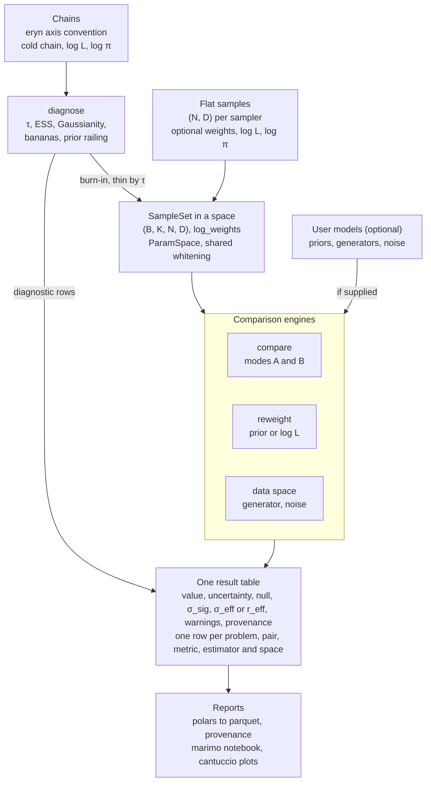

# mixed signals: Architecture Design

> Exported from the claude.ai design doc on 2026-10-13, after design round 8, and closed out the same day in roadmap session 0. This file is the working copy: update it when a decision changes.

mixed signals checks the quality of single posteriors and compares posteriors from different analyses of the same data, reporting every number against a finite-sample null. This document records design rounds 1–8, the design close-out and the decisions taken in the implementation sessions. Every item is **Decided** or **Deferred**, except one item the developers left **Open** (see Open questions). Every method and every assumption cites its source; the sources are collected under References.

## At a glance



Diagnostics read raw chains and supply τ for thinning; every engine then writes rows of the same shape to one table.

## Purpose and scope

v1 covers fixed-dimensional posteriors in two comparison modes. The primary field is gravitational-wave data analysis, but the core stays domain-agnostic.

- **Mode A, approximation vs trusted reference** (e.g. SBI against MCMC). Asymmetric: the reference fixes the whitening.
- **Mode B, peers without truth** (e.g. two pipelines on the same LISA or LVK data). Symmetric.

In v1:

- Single-posterior quality: MCMC health, shape, dependence, prior railing.
- Posterior-to-posterior comparison in modes A and B.
- Prior and likelihood reweighting, when priors and likelihoods are supplied.
- Data-space comparison, when a signal generator and noise model are supplied.

## Decisions so far

The developers have agreed 172 decisions: 88 from rounds 1–8, the repository setup and the design close-out, 7 from roadmap session 1 (Foundations), 7 from roadmap session 2 (Sample containers) and 14 from roadmap session 3 (Validation zoo), all on 2026-10-13, and 14 from roadmap session 4 (Transforms and whitening), 12 from roadmap session 5 (MCMC tools) and 16 from roadmap session 6 (Estimators), all three on 2026-10-14, and 14 from roadmap session 7 (eryn adapters and priors), taken on 2026-10-14 and 2026-10-24.

| Topic | Decision |
| --- | --- |
| Comparison modes | A (approximation vs reference) and B (peers); ensemble calibration later |
| Dimensionality | Fixed-dimensional only; trans-dimensional is future work |
| Inputs | General arrays: one posterior (N, D), K posteriors of the same data, or batches of either; eryn-style inputs are not assumed |
| Batch axis | Independent problems; identical parameter sets across all inputs |
| Multi-source runs | eryn leaves are not batch entries, because of label switching |
| Sample counts | Equal N first; unequal N anticipated in the design |
| Number of posteriors | Kept small; warnings on combinatorial cost |
| Replicate runs | Not supported; possibly never |
| Chain layout | eryn's axis convention; v1 reads the cold chain of a single branch from a run with one independent sampler |
| Flat samples | A separate flat container, not squeezed into the chain layout |
| Chain reduction | Built-in burn-in and τ-thinning tools, optional in pipelines and configs; direct metric calls assume cleaned samples |
| Per-sample data | Raw or cleaned chains with log L and log π; nested-sampling weights optional |
| Autocorrelation | Own τ estimator; eryn and emcee serve as reference examples |
| Backend | JAX is a hard dependency; converters to and from NumPy, CuPy and PyTorch |
| Precision | float64 by default, enabled at import |
| Randomness | Every stochastic function takes an explicit JAX PRNG key; pipelines derive all keys from one config seed |
| Generators | Batched, backend-agnostic interfaces wrapping user code; full contract benched |
| Gradients | JAX generators use `jax.grad` of `get_ll`; CuPy or PyTorch generators supply `get_ll_grad` |
| Fisher matrix | `information_matrix` returns (N, D, D) |
| Noise | Set at generator initialization, or passed as a kwarg |
| `get_swap_ll` | Dropped |
| Priors | Separate objects, using eryn's JAX-compatible prior setup from its feat-jaxpriors branch |
| eryn release | eryn's JAX-compatible prior setup is headed for release; until then, development pins the uv git source lisa-analysis-tools/Eryn at feat-jaxpriors, which is not pushed yet (see Open questions) |
| ParamSpace | Set explicitly; a class method builds it from eryn priors |
| Parametrization | With eryn priors, comparing in physical parameters via eryn's transforms is optional |
| Fixed and discrete parameters | With eryn priors, `DeltaFunction` parameters are dropped and discrete priors stay out of v1; otherwise nothing is dropped |
| Periodic parameters | A non-Euclidean space inside optimal transport |
| Sky position | A coupled sphere topology with great-circle OT costs |
| Periodic whitening | For now, whiten the Euclidean block only and scale periodic axes by their circular standard deviation √(−2 ln R̄); optional |
| Nulls | Every comparison ships with a finite-sample null |
| Null construction | Configurable; each method has a standard default |
| Null defaults | 200 resamples, both sets subsampled to the smaller N_eff; more resamples for significance claims |
| O(N²) metrics | Subsample above a cap with a warning; a kwarg sets the cap |
| σ reporting | Report σ_eff, or r_eff for shape-only rows, and σ_sig; pass/fail on σ_eff or r_eff, with σ_sig checking it is resolved |
| Whitening | An explicit choice, recorded with every result |
| Validation zoo | Shifted, scaled and rotated Gaussians, bananas, multimodal mixtures, railed, periodic and sphere cases; used for tests, calibration tables and the validation page |
| Optimal transport | Method choices owned by the developers; ott-jax is the backend; Sinkhorn divergence with topology-aware costs, and sliced W2 on the Euclidean block |
| Data structures | Own design on pydantic, polars and JAX pytrees |
| Visualization | cantuccio for corner plots; marimo for interactive notebooks |
| Users | Notebooks, importable metrics, and config + CLI pipelines that write reports |
| Config format | YAML |
| CLI | argparse |
| Packaging | One package with extras; Python ≥ 3.12; Apache 2.0 license |
| Dependencies | Lean core: jax, ott-jax, equinox, jaxtyping, numpy, polars, pydantic, pyyaml and scipy, which JAX requires anyway; eryn is an extra, and the dev group installs every extra except the CUDA ones |
| Tooling | uv ≥ 0.13 manages the project; ruff, strict mypy, a style-rule script, pre-commit hooks and CPU-only GitHub Actions CI check every change; CI pins its actions by commit SHA |
| Package layout | The tree under Package layout, with `io/eryn_backend.py` and `priors/eryn_container.py` |
| MCMC tools | `mcmc/` (τ, ESS, reduction) stays separate from `diagnostics/` (posterior shape) |
| Kernels and engines | Kernels live in topic subpackages; SampleSet-level wrappers live in `engines/` |
| OT location | `metrics/ot/`, so users find every metric in one place |
| Pytrees | equinox modules; equinox already arrives through ott-jax and lineax |
| Shape annotations | jaxtyping on every kernel, with beartype runtime checks in tests |
| Shape names | jaxtyping dimensions are words: batch, posterior, sample and param for (B, K, N, D); chains add step, temp, walker and leaf |
| Docs | Sphinx with the furo theme and MyST pages; Google-style docstrings, rendered by napoleon; citations from `docs/references.bib` through sphinxcontrib-bibtex |
| GPU tests | A marked suite, run by hand |
| Engine API | Plain functions that return results |
| Distribution name | `mixed-signals` on PyPI, free but not reserved on 2026-10-13; the GitHub repository takes the same name |
| Thresholds | Per-metric σ_eff and r_eff defaults ship with the package, overridable in the YAML |
| GPUs | A single GPU in v1; sharding the batch axis comes later |
| Report contents | σ_eff, r_eff and σ_sig summary table, corner overlays, null histograms and diagnostics; additions maybe later |
| Method menus | The v1 methods in the Engines table; C2ST and the normalizing-flow estimator are placeholders until implemented |
| References | Every method cites a paper, official document or reference package, and every assumption a paper or a validation-page finding; checked in review |
| Validation page | A docs page generated from zoo runs: calibration tables, null checks, recovered shifts and width ratios, stamped with package version and seed |
| Recipes | Every row records its (functional, estimator, space) triple and the estimator settings |
| Topologies | Real line, interval (one bound may be infinite), circle with its period, and sphere |
| Sphere coordinates | An azimuth axis plus a polar axis given as latitude, colatitude, sin(latitude) or cos(colatitude); the user declares which pairs form a sphere |
| Transforms | Forward, inverse, log\|J\| and full Jacobian, which defaults to `jax.jacfwd` |
| Domain-agnostic core | GW conventions, readers, waveform helpers and the PSD-weighted inner product live in `gw/` |
| Core objects | `ParamSpace`, `Chains`, `SampleSet`, `Transform`, `Estimator` and `Result`, with the fields under Data model |
| Effective sample size | An optional `n_eff` per batch and posterior, set by `reduce_chains` or the user; Kish ESS of the weights by default |
| Structure layering | equinox for anything crossing jit, pydantic for configs, `ParamSpace` and provenance, polars for results; metadata outside pytrees |
| Comparison topologies | Against a reference (mode A default) and all pairs (mode B default) |
| KL direction | Both directions, as separate rows, in modes A and B |
| Comparison nulls | Permutation of τ-thinned pooled samples in both modes; split-half of the reference stays configurable |
| Diagnostic nulls | Gaussian surrogates with the posterior's mean and covariance at its N_eff |
| Uncertainty | The null standard deviation, marked approximate; a subsampling bootstrap on request |
| Result additions | Null draws, null recipe, r_eff, JAX version, device platform and config hash; then estimator settings, the uncertainty method and the PRNG key in provenance |
| σ_eff maps | Closed forms where they exist, tabulated curves for AD and JS, all checked on the zoo |
| Width effect size | r_eff, the Gaussian-equivalent width ratio, for shape-only rows; thresholds on \|ln r_eff\| |
| JS units | Nats |
| MMD bandwidth | Median heuristic on the pooled whitened samples, fixed once per comparison |
| Validity domains | A soft limit adds a warning; a hard limit gives NaN and a warning; nothing raises |
| Zoo access | `mixed_signals.zoo` is public API |
| eryn topology mapping | A periodic prior or an entry of the sampler's `periodic` dict gives a circle; every other parameter an interval from its bounds; `reflective` maps like no flag |
| R̂ | Rank-normalised split-R̂ across walkers as an informational row, always flagged because the walkers are coupled |
| Chain rates | Acceptance and swap rates for chains read from an eryn backend |
| PSIS threshold | Flag k̂ above min(1 − 1/log₁₀ S, 0.7) |
| Prior railing | Posterior density at a finite bound over its peak density, with a zoo-calibrated threshold |
| Interfaces | Kernels, SampleSet functions, and the YAML + CLI pipeline |
| Key derivation | `prng.derive_key` folds the first 64 bits of the SHA-256 digest of each element of a named path into the parent key, so a key does not depend on which other calls run or in which order; root keys use Threefry-2x32 whatever the process default |
| Warnings | Ordinary Python warnings in a `MixedSignalsWarning` hierarchy, raised outside jit; engines capture them per row as category and message entries. Errors derive from `MixedSignalsError`; invalid pydantic models raise pydantic's `ValidationError` |
| Package defaults | Module constants in `_config.py`, such as 200 null draws and the PRNG implementation; no process-wide settings change them at run time |
| ParamSpace YAML | Flat parameter entries (name, label, unit, topology, bounds) and a `spheres` list; angles in radians; a sphere azimuth is a circle of period 2π, and the polar bounds lie inside the range of the polar form |
| Hashes | SHA-256 throughout; one input hash per posterior, in `pair` order, over dtype, shape and C-ordered bytes |
| Result object | A thin `Result` around one polars DataFrame that checks the schema and the required columns and reads and writes parquet; `Provenance` is a pydantic model |
| Citation style | Author-year citations in round brackets; BibTeX keys of first author, year and first significant title word in lowercase ASCII, skipping a leading article, preposition or verb such as "A", "On" or "Is"; each session adds only verified entries |
| Sample metadata | `SampleSet` holds arrays only; engines take the posterior names and the `ParamSpace` |
| SampleSet operations | Select problems, posteriors or parameters; take samples, which drops `n_eff`; convert to NumPy, JAX, torch or CuPy. No stacking of sets in v1: engines pair separate sets, and τ-thinned runs differ in N. A later operation that joins sets raises when their optional fields differ |
| Narrow floats | Inputs narrower than float64 are cast with a `PrecisionWarning` |
| `n_eff` range | A given `n_eff` lies between 1 and the number of samples with positive weight, the range of the Kish value |
| Chain counts | Acceptance and swap counts carry the number of proposals behind each, so rates hold for cut or thinned chains |
| Chain log densities | `log_like` and `log_prior` are optional; `betas` default to ones for a single temperature |
| Array extras | A `torch` extra, with CPU-only torch from the PyTorch index in the dev group; `cuda12` and `cuda13` extras with the JAX CUDA plugin and the matching CuPy wheel, which exclude each other and stay out of the dev group |
| Zoo cases | A `ZooCase` holds K named posteriors, their `ParamSpace`, their densities and a reference table; `sample(key, N, batch_size=B)` gives a `SampleSet` (B, K, N, D), each posterior drawing from `derive_key(key, name)` and each problem folding in its index |
| Zoo reference tables | A polars table per case with the result columns pair, metric and parameters, plus value and basis (closed form or quadrature), so that results join their truth |
| Zoo reference values | Closed forms where they exist, plus one-dimensional quadrature for the marginal JS and AD of Gaussian pairs and for mixture KL |
| Zoo numerics | All numerics of the zoo in JAX, so they jit, vmap and differentiate: closed forms, quadrature, and the set-up of distributions and builders; NumPy only reads user input and holds the fixed Gauss-Legendre table |
| Zoo quadrature | Composite 8-point Gauss-Legendre rules on panels refined around every normal component (μ ± 12σ in σ/2 steps) and every crossing of two weighted components; fixed shapes, no new dependency, checked against QUADPACK with break points in the tests |
| Zoo input checks | Closed forms check concrete inputs and raise ValueError, as `SampleSet` does; inside jit, invalid inputs give NaN |
| SciPy | A core dependency, already installed with JAX, kept for later sessions; the zoo does not import it, the tests use it as an independent check, and the lint group adds `scipy-stubs` |
| Zoo periodic cases | Wrapped normals: exact draws, a circular standard deviation equal to σ, and circles correlated with real axes by wrapping one coordinate |
| Zoo sphere cases | von Mises-Fisher distributions centred near a pole and rotated over it, in any polar form, with closed-form KL and Hellinger |
| Zoo rotated Gaussians | Rotated by ±α/2 in one plane, so the marginals stay identical and only the sign of the correlation differs |
| Zoo mixtures | A two-component mixture against its moment-matched Gaussian, one component alone (a dropped mode) and the same components reweighted |
| Zoo railed cases | Unit normals truncated at one bound, one per offset, with the railing score, truncated moments and closed-form KL |
| Zoo AR(1) chains | AR(1) chains as `Chains` with τ = (1 + φ)/(1 − φ), built in session 3 for sessions 5, 11 and 12 |
| Zoo base Gaussians | The shift and scale builders take an optional mean and covariance, and the rotation builder a mean and per-parameter scales; shifts stay in Mahalanobis units |
| Pooled whitening | The mean of the within-posterior covariances, each posterior weighted equally, the pooled within-group covariance of the Mahalanobis distance; circles take the root mean square of their circular standard deviations. The covariance of the pooled samples would shrink a shift d to d/√(1 + d²/4) |
| Pooling scope | Pooled whitening pools the two posteriors of each pair, so a row does not depend on the other posteriors of a run |
| Whitening rotation | ZCA-cor, W = P^(−1/2) V^(−1/2): whitened axes keep their parameter names, and the units of the parameters do not matter |
| Z-score mode | `decorrelate=False` scales the Euclidean block without decorrelating it, so interval bounds map exactly |
| Fisher whitening | Γ⁻¹ is the covariance: the Euclidean block takes its marginal block of Γ⁻¹ and each circle the square root of its diagonal entry; Γ must be finite, symmetric and positive definite; rank truncation is deferred |
| Conditioning | Checks act on matrices scaled to unit diagonal: singular below D·ε times the largest eigenvalue, and a `ValidityWarning` above the condition number 1/√ε ≈ 6.7e7 |
| Singular widths | A singular covariance from samples gives a NaN whitening and a `ValidityWarning` that names the axes, so the other problems of a batch go on; an invalid Fisher matrix raises ValueError; inside jit, NaN |
| Whitened bounds | Decorrelated Euclidean axes become real lines without units; methods that need bounds run in the original space; circles stay circles, of period P/s |
| Spheres in whitening | Sphere pairs pass unchanged; how a sphere cost weighs against the whitened block belongs to the OT session |
| Axis blocks | `ParamSpace.axis_blocks` gives the positions of the Euclidean block (real and interval axes outside spheres), the circles and the sphere pairs, the port of catpylisa's geometry schema |
| Transform API | One problem per object, with methods on points of any leading shape: `forward`, `inverse`, `log_abs_det_jacobian`, `jacobian`, `map_fisher`, `map_space`, `map_sample_set` and `description`; B problems get B transforms through `jax.vmap` |
| Composition | `Compose` applies its transforms from left to right, and the space column joins their descriptions with " \| " |
| Weighted widths | The unbiased reliability-weight covariance of `numpy.cov` with `aweights`, computed on samples shifted by the sample of largest weight; the package convention for widths |
| Densities under transforms | `map_sample_set` subtracts ln\|det ∂f/∂x\| from `log_prior` and `log_q` and keeps `log_like`, `log_weights` and `n_eff` |
| τ estimator | emcee's walker-averaged autocorrelation function, truncated by Geyer's initial monotone sequence of lag pairs with the antithetic correction of Vehtari et al. (2021); it replaces Sokal's window, which gives τ ≈ 0 or below for anticorrelated chains |
| τ floor and ESS | τ is floored at 1/log₁₀ S for S draws; diagnostic rows report the raw S/τ, above S for antithetic chains |
| Reduced `n_eff` | N/τ_k of the slowest parameter for N kept samples, with τ_k from every k-th lag of the full autocorrelation function, clipped to [1, N] |
| Burn-in | An explicit number of steps, recorded; nothing is detected automatically, and the split-chain KS test flags a remaining transient |
| Thinning factor | For `thin="tau"`, the largest max(1, ⌈τ − 2ε⌉) over the parameters, with ε the a priori error of τ, so noise in τ does not thin uncorrelated chains; the split-chain test uses the same factor per parameter |
| R̂ form | The larger of the rank-normalised split-R̂ of the draws and of the folded draws |
| KS kernel | One weighted two-sample KS statistic in `metrics/marginal.py`, built in session 5 for the split-chain test and reused by session 8 |
| Split-chain KS output | The statistic and its asymptotic Kolmogorov p-value, with the halves thinned per parameter and pooled over the walkers |
| Reduction record | A frozen pydantic `ReductionRecord`: chain shape, cold index, burn-in, thinning factor, τ and τ_k, `n_eff` and the SHA-256 of the chains; `reduce_chains` with the recorded burn-in and factor repeats it exactly |
| emcee in tests | emcee joins the test group as the reference for the autocorrelation function and τ, next to eryn's estimator |
| MCMC validity checks | Fewer than 50τ steps and lag pairs positive to the end warn; walkers that never move leave the average, and τ is NaN when none moves; R̂ warns below 50 effective samples per split chain |
| MCMC interfaces | The τ, ESS, split-chain KS and R̂ kernels take arrays shaped (step, walker, param); `reduce_chains` takes `Chains` |
| Estimator form | Equinox modules that a `fit` classmethod builds per problem and posterior, vmapped over (B, K); frozen pydantic settings give the `estimator_settings` JSON, and `resolved_settings` the values that a rule chose |
| Estimator names | `gaussian`, `kde`, `knn`, `gmm`, `flow` and `classifier`, as `GaussianDensity`, `KernelDensity`, `NearestNeighbours`, `MixtureDensity`, `FlowDensity` and `ClassifierRatio` in `estimators/` modules of those names, with the `Estimator` base in `base.py` |
| KDE core | `jax.scipy.stats.gaussian_kde`, the JAX port of SciPy's estimator, evaluated in chunks at the winding and mirror images of each point |
| KDE bandwidth | Silverman's factor on the Kish n_eff; a float replaces it, and plots pass the resolved factor to cantuccio |
| KDE bounds | The non-negative Jones-Foster correction in one dimension, renormalised by quadrature; reflection at every finite bound in two or more |
| KDE dimension limit | A warning below Silverman's sample size for a relative mean squared error of 0.1 at a Gaussian's mode, recomputed exactly up to 20 dimensions, and always above |
| Circles in estimators | The Gaussian and the GMM unwrap each circle about its circular mean and sum over windings; the KDE unwraps for its bandwidth and wraps its kernels; sphere axes follow their own topologies |
| Unresolved circles | The Gaussian and the GMM warn when the Rayleigh statistic 2N_effR̄² lies below 5.99, the 95% point of χ²₂ |
| Gaussian estimator | The weighted mean and the unbiased weighted covariance, unbounded on intervals, with `sample` for the Gaussian surrogates |
| kNN scope | Topology-aware brute-force distances (Euclidean block, shorter arc, great circle), the k-th neighbour with self-exclusion, and the digamma-corrected log density; the divergence formulas stay in session 9 and KSG's max norm comes with session 11 |
| kNN weights | Zero weights leave every search; unequal positive weights give NaN with a warning, so engines resample first |
| GMM start | Weighted k-means++ seeds, nearest-centre assignment and one M-step, as in scikit-learn; the best of 18 starts by default, from a zoo check |
| GMM stopping | The rule of scikit-learn on z-scored axes: 1e-3 on the mean log-likelihood per sample, at most 100 iterations and 1e-6 on every diagonal; a winning start at the cap warns |
| BIC | Formed in session 11 from the GMM's mean log-likelihood and parameter count |
| Placeholders | `FlowDensity.fit(samples, log_weights, space, settings, *, key)` and `ClassifierRatio.fit(first, first_log_weights, second, second_log_weights, space, settings, *, key)` raise `NotImplementedError` |
| Coordinate helpers | `wrap`, `sphere_coordinates` and `unit_vectors` move from the zoo to `core/topology.py`; `circular_mean`, `mean_resultant_length` and `unwrap_about` join `core/samples.py` |
| eryn transforms | `ErynPhysical` wraps eryn's own JAX backend, on the copy that `to_backend("jax")` returns, so its maps and Jacobians run under jit, vmap and grad: `forward` is eryn's `inverse_transform`, `inverse` its `forward_transform`, and ln\|det ∂x/∂u\| is minus eryn's `log_jacobian` at x; its description is `physical(eryn)` |
| eryn reader | `Chains.from_eryn(source, *, branch, num_repeats_in_model, priors)` reads one branch with all its temperatures from an `EnsembleSampler`, a backend or the path of an HDF5 file; the code lives in `io/eryn_backend.py` |
| eryn acceptance counts | `num_repeats_in_model` is optional: a sampler supplies it, and without it a backend or file gives no acceptance counts, so a rate is never wrong; the proposals are the stored steps times `num_repeats_in_model`, whatever `thin_by` is |
| eryn swap counts | Read whenever a run has several temperatures, with the stored steps times the walkers as proposals per neighbouring pair; one temperature has none |
| Fixed eryn parameters | With the priors, from a sampler or `priors=`, the reader drops the `DeltaFunction` columns after checking the stored key order; `ErynPhysical` and `ErynPrior` cover the same parameters and put the fixed values back only for eryn's calls |
| eryn names | Container keys, or `x0`, `x1`, ... for integer keys |
| eryn labels and units | eryn's label and unit describe the sampled coordinate; a prior without a name takes its parameter name as label; in the physical space a transformed axis takes eryn's `name_phys` as name and label, without a unit |
| eryn entries | Every entry is read: entries without bounds per parameter give real lines, `JointPrior.boundaries` is read per axis, and nested containers recursively; discrete priors are eryn's three discrete classes and anything with `logpmf`, because `PoissonDistribution` has no `logpmf` |
| eryn periodicity | `from_eryn_priors(periodic=)` takes one branch's entry of the sampler's `periodic` dict, because nothing in eryn reads `Prior.boundary`; a circle spans the prior's bounds, whose width must equal the period, or [0, P) without finite bounds, the range into which eryn wraps; a periodic prior with neither raises |
| eryn spheres | `from_eryn_priors(spheres=)` takes `Sphere` objects named by parameter names; a `SineUniform` polar axis needs `sin_latitude` and a `CosineUniform` one `cos_colatitude` |
| Physical spaces | `ErynPhysical.map_space` sorts the inverse transforms of the sampling bounds; a transformed circle raises; a sphere's polar axis turns `sin_latitude` into `latitude` and `cos_colatitude` into `colatitude`, and any other transform of a sphere axis raises |
| Prior protocol | `PriorDistribution` in `priors/protocol.py`: `logpdf` maps (N, D) to (N,), and `rvs(size, *, key)` draws size + (D,) from an explicit JAX key |
| eryn prior adapter | `ErynPrior` makes a container meet the protocol in the sampling coordinates, passing the key on to eryn's `rng_key` on its JAX copy; densities of the physical parameters wait for reweighting |
| eryn entry points | Classmethods on the core objects, `Chains.from_eryn` and `ParamSpace.from_eryn_priors`, which import the eryn modules lazily |

## Design principles

Nine principles shape every module; all are decided.

| Principle | What it means | Status |
| --- | --- | --- |
| Every number has a recipe | Computed by a (functional, estimator, space) triple, e.g. KL × kNN × pooled-whitened; all three are recorded, together with estimator settings such as a bandwidth or ε. Sample-based metrics such as W1 record the estimator as `empirical` | Decided |
| Nulls are a core service | Each comparison ships with the metric's distribution when both inputs share one distribution at the same N_eff; MCMC samples are τ-thinned first | Decided |
| Two σ's | σ_eff is the size of a difference in posterior widths; σ_sig is how surely it is non-zero; thresholds use σ_eff, or r_eff for differences in width alone | Decided |
| Whitening is a choice of space | Both inputs always share one whitening matrix, recorded with the result | Decided |
| Topology is first-class | Each parameter is real, interval, periodic or part of a sphere; estimators, transforms and OT costs respect it | Decided |
| Transforms track Jacobians | Bijectors carry log\|J\| for density metrics and reweighting, and full Jacobians to map Fisher matrices: Γ′ = JᵀΓJ. The full Jacobian defaults to `jax.jacfwd` unless a transform supplies its own | Decided |
| Capability-based dispatch | Supplied priors and implemented generator methods decide which methods can run | Decided |
| Domain-agnostic core | GW conventions, readers, waveform helpers and the PSD-weighted inner product live in a gw subpackage | Decided |
| Every method is cited | Each diagnostic, metric, estimator and null cites the paper, official document or reference package that defines it; each assumption cites a paper or a finding on the validation page | Decided |

## Data model

Comparisons run on flat samples shaped (B, K, N, D); diagnostics also read chains, which follow eryn's axis convention. Inputs are general arrays; eryn objects are one adapter, not an assumption. B counts independent problems, K samplers, N samples and D parameters. In code, jaxtyping annotations spell these axes as `batch`, `posterior`, `sample` and `param`.

**Input shapes**

- One posterior: (N, D).
- K posteriors of the same data: stacked to (K, N, D).
- Batches: (B, K, N, D), with `log_weights` shaped (B, K, N).
- Unequal N (later): pad to a common N with zero-weight samples. Kernels honor weights from day one, so the API does not change.

**Chains (eryn layout)**

- Per branch: chain (nsteps, ntemps, nwalkers, nleaves, ndim); log_like and log_prior (nsteps, ntemps, nwalkers); betas (nsteps, ntemps). Chains read from an eryn backend also carry the acceptance counts (ntemps, nwalkers) and the accepted swaps between neighbouring temperatures (ntemps − 1), each with the number of proposals behind it: eryn counts over the whole run, so the stored steps of a cut or thinned chain are not the denominator of a rate. `log_like` and `log_prior` are optional, for samplers that store only the log posterior; a run with one temperature may also come as (nsteps, nwalkers, ndim), as from emcee.
- v1 reads the cold chain (β = 1) of a single branch from a run with one independent sampler. Runs with several leaves wait for the catalog work, because leaves are not batch entries. Diagnostics read chains directly. Comparisons use flat samples from an explicit, recorded reduction: cold chain, burn-in, thinning by τ. The package ships these tools; pipelines take reduction as an optional argument, and direct metric calls assume cleaned samples.
- τ comes from our own estimator: the walker-averaged autocorrelation function of emcee (Foreman-Mackey 2017), summed over all lags as Goodman and Weare (2010) define τ, and truncated by Geyer's initial monotone sequence (Geyer 1992) with the antithetic correction of Vehtari et al. (2021). eryn's and emcee's estimators serve as reference examples in the tests. Sokal's automatic window (Sokal 1997), which emcee uses, gives τ ≈ 0 or below for anticorrelated chains.
- R̂ assumes independent chains (Gelman and Rubin 1992), but eryn's ensemble moves couple the walkers, and the emcee documentation advises against Gelman-Rubin across the walkers of one ensemble. `diagnose` therefore reports rank-normalised split-R̂ across walkers (Vehtari et al. 2021), the larger of the values for the draws and the folded draws, only as an informational row, always with a warning that the walkers are coupled; it never decides pass/fail.

**Core objects (Decided)**

| Object | Holds |
| --- | --- |
| `ParamSpace` | Names, labels, units, topology and bounds, shared by every input to a comparison, including the sphere pairs the user declares |
| `Chains` | eryn-layout arrays with betas and optional log densities; acceptance and swap counts with their proposals when read from an eryn backend |
| `SampleSet` | Flat samples, `log_weights`, an optional `n_eff` per batch and posterior, and optional per-sample `log_like`, `log_prior` and `log_q`; arrays only, so names and the space go to the engines; generic, so priors and approximations reuse it |
| `Transform` | Composable bijector: forward, inverse, log\|J\| and Jacobian |
| `Estimator` | Gaussian, bounded KDE, kNN and GMM; classifier and normalizing-flow placeholders |
| `Result` | One row per problem, pair, metric, estimator, space and parameter subset, with the columns under Statistical reporting |

**Effective sample size (Decided).** `n_eff` sizes every null and every subsample. `reduce_chains` sets it from τ_k of the thinned chain, and users may set it for correlated samples; otherwise it is the Kish effective sample size of `log_weights` (Kish 1965), which assumes independent samples. A given `n_eff` lies between 1 and the number of samples with positive weight, the range of the Kish value, because nulls cannot subsample more samples than exist.

**Sample containers (session 2).** Every input layout becomes (B, K, N, D) with float64 fields. `log_weights` stay unnormalised; methods normalise them per posterior where needed. Inputs narrower than float64 are cast with a `PrecisionWarning`, because neighbouring float32 values differ by up to 1.2 × 10⁻⁷ of their magnitude (IEEE 2019). The constructors check shapes and types always, and values (finite samples, log weights without NaN or +∞, a positive weight per posterior, the `n_eff` range, whole and consistent counts) when the inputs are concrete; inside `jax.jit` the values are unknown. NumPy inputs are copied into JAX; torch and CuPy arrays share memory through DLPack (Consortium for Python Data API Standards 2021), so they must not change in place afterwards.

**Transforms and whitening (session 4).** A `Transform` maps the parameter vectors of one problem, at points of any leading shape; `jax.vmap` gives one transform per problem. Its log-determinant moves `log_prior` and `log_q` with the samples (Papamakarios et al. 2021), and the Jacobian of its inverse maps Fisher matrices as Γ′ = JᵀΓJ, because the information form is invariant under a change of parameters (Jeffreys 1946). `Whitening` groups the parameters with `ParamSpace.axis_blocks`: it centres and whitens the Euclidean block with ZCA-cor (Kessy, Lewin and Strimmer 2018), divides each circle by its circular standard deviation (Mardia and Jupp 2000) and leaves sphere pairs alone. Reference whitening takes the covariance of one posterior, pooled whitening the mean of the two covariances of a pair (Mahalanobis 1936; Johnson and Wichern 2007), and Fisher whitening the marginal blocks of Γ⁻¹, the posterior covariance at high signal-to-noise ratio (Vallisneri 2008). The covariance of the pooled samples would shrink a Mahalanobis shift d to d/√(1 + d²/4). Covariances are the unbiased weighted estimates of `numpy.cov` with `aweights` (Harris et al. 2020), computed on samples shifted by the sample of largest weight, so a constant parameter gives exact zeros and a 3 mHz offset cancels before any sum (Chan, Golub and LeVeque 1983). Checks act on matrices scaled to unit diagonal, whose condition number lies within a factor D of the best diagonal scaling (van der Sluis 1969). A singular sample covariance gives a NaN whitening with a `ValidityWarning`, an invalid Fisher matrix raises, and a condition number above 1/√ε warns, because inversion loses up to log₁₀ κ digits (Vallisneri 2008).

**MCMC tools (session 5).** The kernels take chains shaped (step, walker, param) after burn-in. τ = Σₜ ρ(t), summed over all lags (Goodman and Weare 2010), comes from emcee's average of each walker's autocorrelation function (Foreman-Mackey 2017), truncated by Geyer's initial monotone sequence of lag pairs (Geyer 1992), plus the next even lag when it is positive (Vehtari et al. 2021), and floored at 1/log₁₀ S, so a chain holds at most S log₁₀ S effective samples. Sokal's window (Sokal 1997) gave −0.003 for an AR(1) chain with φ = −0.5, whose τ is 1/3, and −0.80 for φ = −0.9, whose τ is 0.053; Geyer's pairs recover the first and stop at the floor for the second, and on AR(1) chains with φ of 0.9 and 0.95 the estimate has about 60% of the scatter of emcee's. Each walker is centred on its own mean, so its autocorrelations sum to ½ over all lags; lag pairs that stay positive to the end of the chain therefore put τ at its floor, and warn as a sign of too short chains. The ESS is S·W/τ. Thinning keeps every k-th step with k = max(1, ⌈τ − 2ε⌉) and ε = τ√(2(2M + 1)/(SW)), the a priori error of a sum to lag M (Madras and Sokal 1988; Wolff 2004): with ⌈τ⌉ alone, noise put τ above 1 in 60% of runs of uncorrelated chains and halved their samples. A reduction keeps the cold chain, drops an explicit burn-in, thins by the largest factor over the parameters and sets `n_eff` = N/τ_k, clipped to [1, N], with τ_k from every k-th lag of the full autocorrelation function, which matched (1 + φᵏ)/(1 − φᵏ) of AR(1) chains within 1%. The split-chain test compares the thinned halves pooled over the walkers with the weighted KS statistic of `metrics/marginal.py` and the limiting Kolmogorov distribution (Smirnov 1948); its p-values were uniform for stationary chains. R̂ uses average ranks for ties and Blom's normal scores (Blom 1958), and is NaN for a parameter that never moves.

**Estimators (session 6).** Every estimator is an equinox module that a `fit` classmethod builds from the samples of one posterior of one problem, with `jax.vmap` over problems and posteriors. Its settings are a frozen pydantic model, whose JSON fills the `estimator_settings` column, and `resolved_settings` turns a rule into its value, so plots and later fits reuse it. Densities refer to the coordinates of the space. The Gaussian estimator has the weighted mean and the unbiased weighted covariance (Harris et al. 2020), ignores interval bounds and draws the Gaussian surrogates (Efron and Tibshirani 1993). The bounded KDE wraps JAX's port of SciPy's `gaussian_kde` (Virtanen et al. 2020; JAX authors 2022), with Silverman's factor (n(D + 2)/4)^(−1/(D+4)) on the Kish n_eff (Silverman 1986), which cantuccio's contours take as their `bandwidth`. It sums the kernels over windings on circles, and over mirror images at finite bounds in two or more dimensions (Schuster 1985). In one dimension an interval takes the non-negative correction of Jones and Foster (1996) on the linear correction of Jones (1993), as evmix applies it (Hu and Scarrott 2018), renormalised by Gauss-Legendre quadrature: on the zoo's railed normals, reflection put the railing score 11% and 31% high at N = 10⁴ for peaks 1σ and 2σ inside the bound, and 48% high at N = 10³ for 2σ, where the correction left 2%, 4% and −2%, at about 1.5 times the scatter. A KDE warns below the sample size at which the relative mean squared error at a Gaussian's mode reaches 0.1 (Silverman 1986, Table 4.2), recomputed exactly and extended to 20 dimensions. The kNN estimator measures Euclidean distances on the Euclidean block, the shorter arc on circles and great-circle angles on spheres, in d = E + C + 2S dimensions. It gives the k-th neighbour distance, with each sample left out of its own search, and the log density ψ(k) − ψ(n + 1) − ln V_d − d ln r_k (Loftsgaarden and Quesenberry 1965; Kozachenko and Leonenko 1987; Kraskov, Stögbauer and Grassberger 2004), plus the log area element on spheres. Zero weights leave the searches; unequal positive weights, too few samples and zero k-th distances give NaN with a warning, because the estimators assume equally weighted independent draws (Wang, Kulkarni and Verdú 2009), and engines resample weighted sets first (Smith and Gelfand 1992). The GMM runs weighted EM (Dempster, Laird and Rubin 1977; McLachlan and Peel 2000) on z-scored axes from weighted k-means++ seeds (Arthur and Vassilvitskii 2007), with the stopping rule and the regularisation of scikit-learn (Pedregosa et al. 2011). That rule ended 37 to 68% of single starts on the plateau near the one-Gaussian solution in the hardest zoo mixtures checked, so 18 starts keep the chance that all of them miss below 10⁻³. The winning mean log-likelihood still lay a median 2.6 to 2.8 nats below the optimum for 4 000 samples in those cases, and up to 19 nats; a tolerance of 0.01 nats on the total would have left at most 0.65. The Gaussian and the GMM unwrap each circle about its circular mean, sum their densities over windings, and warn when the Rayleigh statistic 2N_effR̄² lies below 5.99 (Mardia and Jupp 2000). Under `jax.jit`, the image counts follow the widest kernel that the samples admit, √2 times half a period or interval for unbiased widths of two or more effective samples, and a wider kernel gives NaN. The normalizing-flow and classifier estimators (Papamakarios et al. 2021; Sugiyama, Suzuki and Kanamori 2012) raise `NotImplementedError` until their training setups are chosen.

**eryn adapters (session 7).** eryn samples each parameter in a sampling coordinate u, which the transform of its prior maps to the physical parameter x, and stores chains, bounds and log priors in u (Karnesis et al. 2023). `Chains.from_eryn` reads one branch with all its temperatures from a sampler, a backend or an HDF5 file. eryn counts the accepted in-model proposals at stored steps only, `num_repeats_in_model` per step, so the proposals behind the counts are the stored steps times that number (Foreman-Mackey et al. 2013); a tempered run with `thin_by` = 2 and three repeats gave a stored rate of 0.683 against 0.692 over all its proposals. Each stored step proposes one swap per walker between neighbouring temperatures (Vousden, Farr and Mandel 2016). `ParamSpace.from_eryn_priors` describes u: container keys or `x0`, `x1`, ... as names, eryn's labels and units, circles from periodic priors or from the sampler's `periodic` dict, which is what eryn itself wraps, and intervals or real lines otherwise. Spaces and chains leave `DeltaFunction` parameters out, because a fixed axis makes every covariance singular. `ErynPhysical` maps u to x with eryn's own transforms on the JAX copy of the container, so a density moves with ln|det ∂x/∂u| (Papamakarios et al. 2021) and a Fisher matrix with exact Jacobians (Jeffreys 1946); through `jax.pure_callback`, eryn's NumPy transforms had taken 30 ms against 11 ms natively for 10⁶ × 5 points, and `jax.jacfwd` failed on them. `ErynPrior` makes a container meet `PriorDistribution`, the minimal prior interface, in u.

**Structure layering (Decided)**

- equinox modules for anything crossing jit: samples, weights, transforms, estimator state.
- pydantic for configs, `ParamSpace` and provenance; validated, and it drives the CLI.
- polars for results: one long tidy table, written to parquet.
- Metadata stays outside pytrees, because changing static fields triggers recompilation.

## Engines

Four engines share the data model and declare what they need. The menus below are the v1 methods; References lists the sources of each.

| Engine | Needs | v1 methods |
| --- | --- | --- |
| `diagnose` | Chains (flat samples: shape checks only) | Chain health: τ, ESS, split-chain KS, informational R̂ across walkers, and acceptance and swap rates for eryn backends. Shape: Mahalanobis distances vs χ²_D, skewness, kurtosis, Anderson–Darling. Dependence: Pearson, Spearman, distance correlation and mutual information vs their Gaussian values (bananas). GMM-BIC multimodality. Prior railing |
| `compare` | Two or more SampleSets in one space | Moments: per-parameter mean shift and width ratio; Gaussian KL, W2 and Hellinger, split into location and shape. Marginals: KS, k-sample Anderson–Darling, 1D W1, and JS and Hellinger with a bounded KDE. Joint: kNN KL, JS and Hellinger, MMD, energy distance. OT: Sinkhorn divergence, sliced W2. C2ST as a placeholder |
| `reweight` | Stored log π plus a new prior, stored log L plus a new likelihood, or an approximation's density q | Importance weights; evidence ratio Z_new/Z_old = E_old[L_new/L_old]; ESS and PSIS k̂ on every weight set, flagged above min(1 − 1/log₁₀ S, 0.7); weights stay raw, and Pareto smoothing is opt-in |
| Data space | A generator with `generate_template`, plus a noise model | Energy distance with the noise-weighted norm; Fisher-whitened parameter distances when a Fisher matrix is available |

**Method details**

- Mean shifts are in units of the reference σ in mode A and of the pooled σ in mode B, as in Glass's Δ and Cohen's d; the pooled σ is the root mean square of the two widths, the scale of the pooled z-score. Width ratios are σ/σ_ref per parameter.
- KL rows come in both directions, in both modes. In mode A, KL(reference ‖ approximation) grows when the approximation is overconfident, the main failure of amortised SBI posteriors (Hermans et al. 2022); KL(approximation ‖ reference) grows when it puts mass where the reference has none.
- JS values are in nats, the unit of the bilby validation study (Romero-Shaw et al. 2020). The joint kNN JS combines Kozachenko–Leonenko entropy estimates, JS = H(m) − ½H(p) − ½H(q), with the pooled samples standing for the mixture m.
- The Hellinger distance comes in three forms. The Gaussian form follows from the Bhattacharyya distance D_B between the moment-matched Gaussians, H² = 1 − exp(−D_B), whose location and shape terms add (Bhattacharyya 1943; Fukunaga 1990). The marginal form uses the bounded KDE. The joint form uses the kNN Rényi-α estimator at α = ½ (Póczos and Schneider 2011), since H² = 1 − exp(−D_½/2) for the Rényi divergence D_½ (Rényi 1961). Hellinger is symmetric, so it gives one row per pair in both modes.
- MMD uses a Gaussian kernel whose bandwidth is the median pairwise distance of the pooled whitened samples (Gretton et al. 2012). It is fixed once per comparison, so the observed value and the null draws share it, and it is recorded in the recipe.
- Sliced W2 runs on the Euclidean block only, because slicing ignores circles and spheres.
- C2ST and the normalizing-flow estimator are placeholders: their functions exist with final signatures and raise `NotImplementedError` until the classifier and its training setup are chosen.
- Split-chain KS compares the τ-thinned halves of a chain, pooled over the walkers, because the test assumes independent draws (Brooks, Giudici and Philippe 2003); its p-value comes from the limiting Kolmogorov distribution (Smirnov 1948) and is approximate for coupled walkers.
- Gaussianity and dependence statistics are compared with Gaussian surrogates; see Null construction.
- The prior-railing score is the marginal posterior density at a finite bound divided by its peak density, both from the one-dimensional bounded KDE, which corrects its bounds as Jones and Foster (1996) do. No paper defines a railing diagnostic. The LVK tool pe-configurator checks chirp-mass railing with a histogram; our flag threshold is calibrated on the zoo's railed cases and shown on the validation page.

**Comparison topologies (Decided)**

- Against a reference: mode A default, K − 1 comparisons.
- All pairs: mode B default, K(K − 1)/2 comparisons.

Leave-one-out against the pooled rest is deferred. With the small K expected, all pairs already shows the odd one out, and the pooled rest is wider than each member when the members disagree, which blurs its value.

A dry run counts metric evaluations × null resamples before anything runs, and warns above a budget. O(N²) metrics (MMD, energy distance, distance correlation, Sinkhorn, brute-force kNN) subsample above a cap with a warning, and a kwarg sets the cap.

**Data space**

```math
D_E = 2\,\mathbb{E}\lVert s_A - s_B\rVert - \mathbb{E}\lVert s_A - s_A'\rVert - \mathbb{E}\lVert s_B - s_B'\rVert, \qquad \lVert a\rVert^2 = \langle a \mid a \rangle
```

Distances are in noise-σ units, and ‖δh‖ ≲ 1 is indistinguishable in the data (Lindblom, Owen and Brown 2008). At linear order ‖δh‖² ≈ ΔθᵀΓΔθ, so Fisher whitening gives parameter distances the same meaning (Vallisneri 2008). The core takes any noise-weighted inner product; `gw/` supplies the PSD-weighted frequency-domain one (Finn 1992; Cutler and Flanagan 1994). With trans-dimensional support, comparing summed catalog signals this way avoids cross-matching.

## Statistical reporting

Every result row carries a value, its uncertainty, its null, σ_sig and an effect size: σ_eff, or r_eff for rows that measure only a difference in width. Thresholds act on the effect size, with per-metric defaults that the YAML config can override.

**Result columns:** problem, pair, metric, estimator, estimator settings (a JSON object), space (transform chain), parameters, value, uncertainty, uncertainty method, null mean, null std, null draws, null recipe (construction, number of draws, sample size per side), p-value, σ_sig, σ_eff, r_eff, warnings (category and message of each entry), provenance (package version, seed, PRNG key, input hashes, JAX version, device platform, config hash). A null entry means that a column does not apply to the row; NaN marks a value at a hard validity limit. The PRNG key is the key that the engine received, so a row from a direct call without a seed can still be rebuilt.

**Uncertainty (Decided).** The null standard deviation, marked approximate. It is accurate when the difference is small, which is where thresholds decide. A keyword switches on a subsampling bootstrap on half-samples drawn without replacement (Politis, Romano and Wolf 1999), so kNN metrics never see duplicate points.

**σ_eff, the Gaussian-equivalent shift (Decided).** σ_eff is the mean shift between two unit Gaussians that gives the same null-subtracted metric value, in units of the whitening σ. "Exact" marks a closed form for this case. With a squared-Euclidean cost, a pure shift Δ of any distribution gives W2 = |Δ|, sliced W2 = |Δ|/√D and S_ε = |Δ|² for every ε, by the translation property of optimal transport (Peyré and Cuturi 2019), so those maps hold beyond Gaussians. On periodic and sphere axes, zoo-calibrated corrections replace the Euclidean closed forms. Every map is checked on the zoo and shown on the validation page.

| Metric | σ_eff | Basis |
| --- | --- | --- |
| Mean shift, per parameter | The value itself | Exact |
| Gaussian KL, total and location term; kNN KL (each direction) | √(2·KL) | Exact |
| Gaussian W2, total and location term | The value itself | Exact |
| 1D W1 | The value itself | Exact |
| KS | 2Φ⁻¹((1 + D_KS)/2) | Exact |
| k-sample AD, divided by nm/(n + m) | Tabulated curve, the same for every N | Numerical |
| JS, bounded KDE or kNN (nats) | Tabulated curve, the same for every D | Numerical |
| Hellinger, all forms; Gaussian total and location term | √(−8 ln(1 − H²)) | Exact |
| MMD at bandwidth ℓ | √(−2(ℓ² + 2) ln(1 − MMD²/(2c))), with c = (ℓ²/(ℓ² + 2))^(D/2) | Exact |
| Energy distance | Inverse of 2√2 (E[χ_D(Δ/√2)] − E[χ_D]), with χ_D(λ) the noncentral chi distribution | Exact |
| Sliced W2 | √D · SW2 | Exact |
| Sinkhorn divergence, squared-Euclidean cost | √S_ε | Exact |
| C2ST accuracy (placeholder) | 2Φ⁻¹(acc); a lower bound, since real classifiers are sub-optimal | Exact for the Bayes classifier |
| Data-space energy distance | The energy-distance curve with D parameters, in noise σ | Linear order |

At linear order, a posterior whose covariance is the inverse Fisher matrix maps to a unit Gaussian on the D-dimensional tangent space of the noise-whitened data space, so the data-space energy distance follows the same curve and noise σ equals posterior σ.

**r_eff, the Gaussian-equivalent width ratio (Decided).** Rows that measure only a difference in width carry r_eff instead of σ_eff: the ratio of widths along one axis between two unit Gaussians that gives the same null-subtracted value. r_eff is below 1 when the posterior is narrower than its reference; for joint shape terms the sign of the log-determinant ratio sets the direction. Thresholds act on |ln r_eff|, with per-metric defaults calibrated on the zoo's scaled Gaussians.

| Metric | r_eff | Basis |
| --- | --- | --- |
| Width ratio, per parameter | The value itself | Exact |
| Gaussian KL, shape term (each direction) | The ratio r for which the KL between N(0, 1) and N(0, r²), in the row's direction, equals the value | Exact |
| Gaussian W2, shape term | 1 ± the value, with the sign from the log-determinant ratio | Exact |
| Gaussian Hellinger, shape term | The ratio r for which the Hellinger distance between N(0, 1) and N(0, r²) equals the value, with the direction from the log-determinant ratio | Exact |

**σ_sig.** The null's empirical p-value with the +1 correction (Phipson and Smyth 2010), converted to a one-sided σ, Z = Φ⁻¹(1 − p) (Cowan et al. 2011). 200 draws resolve about 2.6σ and 1000 draws about 3.1σ; beyond that a generalized Pareto fit to the null tail is used (Knijnenburg et al. 2009) and flagged as extrapolated.

**Null construction (Decided).** Configurable, with a standard default per method: 200 draws, both sets subsampled to the smaller N_eff, and more draws for significance claims.

- Comparisons, both modes: permutation of the τ-thinned pooled samples (Good 2005); thinning makes the samples close to exchangeable. Splitting the reference into halves at the approximation's N_eff stays available for mode A.
- Posterior-shape diagnostics: 200 Gaussian surrogate sets with the posterior's mean and covariance at its N_eff, a parametric bootstrap (Efron and Tibshirani 1993). The null then carries the finite-N bias of the kNN and KSG estimators. Closed forms, such as Theorem 7 of Székely, Rizzo and Bakirov (2007) for distance correlation and Moran (1948) for Spearman's ρ, serve as test references.
- C2ST: chosen with its implementation.

**Validity domains (Decided).** Each metric declares where it is reliable: minimum N_eff relative to D, bandwidth and ε relative to the whitened scale, maximum D for KDEs. Each limit cites its source or its zoo calibration. A soft limit adds a structured warning to the row. A hard limit, where the estimator is undefined (for example fewer samples than neighbours for kNN), gives a NaN value plus the warning. Nothing raises, so a long run never stops on one metric.

## Validation zoo

Distributions with known answers serve as the test suite, as the source of the σ_eff and r_eff calibration tables, and as the content of the validation page. Session 3 built them in `mixed_signals.zoo`.

| Builder | Posteriors | Reference values |
| --- | --- | --- |
| `gaussians` | Any K Gaussians | KL in both directions, W2 and Hellinger, each with location and shape terms; moment metrics; marginal KS, W1, Hellinger, JS and AD |
| `shifted_gaussians` | `reference` and `shifted` by a Mahalanobis length δ | As for `gaussians`; δ is the true σ_eff |
| `scaled_gaussians` | `reference` and `scaled` by a ratio r on chosen axes | As for `gaussians`; r is the true width ratio and, for one axis, the true r_eff |
| `rotated_gaussians` | `reference` and `rotated`, at ∓α/2 in one plane | As for `gaussians`; every marginal and per-parameter value is exactly zero |
| `banana` | Twisted Gaussian B(b, v) and its moment-matched `gaussian` | Moments; KL(B ‖ N) = ½ ln(1 + 2b²v²) and KL(N ‖ B) = 2b²v² − ½ ln(1 + 2b²v²) |
| `gaussian_mixture` | Two-component `mixture`, its moment-matched `gaussian`, one `component` and the `reweighted` modes | Moments; KL of every pair, by quadrature along the separation axis |
| `railed_gaussians` | Unit normals truncated at zero, one per offset z | Railing score exp(−z²/2), or 1 for z ≤ 0; truncated moments; KL of every pair |
| `wrapped_gaussians` | A wrapped normal centred on the circle boundary, and a copy shifted by δσ | Circular mean and mean resultant length; the generating shift |
| `von_mises_fisher` | A von Mises-Fisher distribution near the north pole, and a copy rotated over it | Mean resultant length; KL and Hellinger; the angular shift |
| `ar1_chains` | AR(1) `Chains` with one coefficient φ per parameter | τ = (1 + φ)/(1 − φ); stationary mean and width |

- **Cases (Decided).** A `ZooCase` holds K named posteriors, their `ParamSpace` and their reference table. `sample(key, N, batch_size=B)` draws a `SampleSet` shaped (B, K, N, D) with equal weights, and `log_prob` evaluates every posterior with respect to the Lebesgue measure of the coordinates. Posterior k draws from `derive_key(key, name)` and problem b folds in its index, so draws depend neither on the other posteriors nor on B, and posteriors of the same name share their random numbers across cases.
- **Reference tables (Decided).** One polars table per case, with the result columns `pair`, `metric` and `parameters`, plus `value` and `basis`, so results join their truth. KL rows come in both directions; symmetric metrics have one row per pair. The effect-size truths are the rows `mean_shift`, `width_ratio`, `mahalanobis_shift` and `angular_shift`, in units of the first posterior of the pair.
- **Reference values (Decided).** Closed forms where they exist, and one-dimensional quadrature for the marginal JS and AD of Gaussian pairs and for mixture KL. All of it runs in JAX float64, so reference values compute under `jit`, map with `vmap` and differentiate with `grad`; NumPy only reads user input. The quadrature uses composite 8-point Gauss-Legendre rules (Davis and Rabinowitz 1984) on panels refined around every normal component and every crossing of two weighted components, so components of very different widths keep their share of an integral. Adaptive QUADPACK (Piessens et al. 1983), as SciPy (Virtanen et al. 2020) runs it, steps over a narrow component without a warning: it gave ½ ln 2 instead of ln 2 for the JS divergence of N(0, 1) and N(4, 0.001²), and 0.92 instead of 8 ln 2 − 4 for the AD distance of fully separated normals. The tests compare every quadrature with QUADPACK given break points at every component. Concrete invalid inputs raise ValueError; inside jit they give NaN. The banana KL values follow from the unit Jacobian of the twist and the maximum entropy of the Gaussian (Cover and Thomas 2006), and the `banana` defaults are the moderately twisted target B(0.03, 100) of Sejdinovic et al. (2014), who also use b = 0.1 and 8 dimensions.
- **Families (Decided).** Periodic cases use wrapped normals, whose circular standard deviation equals σ (Mardia and Jupp 2000); they draw exactly, and wrapping one coordinate of a correlated normal correlates a circle with real axes. Sphere cases use von Mises-Fisher distributions (Fisher 1953), drawn by inversion on the 2-sphere (Fisher, Lewis and Embleton 1987). Rotated Gaussians turn by ±α/2, so their marginals stay identical. The mixture's partners cover moment matching, mode dropping and mode reweighting; with equal weights it is bimodal when its separation exceeds 2 (Schilling, Watkins and Watkins 2002). Railed cases share one bound, with truncated moments from Barr and Sherrill (1999). The shift and scale builders take an optional mean and covariance, and the rotation builder a mean and per-parameter scales, so whitening and float64 can be tested at GW scales.
- **AR(1) chains (Decided).** Chains with known τ (Thompson 2010), summed over all lags as in emcee, with an optional start far from zero whose transient decays as φ^t.
- **Checks.** The tests reproduce every reference value from draws within five standard errors, and every closed form against an independent SciPy computation; an error of 10 per cent in any reference value fails them.
- **Shifts and pooled whitening.** Pooled whitening averages the two covariances of a pair, so for posteriors with equal covariances it keeps the zoo's shifts, which are stated against the first posterior's covariance. The covariance of the pooled samples would shrink a Mahalanobis shift d to d/√(1 + d²/4), below 2 for every d.

**Importable zoo (Decided).** `mixed_signals.zoo` is public and documented, so users can test their own metrics against it.

**Validation page (Decided).** A docs page generated from the zoo runs: calibration tables, null-uniformity checks, and recovered shifts and width ratios, stamped with the package version and seed. An assumption that rests on an empirical finding cites its section.

## Likelihood layer and generators

Generators are batched, backend-agnostic interfaces that users implement around their own code; the full contract is benched for now.

| Method | Returns |
| --- | --- |
| `generate_template(θ)` | Signals in the data domain, one per sample |
| `get_ll(θ)` | Log-likelihoods, shape (N,) |
| `get_ll_grad(θ)` | Gradients, shape (N, D); JAX generators default to `jax.grad` of `get_ll`, CuPy or PyTorch generators supply it |
| `information_matrix(θ)` | Fisher matrices, shape (N, D, D) |

- θ is batched, shape (N, D).
- Noise is set at initialization, or passed as a kwarg to the methods that need it.
- The pipeline never assumes user code is JAX: it calls generators at the boundary, in chunks, with zero-copy DLPack hand-off on GPU. jit covers the metric kernels.
- Which methods a generator implements decides which engines can run.
- Priors are separate objects; see Priors and parameter space.

## Priors and parameter space

Priors come from eryn's JAX-compatible prior setup on its feat-jaxpriors branch, and `ParamSpace` is built from them explicitly.

- **Priors:** an `eryn.priors.ProbDistContainer` keyed by parameter name, or by a tuple of names for joint priors. `logpdf` takes (N, D) and returns (N,); `rvs(size)` returns size + (D,). Conditional priors, CuPy and JAX are supported: on the JAX backend, densities, draws and transforms run under jit, vmap and grad, and draws take an explicit `rng_key`. Priors from other packages meet `PriorDistribution` (Decided), with `logpdf` on (N, D) samples and `rvs(size, *, key)`; eryn containers meet it through `ErynPrior`.
- **ParamSpace:** set explicitly; `ParamSpace.from_eryn_priors(priors, *, periodic, spheres)` takes its names from the container keys, `x0`, `x1`, ... for integer keys, and each prior's label, unit, bounds and `boundary` (Decided).
- **YAML layout (Decided):** one entry per parameter with `name`, `label` (the name when left out), `unit`, `topology` (`real` when left out, `interval` or `circle`) and `bounds`, and a `spheres` list of `azimuth`, `polar` and `polar_form`. The real line keeps the bounds (−∞, ∞), an interval needs at least one finite bound and a circle two. Angles are in radians: a sphere azimuth must be a circle of period 2π, and the polar bounds must lie inside the range of the polar form, which admits eryn's 10⁻¹² margins on sin and cos axes. An invalid space raises pydantic's `ValidationError` with one message per fault.
- **Topology (Decided):** a periodic prior, or an entry of the sampler's `periodic` dict, becomes a circle with period maximum − minimum; the dict's period must equal that width, and a periodic axis without finite bounds spans [0, P), the range into which eryn wraps it. Every other parameter becomes an interval from its bounds, and its finite bounds are edges of bounded KDEs: corrected as Jones and Foster (1996) do in one dimension, reflecting in two or more (Schuster 1985). One bound may be infinite, as for LogNormal or Exponential priors; the real line remains when both are infinite. eryn's `reflective` flag only changes the sampler's proposals, so it maps like no flag. eryn stores bounds in the sampling space; physical-space bounds follow from the prior's inverse transform.
- **Sky position (Decided):** the user declares coupled pairs such as (λ, β) as a sphere, with great-circle OT costs. The polar axis may be latitude, colatitude, sin(latitude) or cos(colatitude), so spheres work in eryn's sampling space, where SineUniform and CosineUniform sample sin β and cos θ, and in physical space. `from_eryn_priors` takes the spheres as `Sphere` objects, whose polar form must fit a SineUniform or CosineUniform prior.
- **Fixed and discrete parameters (Decided):** with eryn priors, `DeltaFunction` parameters are dropped automatically and discrete priors stay out of v1; without eryn priors, nothing is dropped. Spaces leave the fixed parameters out, and `Chains.from_eryn` drops their columns when it knows the priors. Discrete priors are eryn's `DiscreteUniform`, `CategoricalDistribution` and `PoissonDistribution`, and anything with `logpmf`.
- **Transforms (Decided):** eryn priors carry physical ↔ sampling transforms with log Jacobians, which run under jit, vmap and grad on eryn's JAX backend. `ErynPhysical` wraps them as a `Transform` from sampling to physical coordinates. Its `map_space` sorts the inverse transforms of the bounds, renames transformed axes to `name_phys` without a unit, raises for transformed circles, and turns the polar axes of SineUniform and CosineUniform spheres into latitude and colatitude. With eryn priors, comparing in physical parameters is optional (Decided).

**Periodic parameters in OT (Decided).** Periodic axes form a non-Euclidean space: the transport cost uses the wrapped difference min(|Δ|, P − |Δ|) on each one. Decided, as the default for now and optional: whitening acts on the Euclidean block only, and periodic axes are scaled by their circular spread (Mardia and Jupp 2000).

To check when OT is implemented: squared geodesic costs, on circles and on spheres, do not make exp(−c/ε) a positive definite kernel (Feragen, Lauze and Hauberg 2015), so the debiased Sinkhorn divergence can turn negative at large ε (Feydy et al. 2019). The OT session compares chordal costs, unsquared geodesic costs and the current costs on the zoo's periodic and sphere cases, and the developers choose.

## Backend, numerics and packaging

The pipeline runs in JAX with float64 switched on at import; arrays convert to and from NumPy, CuPy and PyTorch at the edges.

- float64 is needed because galactic-binary frequency posteriors have σ_f/f ~ 10⁻⁸, below one float32 step.
- `jax_enable_x64` is process-global, so importing mixed signals switches it on for the host pipeline too; the documentation must say so.
- Every stochastic function takes an explicit JAX PRNG `key`; pipelines derive all keys from one config seed. `prng.derive_key` folds the SHA-256 digest of each element of a named path, such as ("compare", problem, metric, pair, "null"), into the root key, so adding a metric leaves the draws of every other row unchanged (Salmon et al. 2011; Claessen and Pałka 2013). For a fixed key, JAX may change sampled values between releases (JAX authors 2022), so provenance records the JAX version.
- v1 runs on a single GPU; sharding the batch axis B across devices comes later.
- eryn supplies the chain axis convention and priors through the optional `eryn` extra; ott-jax supplies optimal transport.
- One package, `mixed-signals` on PyPI, with extras, licensed Apache 2.0, managed with uv, for Python ≥ 3.12.
- [JAX 0.11.0](https://docs.jax.dev/en/latest/changelog.html) dropped Python 3.11 in July 2026, so the 3.12 floor keeps current JAX available.

## Interfaces

Three layers serve three uses (Decided): kernels for code, SampleSet functions for notebooks, and a config-driven CLI for pipelines.

1. **Kernels:** pure JAX functions on arrays, public and importable one by one.
2. **SampleSet API:** `diagnose`, `compare`, `reweight` and data-space functions that add nulls, both σ's, warnings and provenance. They are plain functions that return results.
3. **Pipeline:** a pydantic-validated YAML config plus an argparse CLI that writes `results.parquet`, provenance and a generated marimo notebook, which runs as a script and exports to HTML.

Plots use cantuccio, with contours drawn from the same estimator settings as the metrics, so plots and numbers agree. The report holds a σ_eff, r_eff and σ_sig summary table, corner overlays, null histograms drawn from the stored null draws, and diagnostics.

Illustrative only; every name is a placeholder:

```python
import jax
import mixed_signals as ms

key = jax.random.key(0)
space = ms.ParamSpace.from_file("params.yaml")
chains_a = ms.Chains.from_eryn("pipeline_a.h5")
chains_b = ms.Chains.from_eryn("pipeline_b.h5")

ms.diagnose(chains_a, space=space)

samples_a = ms.reduce(chains_a, burn="auto", thin="tau")
samples_b = ms.reduce(chains_b, burn="auto", thin="tau")
res = ms.compare(
    [samples_a, samples_b],
    space=space,
    whiten="pooled",
    metrics=["sinkhorn", "energy", "kl_knn"],
    key=key,
)
res.table  # polars DataFrame
```

From the shell: `mixed-signals run config.yaml`.

## Package layout

The tree below is agreed.

```text
mixed-signals/
├── pyproject.toml          # uv_build, Python ≥ 3.12, Apache-2.0, extras
├── uv.lock
├── .pre-commit-config.yaml # ruff, style rules, lockfile check
├── .github/workflows/      # CI: lint, strict mypy, CPU tests, docs build
├── src/mixed_signals/
│   ├── __init__.py         # turns on x64, re-exports the public API
│   ├── _config.py          # x64 switch and check, package defaults
│   ├── errors.py           # warning and exception classes
│   ├── prng.py             # one seed → per-call JAX keys
│   ├── core/
│   │   ├── space.py        # ParamSpace
│   │   ├── topology.py     # Real, Interval, Circle, Sphere
│   │   ├── samples.py      # SampleSet: (B, K, N, D) + log_weights, n_eff
│   │   ├── chains.py       # Chains: eryn axes, cold chain, one branch
│   │   └── result.py       # result schema and provenance
│   ├── io/
│   │   ├── arrays.py       # NumPy, CuPy, torch ↔ JAX via DLPack
│   │   ├── eryn_backend.py # eryn backends → Chains
│   │   └── weights.py      # benched: nested-sampling weights → log_weights
│   ├── priors/
│   │   ├── protocol.py     # minimal prior interface: logpdf, rvs
│   │   └── eryn_container.py  # eryn priors → ParamSpace, ErynPhysical, ErynPrior
│   ├── transforms/
│   │   ├── base.py         # Transform: forward, inverse, log|J|, Jacobian
│   │   └── whiten.py       # reference, pooled, Fisher; Euclidean block
│   ├── estimators/         # Gaussian, bounded KDE, kNN, GMM; classifier and flow placeholders
│   ├── mcmc/
│   │   ├── autocorr.py     # own τ estimator
│   │   ├── ess.py          # ESS, split-chain KS, informational R̂
│   │   └── reduce.py       # burn-in, τ-thinning → SampleSet
│   ├── diagnostics/        # shape, dependence, modes, railing
│   ├── metrics/            # pure JAX kernels
│   │   ├── _cap.py         # O(N²) subsampling cap and warning
│   │   ├── moments.py      # mean shift, width ratio, Gaussian KL, W2, Hellinger
│   │   ├── marginal.py     # KS, AD, 1D W1, JS, Hellinger
│   │   ├── divergence.py   # kNN KL, JS and Hellinger
│   │   ├── kernel.py       # MMD, energy distance
│   │   ├── classifier.py   # C2ST placeholder
│   │   └── ot/             # circle and sphere costs, Sinkhorn, sliced W2
│   ├── reweight/           # importance weights, evidence ratio, PSIS
│   ├── dataspace/          # noise-weighted energy distance, Fisher
│   ├── generators/         # benched: protocols, capability checks
│   ├── nulls/              # permutation, split-half, Gaussian surrogates, N_eff matching
│   ├── sigma/              # σ_sig, σ_eff and r_eff maps, calibration tables
│   ├── engines/            # diagnose, compare, reweight, dataspace
│   ├── zoo/                # cases with known answers: distributions, closed forms
│   ├── pipeline/           # YAML config models, runner, dry-run cost
│   ├── report/             # marimo notebook, cantuccio plots
│   ├── cli.py              # argparse: mixed-signals run config.yaml
│   └── gw/                 # GW conventions, readers, waveform helpers
├── scripts/                # style-rule check; rebuild calibration tables and the validation page from the zoo
├── tests/                  # mirrors src/, zoo validation, GPU suite run by hand
├── examples/               # marimo notebooks
└── docs/                   # Sphinx, references.bib, validation page
```

Decided at setup: core dependencies are jax, ott-jax, equinox, jaxtyping, numpy, polars, pydantic and pyyaml; session 3 added scipy, which JAX already requires, as a core dependency for later sessions; the zoo computes in JAX, and the tests use SciPy as an independent check, with `scipy-stubs` in the lint group. jaxtyping is listed directly because every kernel imports it. eryn is the `eryn` extra, because its runtime dependencies include matplotlib, pandas, seaborn and pytest, and only `io/eryn_backend.py` and `priors/eryn_container.py` use it; both import it lazily. The other extras are plot (cantuccio), report (marimo, cantuccio), torch, and cuda12 and cuda13, which install the JAX CUDA plugin with the matching CuPy wheel and exclude each other; the gw extra arrives with its module. The dev dependency group installs every extra except the CUDA ones, with CPU-only torch from the PyTorch index on Linux and Windows, beartype and emcee sit in the test group, and Sphinx in the docs group, where sphinxcontrib-bibtex renders the citations from `docs/references.bib`.

## Open questions

One item stays open by the developers' decision.

- [ ] **eryn branch and lock.** `pyproject.toml` pins lisa-analysis-tools/Eryn at `feat-jaxpriors`, the branch that holds eryn's JAX-compatible priors, but the branch is not pushed yet. uv cannot lock a branch that the server lacks, so `uv.lock` still records l2d-dev, and `uv run`, the uv-lock hook and CI's `uv sync --locked` fail until the push; local checks run with `uv run --no-sync` on a wheel of the branch in `.venv`. To check when all sessions are finalised: push or merge the branch, pin the ref the developers choose, and rebuild `uv.lock`.

## Deferred

Thirteen items wait until the v1 core is stable; replicate runs may never come.

- **Trans-dimensional catalogs:** cross-matching and label switching, including multi-leaf eryn runs; comparing summed signals in data space avoids matching for the global check.
- **Injection-ensemble calibration:** PP plots, SBC, TARP; needs an ensemble container with true parameters.
- **Generator contract:** the full interface users implement around their waveform and likelihood code.
- **Unequal N:** zero-weight padding in the existing `log_weights` field, so the API does not change.
- **Multi-GPU:** sharding the batch axis B across devices.
- **Replicate runs:** not at this stage, possibly never; they would add a replicate axis and run-to-run nulls.
- **C2ST and the normalizing-flow estimator:** the classifier, its training setup and its null, and optax as a dependency; v1 ships placeholders.
- **Leave-one-out comparisons:** each posterior against the pooled rest, for larger K.
- **Nested-sampling weights:** converting the weights that nested samplers report into `log_weights` in `io/weights.py`; until then users pass the logarithm of those weights.
- **Independent eryn samplers:** eryn runs with several independent samplers (`nsamplers` > 1), each of which can stop at its own step; v1 reads runs with one sampler.
- **Weighted zoo draws:** draws from a wider proposal with `log_weights` = ln p − ln q, to test that every kernel honours weights; until then sessions 8 and 13 build weights in their tests.
- **Rank-truncated Fisher projection:** catpylisa's projection onto the measurable directions of a singular Fisher matrix. It is not a bijection, so it has no inverse and no log-determinant; until data-space comparisons need it, Fisher whitening needs a positive-definite Γ.
- **Independent-data tension:** the parameter-shift probability (Raveri and Hu 2019; Raveri and Doux 2021), for posteriors from independent data, such as multiband sources seen by LISA and by ground-based detectors. Modes A and B analyse the same data, where every shift is a systematic difference.

## References

Every method and assumption above cites the sources below. Each module cites the same entries in a `References` section of its docstrings, with keys from `docs/references.bib`.

**Sources by method**

| Method or assumption | Sources |
| --- | --- |
| Integrated autocorrelation time τ | Geyer (1992); Vehtari et al. (2021); Goodman and Weare (2010); Sokal (1997); Foreman-Mackey et al. (2013); emcee documentation |
| Effective sample size | Geyer (1992); Vehtari et al. (2021); Kish (1965) for weights |
| Thinning factor; error of τ | Madras and Sokal (1988); Wolff (2004) |
| Split-chain KS | Brooks, Giudici and Philippe (2003); LaplacesDemon R package, `KS.Diagnostic` (Hall, Hall and Statisticat 2026); Smirnov (1948) |
| R̂, informational only | Gelman and Rubin (1992); Vehtari et al. (2021); Blom (1958); emcee documentation |
| Acceptance rates of ensemble moves; the (step, walker, param) chain layout | Foreman-Mackey et al. (2013) |
| Swap rates and the cold chain of parallel tempering | Vousden, Farr and Mandel (2016) |
| eryn | Karnesis et al. (2023) |
| Mahalanobis distances vs χ²_D | Mahalanobis (1936); Johnson and Wichern (2007) |
| Skewness and kurtosis | Joanes and Gill (1998) |
| Anderson–Darling, one sample | Anderson and Darling (1954); Stephens (1974) |
| Spearman's ρ and its Gaussian value | Spearman (1904); Moran (1948) |
| Distance correlation and its Gaussian value | Székely, Rizzo and Bakirov (2007) |
| Mutual information and its Gaussian value | Kraskov, Stögbauer and Grassberger (2004); Cover and Thomas (2006) |
| GMM-BIC multimodality | Dempster, Laird and Rubin (1977); McLachlan and Peel (2000); Schwarz (1978); Fraley and Raftery (2002); k-means++ starts: Arthur and Vassilvitskii (2007); stopping rule: scikit-learn (Pedregosa et al. 2011); number of starts: zoo check |
| Prior railing | Bounded KDE: Jones (1993), Jones and Foster (1996); related LVK check: pe-configurator; threshold: validation page |
| Gaussian surrogates | Efron and Tibshirani (1993) |
| Mean shift | Glass, McGaw and Smith (1981); Cohen (1988) |
| Width ratio | Nakagawa et al. (2015) |
| Gaussian KL | Kullback and Leibler (1951); Rasmussen and Williams (2006), Appendix A |
| Gaussian W2 | Dowson and Landau (1982); Givens and Shortt (1984) |
| KS, two sample | Smirnov (1948); SciPy `ks_2samp` (Virtanen et al. 2020) |
| k-sample Anderson–Darling | Scholz and Stephens (1987); SciPy `anderson_ksamp` |
| 1D W1 | Vallender (1974); SciPy `wasserstein_distance` |
| JS | Lin (1991); GW usage in nats: Romero-Shaw et al. (2020) |
| Bounded KDE | Reflection: Schuster (1985); boundary correction: Jones (1993), Jones and Foster (1996), evmix (Hu and Scarrott 2018); bandwidth and dimension limit: Silverman (1986); estimator: SciPy (Virtanen et al. 2020) through JAX (JAX authors 2022) |
| kNN density and its digamma correction | Loftsgaarden and Quesenberry (1965); Kozachenko and Leonenko (1987); Kraskov, Stögbauer and Grassberger (2004) |
| Equal weights for kNN; resampling | Wang, Kulkarni and Verdú (2009); Smith and Gelfand (1992) |
| Circular mean, mean resultant length, Rayleigh test | Mardia and Jupp (2000) |
| kNN KL | Wang, Kulkarni and Verdú (2009) |
| kNN JS | Kozachenko and Leonenko (1987); Lin (1991) |
| Hellinger distance | Hellinger (1909); Bhattacharyya (1943); Gaussian form: Fukunaga (1990); kNN form: Póczos and Schneider (2011), Rényi (1961) |
| MMD and its median bandwidth | Gretton et al. (2012); Garreau, Jitkrittum and Kanagawa (2017) |
| Energy distance | Baringhaus and Franz (2004); Székely and Rizzo (2013); Sejdinovic et al. (2013) |
| C2ST (placeholder) | Lopez-Paz and Oquab (2017); Lueckmann et al. (2021); classifier density ratios: Sugiyama, Suzuki and Kanamori (2012) |
| Normalizing-flow estimator (placeholder) | Papamakarios et al. (2021) |
| Sliced W2 | Rabin et al. (2012); Bonneel et al. (2015); ott-jax `ott.tools.sliced` |
| Sinkhorn divergence | Cuturi (2013); Genevay, Peyré and Cuturi (2018); Feydy et al. (2019); ott-jax (Cuturi et al. 2022) |
| Positivity of OT costs | Feragen, Lauze and Hauberg (2015); Feydy et al. (2019) |
| KL direction in mode A | Hermans et al. (2022) |
| σ_eff maps | Peyré and Cuturi (2019); Janati et al. (2020); Fukunaga (1990); Johnson, Kotz and Balakrishnan (1995); zoo checks on the validation page |
| p-values and σ_sig | Phipson and Smyth (2010); Cowan et al. (2011) |
| Null tail fit | Knijnenburg et al. (2009) |
| Permutation nulls | Good (2005) |
| Subsampling bootstrap | Politis, Romano and Wolf (1999) |
| Importance weights and evidence ratio | Payne, Talbot and Thrane (2019); Thrane and Talbot (2019) |
| PSIS k̂ | Vehtari et al. (2024) |
| Noise-weighted inner product | Finn (1992); Cutler and Flanagan (1994) |
| Indistinguishability, ‖δh‖ ≲ 1 | Lindblom, Owen and Brown (2008) |
| Fisher matrix as the high-SNR covariance; conditioning of its inverse | Vallisneri (2008) |
| Γ′ = JᵀΓJ, the invariance of the information form | Jeffreys (1946) |
| Energy distance in a Hilbert space | Lyons (2013) |
| Whitening; ZCA-cor | Kessy, Lewin and Strimmer (2018) |
| Pooled within-group covariance | Mahalanobis (1936); Johnson and Wichern (2007) |
| Condition numbers after unit-diagonal scaling | van der Sluis (1969) |
| Weighted covariance; shifted-data computation | Harris et al. (2020); Chan, Golub and LeVeque (1983) |
| Densities under a change of variables; log-determinants of compositions | Papamakarios et al. (2021) |
| Circular spread; wrapped normals | Mardia and Jupp (2000) |
| Banana distributions | Haario, Saksman and Tamminen (1999); parameter values: Sejdinovic et al. (2014); KL to the moment-matched Gaussian: Cover and Thomas (2006) |
| von Mises-Fisher distribution and its draws | Fisher (1953); Fisher, Lewis and Embleton (1987); Mardia and Jupp (2000) |
| Truncated normal moments; inverse-CDF draws | Barr and Sherrill (1999); Devroye (1986) |
| Bimodality of normal mixtures | Schilling, Watkins and Watkins (2002) |
| 1D W1 of normals | Vallender (1974); Leone, Nelson and Nottingham (1961) |
| Two-sample AD in the population limit | Pettitt (1976); Scholz and Stephens (1987) |
| AR(1) autocorrelation time | Thompson (2010); emcee documentation (Foreman-Mackey 2017) |
| Quadrature of reference values | Gauss-Legendre rules: Davis and Rabinowitz (1984); checked against QUADPACK (Piessens et al. 1983) through SciPy (Virtanen et al. 2020) |
| PRNG keys and their derivation | Salmon et al. (2011); Claessen and Pałka (2013); JAX authors (2019); JAX authors (2022) |
| SHA-256 hashes | National Institute of Standards and Technology (2015) |
| float32 and float64 resolution | IEEE (2019) |
| Array interchange through DLPack | Consortium for Python Data API Standards (2021) |
| Parameter-shift probability (deferred) | Raveri and Hu (2019); Raveri and Doux (2021) |

**Bibliography**

- Anderson, T. W. and Darling, D. A. (1954). A test of goodness of fit. *Journal of the American Statistical Association* 49(268), 765–769.
- Arthur, D. and Vassilvitskii, S. (2007). k-means++: the advantages of careful seeding. *Proceedings of the Eighteenth Annual ACM-SIAM Symposium on Discrete Algorithms*, 1027–1035.
- Baringhaus, L. and Franz, C. (2004). On a new multivariate two-sample test. *Journal of Multivariate Analysis* 88(1), 190–206.
- Barr, D. R. and Sherrill, E. T. (1999). Mean and variance of truncated normal distributions. *The American Statistician* 53(4), 357–361.
- Bhattacharyya, A. (1943). On a measure of divergence between two statistical populations defined by their probability distributions. *Bulletin of the Calcutta Mathematical Society* 35, 99.
- Bonneel, N., Rabin, J., Peyré, G. and Pfister, H. (2015). Sliced and Radon Wasserstein barycenters of measures. *Journal of Mathematical Imaging and Vision* 51(1), 22–45.
- Blom, G. (1958). *Statistical Estimates and Transformed Beta-Variables*. Wiley.
- Brooks, S. P., Giudici, P. and Philippe, A. (2003). Nonparametric convergence assessment for MCMC model selection. *Journal of Computational and Graphical Statistics* 12(1), 1–22.
- Chan, T. F., Golub, G. H. and LeVeque, R. J. (1983). Algorithms for computing the sample variance: analysis and recommendations. *The American Statistician* 37(3), 242–247.
- Claessen, K. and Pałka, M. H. (2013). Splittable pseudorandom number generators using cryptographic hashing. *Proceedings of the 2013 ACM SIGPLAN Symposium on Haskell*, 47–58.
- Cohen, J. (1988). *Statistical Power Analysis for the Behavioral Sciences*, 2nd edition. Lawrence Erlbaum.
- Consortium for Python Data API Standards (2021). Python array API standard, version 2025.12: Data interchange mechanisms. <https://data-apis.org/array-api/latest/design_topics/data_interchange.html>
- Cover, T. M. and Thomas, J. A. (2006). *Elements of Information Theory*, 2nd edition. Wiley.
- Cowan, G., Cranmer, K., Gross, E. and Vitells, O. (2011). Asymptotic formulae for likelihood-based tests of new physics. *European Physical Journal C* 71, 1554.
- Cutler, C. and Flanagan, É. É. (1994). Gravitational waves from merging compact binaries: How accurately can one extract the binary's parameters from the inspiral waveform? *Physical Review D* 49(6), 2658–2697.
- Cuturi, M. (2013). Sinkhorn distances: Lightspeed computation of optimal transport. *Advances in Neural Information Processing Systems* 26.
- Cuturi, M., Meng-Papaxanthos, L., Tian, Y., Bunne, C., Davis, G. and Teboul, O. (2022). Optimal Transport Tools (OTT): A JAX toolbox for all things Wasserstein. arXiv:2201.12324.
- Davis, P. J. and Rabinowitz, P. (1984). *Methods of Numerical Integration*, 2nd edition. Academic Press.
- Dempster, A. P., Laird, N. M. and Rubin, D. B. (1977). Maximum likelihood from incomplete data via the EM algorithm. *Journal of the Royal Statistical Society B* 39(1), 1–22.
- Devroye, L. (1986). *Non-Uniform Random Variate Generation*. Springer.
- Dowson, D. C. and Landau, B. V. (1982). The Fréchet distance between multivariate normal distributions. *Journal of Multivariate Analysis* 12(3), 450–455.
- Efron, B. and Tibshirani, R. J. (1993). *An Introduction to the Bootstrap*. Chapman & Hall.
- emcee documentation: Foreman-Mackey, D. (2017). Autocorrelation analysis & convergence. Tutorial in the emcee documentation. <https://emcee.readthedocs.io/en/stable/tutorials/autocorr/>
- Feragen, A., Lauze, F. and Hauberg, S. (2015). Geodesic exponential kernels: When curvature and linearity conflict. *Proceedings of the IEEE Conference on Computer Vision and Pattern Recognition*, 3032–3042.
- Feydy, J., Séjourné, T., Vialard, F.-X., Amari, S., Trouvé, A. and Peyré, G. (2019). Interpolating between optimal transport and MMD using Sinkhorn divergences. *Proceedings of AISTATS*, PMLR 89, 2681–2690.
- Finn, L. S. (1992). Detection, measurement, and gravitational radiation. *Physical Review D* 46(12), 5236–5249.
- Fisher, N. I., Lewis, T. and Embleton, B. J. J. (1987). *Statistical Analysis of Spherical Data*. Cambridge University Press.
- Fisher, R. A. (1953). Dispersion on a sphere. *Proceedings of the Royal Society of London A* 217(1130), 295–305.
- Foreman-Mackey, D., Hogg, D. W., Lang, D. and Goodman, J. (2013). emcee: The MCMC Hammer. *Publications of the Astronomical Society of the Pacific* 125(925), 306–312.
- Fraley, C. and Raftery, A. E. (2002). Model-based clustering, discriminant analysis, and density estimation. *Journal of the American Statistical Association* 97(458), 611–631.
- Fukunaga, K. (1990). *Introduction to Statistical Pattern Recognition*, 2nd edition. Academic Press.
- Garreau, D., Jitkrittum, W. and Kanagawa, M. (2017). Large sample analysis of the median heuristic. arXiv:1707.07269.
- Gelman, A. and Rubin, D. B. (1992). Inference from iterative simulation using multiple sequences. *Statistical Science* 7(4), 457–472.
- Genevay, A., Peyré, G. and Cuturi, M. (2018). Learning generative models with Sinkhorn divergences. *Proceedings of AISTATS*, PMLR 84, 1608–1617.
- Geyer, C. J. (1992). Practical Markov chain Monte Carlo. *Statistical Science* 7(4), 473–483.
- Givens, C. R. and Shortt, R. M. (1984). A class of Wasserstein metrics for probability distributions. *Michigan Mathematical Journal* 31(2), 231–240.
- Glass, G. V., McGaw, B. and Smith, M. L. (1981). *Meta-Analysis in Social Research*. Sage.
- Good, P. I. (2005). *Permutation, Parametric, and Bootstrap Tests of Hypotheses*, 3rd edition. Springer.
- Goodman, J. and Weare, J. (2010). Ensemble samplers with affine invariance. *Communications in Applied Mathematics and Computational Science* 5(1), 65–80.
- Gretton, A., Borgwardt, K. M., Rasch, M. J., Schölkopf, B. and Smola, A. (2012). A kernel two-sample test. *Journal of Machine Learning Research* 13, 723–773.
- Haario, H., Saksman, E. and Tamminen, J. (1999). Adaptive proposal distribution for random walk Metropolis algorithm. *Computational Statistics* 14(3), 375–395.
- Hall, B., Hall, M. and Statisticat, LLC (2026). KS.Diagnostic: Kolmogorov-Smirnov convergence diagnostic. LaplacesDemon R package, version 16.1.8. <https://www.rdocumentation.org/packages/LaplacesDemon/versions/16.1.8/topics/KS.Diagnostic>
- Harris, C. R. et al. (2020). Array programming with NumPy. *Nature* 585, 357–362.
- Hellinger, E. (1909). Neue Begründung der Theorie quadratischer Formen von unendlichvielen Veränderlichen. *Journal für die reine und angewandte Mathematik* 136, 210.
- Hermans, J., Delaunoy, A., Rozet, F., Wehenkel, A., Begy, V. and Louppe, G. (2022). A trust crisis in simulation-based inference? Your posterior approximations can be unfaithful. *Transactions on Machine Learning Research*.
- Hu, Y. and Scarrott, C. (2018). evmix: An R package for extreme value mixture modeling, threshold estimation and boundary corrected kernel density estimation. *Journal of Statistical Software* 84(5).
- IEEE (2019). IEEE Standard for Floating-Point Arithmetic. IEEE Std 754-2019.
- Janati, H., Muzellec, B., Peyré, G. and Cuturi, M. (2020). Entropic optimal transport between unbalanced Gaussian measures has a closed form. *Advances in Neural Information Processing Systems* 33.
- JAX authors (2019). JAX PRNG design. JAX documentation, JAX Enhancement Proposal 263. <https://docs.jax.dev/en/latest/jep/263-prng.html>
- JAX authors (2022). Gaussian kernel density estimator: jax.scipy.stats.gaussian_kde, added in JAX 0.3.15. JAX documentation. <https://docs.jax.dev/en/latest/_autosummary/jax.scipy.stats.gaussian_kde.html>
- JAX authors (2022). API compatibility. JAX documentation. <https://docs.jax.dev/en/latest/api_compatibility.html>
- Jeffreys, H. (1946). An invariant form for the prior probability in estimation problems. *Proceedings of the Royal Society of London A* 186(1007), 453–461.
- Joanes, D. N. and Gill, C. A. (1998). Comparing measures of sample skewness and kurtosis. *Journal of the Royal Statistical Society D* 47(1), 183–189.
- Johnson, N. L., Kotz, S. and Balakrishnan, N. (1995). *Continuous Univariate Distributions*, Volume 2, 2nd edition. Wiley.
- Johnson, R. A. and Wichern, D. W. (2007). *Applied Multivariate Statistical Analysis*, 6th edition. Pearson.
- Jones, M. C. (1993). Simple boundary correction for kernel density estimation. *Statistics and Computing* 3(3), 135–146.
- Jones, M. C. and Foster, P. J. (1996). A simple nonnegative boundary correction method for kernel density estimation. *Statistica Sinica* 6(4), 1005–1013.
- Karnesis, N., Katz, M. L., Korsakova, N., Gair, J. R. and Stergioulas, N. (2023). Eryn: a multipurpose sampler for Bayesian inference. *Monthly Notices of the Royal Astronomical Society* 526(4), 4814–4830. arXiv:2303.02164.
- Kessy, A., Lewin, A. and Strimmer, K. (2018). Optimal whitening and decorrelation. *The American Statistician* 72(4), 309–314.
- Kish, L. (1965). *Survey Sampling*. Wiley.
- Knijnenburg, T. A., Wessels, L. F. A., Reinders, M. J. T. and Shmulevich, I. (2009). Fewer permutations, more accurate P-values. *Bioinformatics* 25(12), i161–i168.
- Kozachenko, L. F. and Leonenko, N. N. (1987). Sample estimate of the entropy of a random vector. *Problems of Information Transmission* 23(2), 95–101.
- Kraskov, A., Stögbauer, H. and Grassberger, P. (2004). Estimating mutual information. *Physical Review E* 69(6), 066138.
- Kullback, S. and Leibler, R. A. (1951). On information and sufficiency. *Annals of Mathematical Statistics* 22(1), 79–86.
- Leone, F. C., Nelson, L. S. and Nottingham, R. B. (1961). The folded normal distribution. *Technometrics* 3(4), 543–550.
- Lin, J. (1991). Divergence measures based on the Shannon entropy. *IEEE Transactions on Information Theory* 37(1), 145–151.
- Lindblom, L., Owen, B. J. and Brown, D. A. (2008). Model waveform accuracy standards for gravitational wave data analysis. *Physical Review D* 78(12), 124020.
- Loftsgaarden, D. O. and Quesenberry, C. P. (1965). A nonparametric estimate of a multivariate density function. *Annals of Mathematical Statistics* 36(3), 1049–1051.
- Lopez-Paz, D. and Oquab, M. (2017). Revisiting classifier two-sample tests. *International Conference on Learning Representations*.
- Lueckmann, J.-M., Boelts, J., Greenberg, D., Gonçalves, P. and Macke, J. (2021). Benchmarking simulation-based inference. *Proceedings of AISTATS*, PMLR 130, 343–351.
- Lyons, R. (2013). Distance covariance in metric spaces. *Annals of Probability* 41(5), 3284–3305.
- Madras, N. and Sokal, A. D. (1988). The pivot algorithm: a highly efficient Monte Carlo method for the self-avoiding walk. *Journal of Statistical Physics* 50(1–2), 109–186.
- Mahalanobis, P. C. (1936). On the generalised distance in statistics. *Proceedings of the National Institute of Sciences of India* 2(1), 49–55.
- Mardia, K. V. and Jupp, P. E. (2000). *Directional Statistics*. Wiley.
- McLachlan, G. and Peel, D. (2000). *Finite Mixture Models*. Wiley.
- Moran, P. A. P. (1948). Rank correlation and product-moment correlation. *Biometrika* 35(1/2), 203–206.
- Nakagawa, S., Poulin, R., Mengersen, K., Reinhold, K., Engqvist, L., Lagisz, M. and Senior, A. M. (2015). Meta-analysis of variation: ecological and evolutionary applications and beyond. *Methods in Ecology and Evolution* 6(2), 143–152.
- National Institute of Standards and Technology (2015). Secure Hash Standard (SHS). Federal Information Processing Standards Publication 180-4.
- Papamakarios, G., Nalisnick, E., Rezende, D. J., Mohamed, S. and Lakshminarayanan, B. (2021). Normalizing flows for probabilistic modeling and inference. *Journal of Machine Learning Research* 22(57), 1–64.
- Payne, E., Talbot, C. and Thrane, E. (2019). Higher order gravitational-wave modes with likelihood reweighting. *Physical Review D* 100(12), 123017.
- pe-configurator (Estelles, H., Ossokine, S. and Williams, D.). Waveform settings and prior bounds for gravitational-wave parameter estimation, MIT license. <https://pypi.org/project/pe-configurator>
- Pedregosa, F. et al. (2011). Scikit-learn: Machine learning in Python. *Journal of Machine Learning Research* 12(85), 2825–2830.
- Pettitt, A. N. (1976). A two-sample Anderson-Darling rank statistic. *Biometrika* 63(1), 161–168.
- Peyré, G. and Cuturi, M. (2019). Computational optimal transport. *Foundations and Trends in Machine Learning* 11(5–6), 355–607.
- Phipson, B. and Smyth, G. K. (2010). Permutation P-values should never be zero: calculating exact P-values when permutations are randomly drawn. *Statistical Applications in Genetics and Molecular Biology* 9(1), article 39.
- Piessens, R., de Doncker-Kapenga, E., Überhuber, C. W. and Kahaner, D. K. (1983). *QUADPACK: A Subroutine Package for Automatic Integration*. Springer Series in Computational Mathematics 1. Springer.
- Póczos, B. and Schneider, J. (2011). On the estimation of α-divergences. *Proceedings of AISTATS*, PMLR 15, 609–617.
- Politis, D. N., Romano, J. P. and Wolf, M. (1999). *Subsampling*. Springer.
- Rabin, J., Peyré, G., Delon, J. and Bernot, M. (2012). Wasserstein barycenter and its application to texture mixing. *Scale Space and Variational Methods in Computer Vision*, Lecture Notes in Computer Science 6667, 435–446.
- Rasmussen, C. E. and Williams, C. K. I. (2006). *Gaussian Processes for Machine Learning*. MIT Press.
- Raveri, M. and Doux, C. (2021). Non-Gaussian estimates of tensions in cosmological parameters. *Physical Review D* 104(4), 043504.
- Raveri, M. and Hu, W. (2019). Concordance and discordance in cosmology. *Physical Review D* 99(4), 043506.
- Rényi, A. (1961). On measures of entropy and information. *Proceedings of the Fourth Berkeley Symposium on Mathematical Statistics and Probability*, Volume 1, 547–561.
- Romero-Shaw, I. M. et al. (2020). Bayesian inference for compact binary coalescences with BILBY: validation and application to the first LIGO–Virgo gravitational-wave transient catalogue. *Monthly Notices of the Royal Astronomical Society* 499(3), 3295–3319.
- Salmon, J. K., Moraes, M. A., Dror, R. O. and Shaw, D. E. (2011). Parallel random numbers: as easy as 1, 2, 3. *Proceedings of the 2011 International Conference for High Performance Computing, Networking, Storage and Analysis*, 1–12.
- Schilling, M. F., Watkins, A. E. and Watkins, W. (2002). Is human height bimodal? *The American Statistician* 56(3), 223–229.
- Scholz, F. W. and Stephens, M. A. (1987). K-sample Anderson–Darling tests. *Journal of the American Statistical Association* 82(399), 918–924.
- Schuster, E. F. (1985). Incorporating support constraints into nonparametric estimators of densities. *Communications in Statistics: Theory and Methods* 14(5), 1123–1136.
- Schwarz, G. (1978). Estimating the dimension of a model. *Annals of Statistics* 6(2), 461–464.
- Sejdinovic, D., Sriperumbudur, B., Gretton, A. and Fukumizu, K. (2013). Equivalence of distance-based and RKHS-based statistics in hypothesis testing. *Annals of Statistics* 41(5), 2263–2291.
- Sejdinovic, D., Strathmann, H., Garcia, M. L., Andrieu, C. and Gretton, A. (2014). Kernel adaptive Metropolis-Hastings. *Proceedings of the 31st International Conference on Machine Learning*, PMLR 32(2), 1665–1673.
- Silverman, B. W. (1986). *Density Estimation for Statistics and Data Analysis*. Chapman and Hall.
- Smirnov, N. (1948). Table for estimating the goodness of fit of empirical distributions. *Annals of Mathematical Statistics* 19(2), 279–281.
- Smith, A. F. M. and Gelfand, A. E. (1992). Bayesian statistics without tears: a sampling-resampling perspective. *The American Statistician* 46(2), 84–88.
- Sokal, A. D. (1997). Monte Carlo methods in statistical mechanics: foundations and new algorithms. In *Functional Integration: Basics and Applications*, NATO ASI Series B 361, 131–192. Springer US.
- Spearman, C. (1904). The proof and measurement of association between two things. *American Journal of Psychology* 15(1), 72–101.
- Stephens, M. A. (1974). EDF statistics for goodness of fit and some comparisons. *Journal of the American Statistical Association* 69(347), 730–737.
- Sugiyama, M., Suzuki, T. and Kanamori, T. (2012). *Density Ratio Estimation in Machine Learning*. Cambridge University Press.
- Székely, G. J. and Rizzo, M. L. (2013). Energy statistics: A class of statistics based on distances. *Journal of Statistical Planning and Inference* 143(8), 1249–1272.
- Székely, G. J., Rizzo, M. L. and Bakirov, N. K. (2007). Measuring and testing dependence by correlation of distances. *Annals of Statistics* 35(6), 2769–2794.
- Thompson, M. B. (2010). A comparison of methods for computing autocorrelation time. Technical Report 1007, Department of Statistics, University of Toronto. arXiv:1011.0175.
- Thrane, E. and Talbot, C. (2019). An introduction to Bayesian inference in gravitational-wave astronomy: Parameter estimation, model selection, and hierarchical models. *Publications of the Astronomical Society of Australia* 36, e010.
- Vallender, S. S. (1974). Calculation of the Wasserstein distance between probability distributions on the line. *Theory of Probability and Its Applications* 18(4), 784–786.
- Vallisneri, M. (2008). Use and abuse of the Fisher information matrix in the assessment of gravitational-wave parameter-estimation prospects. *Physical Review D* 77(4), 042001.
- van der Sluis, A. (1969). Condition numbers and equilibration of matrices. *Numerische Mathematik* 14(1), 14–23.
- Vehtari, A., Gelman, A., Simpson, D., Carpenter, B. and Bürkner, P.-C. (2021). Rank-normalization, folding, and localization: An improved R̂ for assessing convergence of MCMC. *Bayesian Analysis* 16(2), 667–718.
- Vehtari, A., Simpson, D., Gelman, A., Yao, Y. and Gabry, J. (2024). Pareto smoothed importance sampling. *Journal of Machine Learning Research* 25(72), 1–58.
- Virtanen, P. et al. (2020). SciPy 1.0: fundamental algorithms for scientific computing in Python. *Nature Methods* 17, 261–272.
- Vousden, W. D., Farr, W. M. and Mandel, I. (2016). Dynamic temperature selection for parallel tempering in Markov chain Monte Carlo simulations. *Monthly Notices of the Royal Astronomical Society* 455(2), 1919–1937.
- Wang, Q., Kulkarni, S. R. and Verdú, S. (2009). Divergence estimation for multidimensional densities via k-nearest-neighbor distances. *IEEE Transactions on Information Theory* 55(5), 2392–2405.
- Wolff, U. (2004). Monte Carlo errors with less errors. *Computer Physics Communications* 156(2), 143–153.
