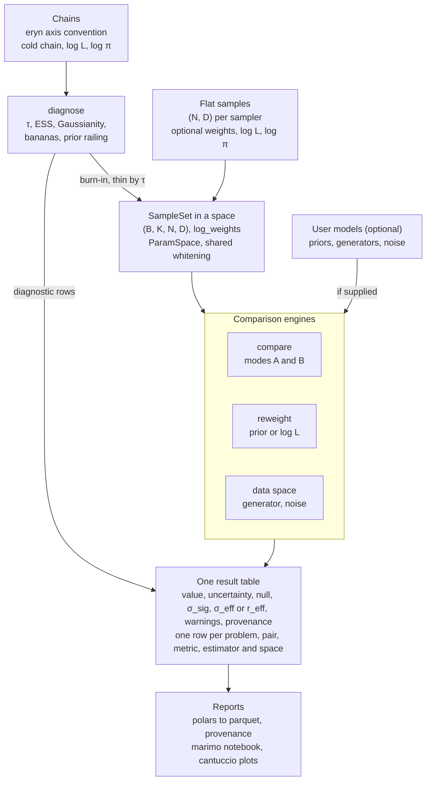

# mixed signals: Architecture Design

> Exported from the claude.ai design doc on 2026-10-13, after design round 8, and closed out the same day in roadmap session 0. This file is the working copy: update it when a decision changes.

mixed signals checks the quality of single posteriors and compares posteriors from different analyses of the same data, reporting every number against a finite-sample null. This document records design rounds 1–8, the design close-out and the decisions taken in the implementation sessions. Every item is **Decided** or **Deferred**, except one item the developers left **Open** (see Open questions). Every method and every assumption cites its source; the sources are collected under References.

## At a glance



Diagnostics read raw chains and supply τ for thinning; every engine then writes rows of the same shape to one table.

## Purpose and scope

v1 covers fixed-dimensional posteriors in two comparison modes. The primary field is gravitational-wave data analysis, but the core stays domain-agnostic.

- **Mode A, approximation vs trusted reference** (e.g. SBI against MCMC). Asymmetric: the reference fixes the whitening.
- **Mode B, peers without truth** (e.g. two pipelines on the same LISA or LVK data). Symmetric.

In v1:

- Single-posterior quality: MCMC health, shape, dependence, prior railing.
- Posterior-to-posterior comparison in modes A and B.
- Prior and likelihood reweighting, when priors and likelihoods are supplied.
- Data-space comparison, when a signal generator and noise model are supplied.

## Decisions so far

The developers have agreed 354 decisions: 88 from rounds 1–8, the repository setup and the design close-out, 7 from roadmap session 1 (Foundations), 7 from roadmap session 2 (Sample containers) and 14 from roadmap session 3 (Validation zoo), all on 2026-10-13, and 14 from roadmap session 4 (Transforms and whitening), 12 from roadmap session 5 (MCMC tools) and 16 from roadmap session 6 (Estimators), all three on 2026-10-14, 14 from roadmap session 7 (eryn adapters and priors), taken on 2026-10-14 and 2026-10-24, 14 from roadmap session 8 (Metrics I: moments and marginals), on 2026-10-24, and 10 from roadmap session 9 (Metrics II: divergences, kernels and classifiers), 14 from roadmap session 10 (Optimal transport) and 16 from roadmap session 11 (Diagnostics), all three on 2026-10-25, 12 from the first part of roadmap session 12 (Nulls and σ), on 2026-11-16, 5 from its second part, on 2026-11-17, 18 from roadmap session 13 (Reweighting), on 2026-11-18, 28 from roadmap session 14 (Engines), on 2026-11-19 and 2026-11-20, and 15 from roadmap session 15 (Data space), on 2026-11-20, 28 from roadmap session 16 (Pipeline and CLI), on 2026-11-20 and 2026-11-21, and 22 from roadmap session 17 (Reports), on 2026-11-22.

| Topic | Decision |
| --- | --- |
| Comparison modes | A (approximation vs reference) and B (peers); ensemble calibration later |
| Dimensionality | Fixed-dimensional only; trans-dimensional is future work |
| Inputs | General arrays: one posterior (N, D), K posteriors of the same data, or batches of either; eryn-style inputs are not assumed |
| Batch axis | Independent problems; identical parameter sets across all inputs |
| Multi-source runs | eryn leaves are not batch entries, because of label switching |
| Sample counts | Equal N first; unequal N anticipated in the design |
| Number of posteriors | Kept small; warnings on combinatorial cost |
| Replicate runs | Not supported; possibly never |
| Chain layout | eryn's axis convention; v1 reads the cold chain of a single branch from a run with one independent sampler |
| Flat samples | A separate flat container, not squeezed into the chain layout |
| Chain reduction | Built-in burn-in and τ-thinning tools, optional in pipelines and configs; direct metric calls assume cleaned samples |
| Per-sample data | Raw or cleaned chains with log L and log π; nested-sampling weights optional |
| Autocorrelation | Own τ estimator; eryn and emcee serve as reference examples |
| Backend | JAX is a hard dependency; converters to and from NumPy, CuPy and PyTorch |
| Precision | float64 by default, enabled at import |
| Randomness | Every stochastic function takes an explicit JAX PRNG key; pipelines derive all keys from one config seed |
| Generators | Batched, backend-agnostic interfaces wrapping user code; full contract benched. Data space defines `generate_template`, the optional `information_matrix(θ, noise=)` and a noise model with `whiten` (session 15) |
| Gradients | JAX generators use `jax.grad` of `get_ll`; CuPy or PyTorch generators supply `get_ll_grad` |
| Fisher matrix | `information_matrix(θ, noise=)` returns (N, D, D) for the noise model it receives |
| Noise | Set at generator initialization, or passed as a kwarg; data space takes a `NoiseModel` with `whiten(signals)` and passes it to `information_matrix` as `noise=` |
| `get_swap_ll` | Dropped |
| Priors | Separate objects, using eryn's JAX-compatible prior setup from its feat-jaxpriors branch |
| eryn release | eryn's JAX-compatible prior setup is headed for release; until then, development pins the uv git source lisa-analysis-tools/Eryn at feat-jaxpriors, pushed on 2026-11-20 and locked at commit aae1549 (see Open questions) |
| ParamSpace | Set explicitly; a class method builds it from eryn priors |
| Parametrization | With eryn priors, comparing in physical parameters via eryn's transforms is optional |
| Fixed and discrete parameters | With eryn priors, `DeltaFunction` parameters are dropped and discrete priors stay out of v1; otherwise nothing is dropped |
| Periodic parameters | A non-Euclidean space inside optimal transport, measured along chords |
| Sky position | A coupled sphere topology, measured along chords in optimal transport, with a radius that whitening sets |
| Periodic whitening | For now, whiten the Euclidean block only and scale periodic axes by their circular standard deviation √(−2 ln R̄); optional |
| Nulls | Every comparison ships with a finite-sample null |
| Null construction | Configurable; each method has a standard default |
| Null defaults | 200 resamples; the null sides carry the effective sample size, which replaced the subsampling of both sets to the smaller N_eff in session 12; more resamples for significance claims |
| O(N²) metrics | Subsample above a cap with a warning; a kwarg sets the cap |
| σ reporting | Report σ_eff, or r_eff for shape-only rows, and σ_sig; pass/fail on σ_eff or r_eff, with σ_sig checking it is resolved |
| Whitening | An explicit choice, recorded with every result |
| Validation zoo | Shifted, scaled and rotated Gaussians, bananas, multimodal mixtures, railed, periodic and sphere cases; used for tests, the checks of the σ_eff and r_eff maps and the validation page |
| Optimal transport | Method choices owned by the developers; ott-jax is the backend; the debiased Sinkhorn divergence, sliced W2 and the sliced Sinkhorn divergence, all with the squared chordal cost |
| Data structures | Own design on pydantic, polars and JAX pytrees |
| Visualization | cantuccio for corner plots; marimo for interactive notebooks |
| Users | Notebooks, importable metrics, and config + CLI pipelines that write reports |
| Config format | YAML |
| CLI | argparse |
| Packaging | One package with extras; Python ≥ 3.12; Apache 2.0 license |
| Dependencies | Lean core: jax, ott-jax, equinox, jaxtyping, numpy, polars, pydantic, pyyaml and scipy, which JAX requires anyway; eryn is an extra, and the dev group installs every extra except the CUDA ones |
| Tooling | uv ≥ 0.13 manages the project; ruff, strict mypy, ty's deprecated rule, a style-rule script, pre-commit hooks and CPU-only GitHub Actions CI check every change; CI pins its actions by commit SHA |
| Package layout | The tree under Package layout, with `io/eryn_backend.py` and `priors/eryn_container.py` |
| MCMC tools | `mcmc/` (τ, ESS, reduction) stays separate from `diagnostics/` (posterior shape) |
| Kernels and engines | Kernels live in topic subpackages; SampleSet-level wrappers live in `engines/` |
| OT location | `metrics/ot/`, so users find every metric in one place |
| Pytrees | equinox modules; equinox already arrives through ott-jax and lineax |
| Shape annotations | jaxtyping on every kernel, with beartype runtime checks in tests |
| Shape names | jaxtyping dimensions are words: batch, posterior, sample and param for (B, K, N, D); chains add step, temp, walker and leaf |
| Docs | Sphinx with the furo theme and MyST pages; Google-style docstrings, rendered by napoleon; citations from `docs/references.bib` through sphinxcontrib-bibtex |
| GPU tests | A marked suite, run by hand |
| Engine API | Plain functions that return results |
| Distribution name | `mixed-signals` on PyPI, free but not reserved on 2026-10-13; the GitHub repository takes the same name |
| Thresholds | Per-metric σ_eff and r_eff defaults ship with the package, overridable in the YAML |
| GPUs | A single GPU in v1; sharding the batch axis comes later |
| Report contents | σ_eff, r_eff and σ_sig summary table, corner overlays, null histograms and diagnostics; session 17 added the sections under Report sections |
| Method menus | The v1 methods in the Engines table; C2ST and the normalizing-flow estimator are placeholders until implemented |
| References | Every method cites a paper, official document or reference package, and every assumption a paper or a validation-page finding; checked in review |
| Validation page | A docs page generated from zoo runs: null checks, recovered shifts and width ratios and the checks behind the defaults, stamped with package version and seed |
| Recipes | Every row records its (functional, estimator, space) triple and the estimator settings |
| Topologies | Real line, interval (one bound may be infinite), circle with its period, and sphere |
| Sphere coordinates | An azimuth axis plus a polar axis given as latitude, colatitude, sin(latitude) or cos(colatitude); the user declares which pairs form a sphere |
| Transforms | Forward, inverse, log\|J\| and full Jacobian, which defaults to `jax.jacfwd` |
| Domain-agnostic core | GW conventions, readers, waveform helpers and the PSD-weighted inner product live in `gw/` |
| Core objects | `ParamSpace`, `Chains`, `SampleSet`, `Transform`, `Estimator` and `Result`, with the fields under Data model |
| Effective sample size | An optional `n_eff` per batch and posterior, set by `reduce_chains` or the user; Kish ESS of the weights by default |
| Structure layering | equinox for anything crossing jit, pydantic for configs, `ParamSpace` and provenance, polars for results; metadata outside pytrees |
| Comparison topologies | Against a reference (mode A default) and all pairs (mode B default) |
| KL direction | Both directions, as separate rows, in modes A and B |
| Comparison nulls | Permutation of τ-thinned pooled samples in both modes; split-half of the reference stays configurable |
| Diagnostic nulls | Gaussian surrogates with the posterior's mean and covariance at its N_eff |
| Uncertainty | The null standard deviation, marked approximate; a subsampling bootstrap on request |
| Result additions | Null draws, null recipe, r_eff, JAX version, device platform and config hash; then estimator settings, the uncertainty method and the PRNG key in provenance |
| σ_eff maps | Closed forms where they exist; AD and JS by bisection on the zoo's quadratures, which replaced the tabulated curves in session 12; all checked on the zoo |
| Width effect size | r_eff, the Gaussian-equivalent width ratio, for shape-only rows; thresholds on \|ln r_eff\| |
| JS units | Nats |
| MMD bandwidth | Median heuristic on the pooled whitened samples, fixed once per comparison |
| Validity domains | A soft limit adds a warning; a hard limit gives NaN and a warning; nothing raises |
| Zoo access | `mixed_signals.zoo` is public API |
| eryn topology mapping | A periodic prior or an entry of the sampler's `periodic` dict gives a circle; every other parameter an interval from its bounds; `reflective` maps like no flag |
| R̂ | Rank-normalised split-R̂ across walkers as an informational row, always flagged because the walkers are coupled |
| Chain rates | Acceptance and swap rates for chains read from an eryn backend |
| PSIS threshold | Flag k̂ above min(1 − 1/log₁₀ S, 0.7) |
| Prior railing | Posterior density at a finite bound over its peak density, from the corrected 1D KDE, flagged above 0.02, the edge-to-peak ratio at which pe-configurator reports railing; the zoo checks the recovery of the score |
| Interfaces | Kernels, SampleSet functions, and the YAML + CLI pipeline |
| Key derivation | `prng.derive_key` folds the first 64 bits of the SHA-256 digest of each element of a named path into the parent key, so a key does not depend on which other calls run or in which order; root keys use Threefry-2x32 whatever the process default |
| Warnings | Ordinary Python warnings in a `MixedSignalsWarning` hierarchy, raised outside jit; engines capture them per row as category and message entries. Errors derive from `MixedSignalsError`; invalid pydantic models raise pydantic's `ValidationError` |
| Package defaults | Module constants in `_config.py`, such as 200 null draws and the PRNG implementation; no process-wide settings change them at run time |
| ParamSpace YAML | Flat parameter entries (name, label, unit, topology, bounds) and a `spheres` list; angles in radians; a sphere azimuth is a circle of period 2π, and the polar bounds lie inside the range of the polar form |
| Hashes | SHA-256 throughout; one input hash per posterior, in `pair` order, over dtype, shape and C-ordered bytes |
| Result object | A thin `Result` around one polars DataFrame that checks the schema and the required columns and reads and writes parquet; `Provenance` is a pydantic model |
| Citation style | Author-year citations in round brackets; BibTeX keys of first author, year and first significant title word in lowercase ASCII, skipping a leading article, preposition or verb such as "A", "On" or "Is"; each session adds only verified entries |
| Sample metadata | `SampleSet` holds arrays only; engines take the posterior names and the `ParamSpace` |
| SampleSet operations | Select problems, posteriors or parameters; take samples, which drops `n_eff`; convert to NumPy, JAX, torch or CuPy. No stacking of sets in v1: engines pair separate sets, and τ-thinned runs differ in N. A later operation that joins sets raises when their optional fields differ |
| Narrow floats | Inputs narrower than float64 are cast with a `PrecisionWarning` |
| `n_eff` range | A given `n_eff` lies between 1 and the number of samples with positive weight, the range of the Kish value |
| Chain counts | Acceptance and swap counts carry the number of proposals behind each, so rates hold for cut or thinned chains |
| Chain log densities | `log_like` and `log_prior` are optional; `betas` default to ones for a single temperature |
| Array extras | A `torch` extra, with CPU-only torch from the PyTorch index in the dev group; `cuda12` and `cuda13` extras with the JAX CUDA plugin and the matching CuPy wheel, which exclude each other and stay out of the dev group |
| Zoo cases | A `ZooCase` holds K named posteriors, their `ParamSpace`, their densities and a reference table; `sample(key, N, batch_size=B)` gives a `SampleSet` (B, K, N, D), each posterior drawing from `derive_key(key, name)` and each problem folding in its index |
| Zoo reference tables | A polars table per case with the result columns pair, metric and parameters, plus value and basis (closed form or quadrature), so that results join their truth |
| Zoo reference values | Closed forms where they exist, plus one-dimensional quadrature for the marginal JS and AD of Gaussian pairs and for mixture KL |
| Zoo numerics | All numerics of the zoo in JAX, so they jit, vmap and differentiate: closed forms, quadrature, and the set-up of distributions and builders; NumPy only reads user input and holds the fixed Gauss-Legendre table |
| Zoo quadrature | Composite 8-point Gauss-Legendre rules on panels refined around every normal component (μ ± 12σ in σ/2 steps) and every crossing of two weighted components; fixed shapes, no new dependency, checked against QUADPACK with break points in the tests |
| Zoo input checks | Closed forms check concrete inputs and raise ValueError, as `SampleSet` does; inside jit, invalid inputs give NaN |
| SciPy | A core dependency, already installed with JAX, kept for later sessions; the zoo does not import it, the tests use it as an independent check, and the lint group adds `scipy-stubs` |
| Zoo periodic cases | Wrapped normals: exact draws, a circular standard deviation equal to σ, and circles correlated with real axes by wrapping one coordinate |
| Zoo sphere cases | von Mises-Fisher distributions centred near a pole and rotated over it, in any polar form, with closed-form KL and Hellinger |
| Zoo rotated Gaussians | Rotated by ±α/2 in one plane, so the marginals stay identical and only the sign of the correlation differs |
| Zoo mixtures | A two-component mixture against its moment-matched Gaussian, one component alone (a dropped mode) and the same components reweighted |
| Zoo railed cases | Unit normals truncated at one bound, one per offset, with the railing score in rows named `railing_lower` or `railing_upper` by side, truncated moments and closed-form KL |
| Zoo AR(1) chains | AR(1) chains as `Chains` with τ = (1 + φ)/(1 − φ), built in session 3 for sessions 5, 11 and 12 |
| Zoo base Gaussians | The shift and scale builders take an optional mean and covariance, and the rotation builder a mean and per-parameter scales; shifts stay in Mahalanobis units |
| Pooled whitening | The mean of the within-posterior covariances, each posterior weighted equally, the pooled within-group covariance of the Mahalanobis distance; circles take the root mean square of their circular standard deviations. The covariance of the pooled samples would shrink a shift d to d/√(1 + d²/4) |
| Pooling scope | Pooled whitening pools the two posteriors of each pair, so a row does not depend on the other posteriors of a run |
| Whitening rotation | ZCA-cor, W = P^(−1/2) V^(−1/2): whitened axes keep their parameter names, and the units of the parameters do not matter |
| Z-score mode | `decorrelate=False` scales the Euclidean block without decorrelating it, so interval bounds map exactly |
| Fisher whitening | Γ⁻¹ is the covariance: the Euclidean block takes its marginal block of Γ⁻¹ and each circle the square root of its diagonal entry; Γ must be finite, symmetric and positive definite; rank truncation is deferred |
| Conditioning | Checks act on matrices scaled to unit diagonal: singular below D·ε times the largest eigenvalue, and a `ValidityWarning` above the condition number 1/√ε ≈ 6.7e7 |
| Singular widths | A singular covariance from samples gives a NaN whitening and a `ValidityWarning` that names the axes, so the other problems of a batch go on; an invalid Fisher matrix raises ValueError; inside jit, NaN |
| Whitened bounds | Decorrelated Euclidean axes become real lines without units; methods that need bounds run in the original space; circles stay circles, of period P/s; spheres take the radius 1/s |
| Spheres in whitening | Sphere pairs keep their angles; each sphere takes the radius 1/s for its pooled angular width s, so its distances come in units of that width, as on a whitened circle |
| Axis blocks | `ParamSpace.axis_blocks` gives the positions of the Euclidean block (real and interval axes outside spheres), the circles and the sphere pairs, the port of catpylisa's geometry schema |
| Transform API | One problem per object, with methods on points of any leading shape: `forward`, `inverse`, `log_abs_det_jacobian`, `jacobian`, `map_fisher`, `map_space`, `map_sample_set` and `description`; B problems get B transforms through `jax.vmap` |
| Composition | `Compose` applies its transforms from left to right, and the space column joins their descriptions with " \| " |
| Weighted widths | The unbiased reliability-weight covariance of `numpy.cov` with `aweights`, computed on samples shifted by the sample of largest weight; the package convention for widths |
| Densities under transforms | `map_sample_set` subtracts ln\|det ∂f/∂x\| from `log_prior` and `log_q` and keeps `log_like`, `log_weights` and `n_eff` |
| τ estimator | emcee's walker-averaged autocorrelation function, truncated by Geyer's initial monotone sequence of lag pairs with the antithetic correction of Vehtari et al. (2021); it replaces Sokal's window, which gives τ ≈ 0 or below for anticorrelated chains |
| τ floor and ESS | τ is floored at 1/log₁₀ S for S draws; diagnostic rows report the raw S/τ, above S for antithetic chains |
| Reduced `n_eff` | N/τ_k of the slowest parameter for N kept samples, with τ_k from every k-th lag of the full autocorrelation function, clipped to [1, N] |
| Burn-in | An explicit number of steps, recorded; nothing is detected automatically, and the split-chain KS test flags a remaining transient |
| Thinning factor | For `thin="tau"`, the largest max(1, ⌈τ − 2ε⌉) over the parameters, with ε the a priori error of τ, so noise in τ does not thin uncorrelated chains; the split-chain test uses the same factor per parameter |
| R̂ form | The larger of the rank-normalised split-R̂ of the draws and of the folded draws |
| KS kernel | One weighted two-sample KS statistic in `metrics/marginal.py`, built in session 5 for the split-chain test and reused by session 8 |
| Split-chain KS output | The statistic and its asymptotic Kolmogorov p-value, with the halves thinned per parameter and pooled over the walkers |
| Reduction record | A frozen pydantic `ReductionRecord`: chain shape, cold index, burn-in, thinning factor, τ and τ_k, `n_eff` and the SHA-256 of the chains; `reduce_chains` with the recorded burn-in and factor repeats it exactly |
| emcee in tests | emcee joins the test group as the reference for the autocorrelation function and τ, next to eryn's estimator |
| MCMC validity checks | Fewer than 50τ steps and lag pairs positive to the end warn; walkers that never move leave the average, and τ is NaN when none moves; R̂ warns below 50 effective samples per split chain |
| MCMC interfaces | The τ, ESS, split-chain KS and R̂ kernels take arrays shaped (step, walker, param); `reduce_chains` takes `Chains` |
| Estimator form | Equinox modules that a `fit` classmethod builds per problem and posterior, vmapped over (B, K); frozen pydantic settings give the `estimator_settings` JSON, and `resolved_settings` the values that a rule chose |
| Estimator names | `gaussian`, `kde`, `knn`, `gmm`, `flow` and `classifier`, as `GaussianDensity`, `KernelDensity`, `NearestNeighbours`, `MixtureDensity`, `FlowDensity` and `ClassifierRatio` in `estimators/` modules of those names, with the `Estimator` base in `base.py` |
| KDE core | `jax.scipy.stats.gaussian_kde`, the JAX port of SciPy's estimator, evaluated in chunks at the winding and mirror images of each point |
| KDE bandwidth | Silverman's factor on the Kish n_eff; a float replaces it, and plots pass the resolved factor to cantuccio |
| KDE bounds | The non-negative Jones-Foster correction in one dimension, renormalised by quadrature; reflection at every finite bound in two or more |
| KDE dimension limit | A warning below Silverman's sample size for a relative mean squared error of 0.1 at a Gaussian's mode, recomputed exactly up to 20 dimensions, and always above |
| Circles in estimators | The Gaussian and the GMM unwrap each circle about its circular mean and sum over windings; the KDE unwraps for its bandwidth and wraps its kernels; sphere axes follow their own topologies |
| Unresolved circles | The Gaussian and the GMM warn when the Rayleigh statistic 2N_effR̄² lies below 5.99, the 95% point of χ²₂ |
| Gaussian estimator | The weighted mean and the unbiased weighted covariance, unbounded on intervals, with `sample` for the Gaussian surrogates |
| kNN scope | Topology-aware brute-force distances (Euclidean block, shorter arc, great-circle arc times the sphere's radius), the k-th neighbour with self-exclusion, and the digamma-corrected log density; the divergence formulas stay in session 9; since session 11 a maximum norm and counts of the samples strictly within a radius serve the KSG estimator |
| kNN weights | Zero weights leave every search; unequal positive weights give NaN with a warning, so engines convert weighted sets by rejection sampling first (session 14) |
| GMM start | Weighted k-means++ seeds, nearest-centre assignment and one M-step, as in scikit-learn; the best of 18 starts by default, from a zoo check |
| GMM stopping | The rule of scikit-learn on z-scored axes: 1e-3 on the mean log-likelihood per sample, at most 100 iterations and 1e-6 on every diagonal; a winning start at the cap warns |
| BIC | −2n·ℓ̄ + p ln n from the GMM's mean log-likelihood and parameter count, for 1 to 5 components, with n the posterior's n_eff in both terms, as Kass and Raftery (1995) and Jones (2011) take n; on repeated draws, n = N inflated ΔBIC tenfold |
| Placeholders | `FlowDensity.fit(samples, log_weights, space, settings, *, key)` and `ClassifierRatio.fit(first, first_log_weights, second, second_log_weights, space, settings, *, key)` raise `NotImplementedError` |
| Coordinate helpers | `wrap`, `sphere_coordinates` and `unit_vectors` move from the zoo to `core/topology.py`; `circular_mean`, `mean_resultant_length` and `unwrap_about` join `core/samples.py` |
| eryn transforms | `ErynPhysical` wraps eryn's own JAX backend, on the copy that `to_backend("jax")` returns, so its maps and Jacobians run under jit, vmap and grad: `forward` is eryn's `inverse_transform`, `inverse` its `forward_transform`, and ln\|det ∂x/∂u\| is minus eryn's `log_jacobian` at x; its description is `physical(eryn)` |
| eryn reader | `Chains.from_eryn(source, *, branch, num_repeats_in_model, priors)` reads one branch with all its temperatures from an `EnsembleSampler`, a backend or the path of an HDF5 file; the code lives in `io/eryn_backend.py` |
| eryn acceptance counts | `num_repeats_in_model` is optional: a sampler supplies it, and without it a backend or file gives no acceptance counts, so a rate is never wrong; the proposals are the stored steps times `num_repeats_in_model`, whatever `thin_by` is |
| eryn swap counts | Read whenever a run has several temperatures, with the stored steps times the walkers as proposals per neighbouring pair; one temperature has none |
| Fixed eryn parameters | With the priors, from a sampler or `priors=`, the reader drops the `DeltaFunction` columns after checking the stored key order; `ErynPhysical` and `ErynPrior` cover the same parameters and put the fixed values back only for eryn's calls |
| eryn names | Container keys, or `x0`, `x1`, ... for integer keys |
| eryn labels and units | eryn's label and unit describe the sampled coordinate; a prior without a name takes its parameter name as label; in the physical space a transformed axis takes eryn's `name_phys` as name and label, without a unit |
| eryn entries | Every entry is read: entries without bounds per parameter give real lines, `JointPrior.boundaries` is read per axis, and nested containers recursively; discrete priors are eryn's three discrete classes and anything with `logpmf`, because `PoissonDistribution` has no `logpmf` |
| eryn periodicity | `from_eryn_priors(periodic=)` takes one branch's entry of the sampler's `periodic` dict, because nothing in eryn reads `Prior.boundary`; a circle spans the prior's bounds, whose width must equal the period, or [0, P) without finite bounds, the range into which eryn wraps; a periodic prior with neither raises |
| eryn spheres | `from_eryn_priors(spheres=)` takes `Sphere` objects named by parameter names; a `SineUniform` polar axis needs `sin_latitude` and a `CosineUniform` one `cos_colatitude` |
| Physical spaces | `ErynPhysical.map_space` sorts the inverse transforms of the sampling bounds; a transformed circle raises; a sphere's polar axis turns `sin_latitude` into `latitude` and `cos_colatitude` into `colatitude`, and any other transform of a sphere axis raises |
| Prior protocol | `PriorDistribution` in `priors/protocol.py`: `logpdf` maps (N, D) to (N,), and `rvs(size, *, key)` draws size + (D,) from an explicit JAX key |
| eryn prior adapter | `ErynPrior` makes a container meet the protocol in the sampling coordinates, passing the key on to eryn's `rng_key` on its JAX copy; since session 13, `coordinates="physical"` gives the densities of the physical parameters |
| eryn entry points | Classmethods on the core objects, `Chains.from_eryn` and `ParamSpace.from_eryn_priors`, which import the eryn modules lazily |
| Metric deliverables | Pure-JAX kernels named as the zoo's metrics, and the closed-form σ_eff and r_eff maps of the moment and marginal metrics in `sigma/maps.py`; session 12 adds the AD and JS curves, σ_sig and the calibration, and session 14 builds the rows |
| Metric coordinates | Kernels compute in the coordinates they receive: engines z-score both inputs with their shared whitening (`decorrelate=False`) for per-parameter rows, so mean shifts and W1 are in units of σ_ref in mode A or of the pooled RMS σ in mode B, and run joint rows in the decorrelated whitening |
| Gaussian kernels | The Gaussian KL, W2 and Hellinger with location and shape terms move from the zoo to `metrics/moments.py` and return ln(det Σ_q/det Σ_p) for the r_eff direction; the zoo's checked wrappers call them, and on circles the mean difference is the shortest signed arc |
| Moment estimators | Mean shift and width ratio read `empirical`: weighted means and unbiased widths, and on circles the circular mean and circular standard deviation; the Gaussian divergences read `gaussian` |
| Weighted AD | H = (F + G)/2 with each posterior's weights summing to one, summed at the ends of runs of ties as SciPy's right-continuous form, so it estimates the zoo's AD distance for any n and m |
| Circle marginals | Forms that no rotation changes: Kuiper's V in rows named `kuiper_ks`, and W1 along the circle in rows named `w1` |
| AD on circles | Cut opposite the circular mean of the two marginals pooled with equal weight, with a Rayleigh warning, because no verified two-sample AD is invariant under rotations |
| Sphere axes in marginal rows | Their own topologies: the azimuth a circle, the polar axis an interval |
| Marginal JS and Hellinger | Gauss-Legendre quadrature of the two bounded KDEs over each estimate's reach, on panels of at most two bandwidths; inside jit a wider panel gives NaN |
| Marginal KDE bandwidth | One factor per pair: Silverman's one-dimensional factor at the smaller Kish n_eff, fixed once per comparison and reused by every null draw; each kernel is that factor times its own width, so smoothing keeps width ratios |
| Subsampling cap | `SAMPLE_CAP` = 10 000 samples per posterior, from a CPU timing of the energy distance; a keyword overrides it. The kNN metrics keep it for now, although an evaluation costs up to 30 times more there, until a later benchmark |
| Capped draws | Uniform without replacement, keeping the log weights and putting zero-weight samples last, with a `SubsamplingWarning`; the number of samples, which sets the cost, meets the cap |
| Split-chain test on circles | Chain-health rows take Kuiper's V with its limiting distribution on circle parameters, in session 11 |
| Zoo marginal truths | `wrapped_gaussians` gains `kuiper_ks`, `w1`, `ad`, `js` and `hellinger` for its circle and `railed_gaussians` `ks`, `w1`, `ad`, `js` and `hellinger` for its railed axis, by closed forms or quadrature checked against SciPy; shared axes carry exact zeros |
| Metrics II names | `knn_kl_divergence`, `knn_js_divergence` and `knn_hellinger_distance` in `metrics/divergence.py`, with rows `kl`, `js` and `hellinger` and the estimator `knn`; `maximum_mean_discrepancy`, `energy_distance` and `median_bandwidth` in `metrics/kernel.py`, with rows `mmd` and `energy` and the estimator `empirical`; the placeholder `classifier_two_sample_test(first, first_log_weights, second, second_log_weights, space, settings, *, key)` in `metrics/classifier.py`, with rows `c2st` |
| kNN ranks | k = 3 for KL, 10 for JS and 5 for Hellinger: on shifted unit Gaussians in 1 to 16 dimensions, the most resolution of a shift for at most a few percentage points more bias than the smallest valid k |
| kNN KL in higher dimensions | The estimate reads low from D = 4 for every k, −29 to −32% at D = 16 with k = 3, also in the bias-reduced form of Wang, Kulkarni and Verdú (2009); no warning, and session 12 replaces the √(2·KL) map of kNN KL rows by a zoo-calibrated one |
| kNN JS sample counts | The larger posterior is subsampled, uniformly without replacement from the row's key, to the positive-weight count of the smaller, so the pooled samples stand for the equal mixture; inside jit, unequal counts give NaN |
| kNN Hellinger | The mean of the two directional estimates of the Bhattacharyya coefficient, so the value does not depend on the order of the pair; on the zoo it resolved shifts 1.2 to 2.9 times better than one direction, at the same bias |
| kNN values near zero | Raw: KL and JS may fall below zero, and Hellinger is sign(1 − B̂C)√\|1 − B̂C\|, so null draws keep their spread and the signed square keeps 1 − B̂C |
| Kernel estimators | Weighted V-statistics for MMD and the energy distance, the distances between the weighted empirical distributions, never negative; the `mmd` row holds MMD², whose O(1/N) bias cancels in null subtraction |
| Kernel metrics on circles and spheres | Chordal distances: each circle of period P embedded as a circle of circumference P in a plane, each sphere as a sphere of its radius, the unit sphere in radians. Arc lengths lose strict negative type (Lyons 2020) and positive definiteness of the Gaussian kernel (Feragen, Lauze and Hauberg 2015); on the zoo both resolved shifts equally, and only chords resolved two circle distributions that differ in even harmonics |
| MMD bandwidth computation | The weighted median over all pairs of a uniform subsample of 1 000 samples per posterior, each posterior pooled with half the mass, from a key whose path ends in "bandwidth" |
| Kernel σ_eff maps | Closed forms in `sigma/maps.py` from session 9: MMD² from the bandwidth and D, and the energy distance by bisection on the mean of the noncentral χ distribution, summed as a Poisson mixture |
| OT metrics | The debiased Sinkhorn divergence S_ε through ott-jax, sliced W2 and the sliced Sinkhorn divergence of Nadjahi et al. (2020), in rows `sinkhorn`, `sliced_w2` and `sliced_sinkhorn` with the estimator `empirical` |
| OT debiasing | `sinkhorn` rows hold S_ε, which vanishes for equal inputs; `sliced_w2` rows hold SW2², whose finite-sample bias cancels in the null subtraction, as in the permutation test of sliced distances of Tran and Schreuder (2026) |
| OT cost | The squared Euclidean distance of the chordal embedding of MMD and the energy distance, whose Gibbs kernel is positive definite at every ε, so S_ε ≥ 0 (Feydy et al. 2019); squared arcs turned S_ε far below zero in a zoo check |
| Sphere weight | Whitening records the radius 1/s on each `Sphere` of the whitened space, as it records circle periods P/s, and every distance-based metric reads it |
| Sphere width | s = √(1 − R̄) of the unit vectors, the width 1/√κ of a concentrated von Mises-Fisher distribution, pooled as the root mean square over the posteriors; Fisher whitening takes the root of half the trace of the sky covariance in the tangent plane at the centre |
| kNN on spheres | Neighbour distances are great-circle arcs times the radius, and the log density adds 2 ln R per sphere to its area element |
| Sinkhorn ε | 0.25 ℓ², with ℓ the median bandwidth of the comparison, fixed once per comparison and reused in every null draw, from a zoo check; a vector of ε gives the curve S_ε(ε), whose null band, a null option, and benchmark come with session 12 and whose plot comes with session 17 |
| Sinkhorn solver | ott-jax in the log domain with symmetric self terms, online in chunks of about 2²² costs; the iterations stop at an L1 marginal error of 1e-6 or after 2 000 steps, and an unconverged divergence is NaN with a `ValidityWarning` |
| ott-jax source | Development pins ott-jax's main branch at commit 36338c9, whose fix of the online mode on JAX 0.9 and later (ott-jax pull request 701) is not released; like the eryn branch, a release blocker |
| Sliced directions | Complete random orthonormal bases of the chordal embedding of E + 2C + 3S coordinates, drawn once per comparison from a key ending in "directions" and reused in every null draw: as many bases as hold 500 directions for sliced W2 and 20 for the sliced Sinkhorn divergence; independent uniform directions, the default until session 12b, stay available |
| Sliced Sinkhorn | Its own cap of 2 000 samples per posterior, and ε = 0.25 times the weighted median projected squared distance over pooled pairs and directions, fixed once per comparison |
| OT σ_eff maps | √S_ε for `sinkhorn`, √(n · value) for `sliced_w2` and `sliced_sinkhorn` with n = E + 2C + 3S; exact for shifts of the Euclidean block; on circles and spheres no correction, but a warning beyond the widths where they read shifts low (session 12b) |
| Gaussian OT truths | Zoo functions for S_ε between Gaussians (Janati et al. 2020; Mallasto, Gerolin and Minh 2022) and for sliced W2² and sliced S_ε of shifted and axis-scaled unit Gaussians; reference tables hold only values free of ε |
| OT names | `sinkhorn_divergence` in `metrics/ot/sinkhorn.py`; `sliced_directions`, `sliced_wasserstein_distance`, `sliced_sinkhorn_divergence` and `sliced_sinkhorn_epsilon` in `metrics/ot/sliced.py`; the embedding in the private `metrics/_embedding.py`; `spherical_width` in `core/samples.py` |
| Diagnostics scope | Kernels in `diagnostics/`, the Gaussian-surrogate null in `nulls/surrogates.py`, the empirical p-value and σ_sig in `sigma/significance.py` without a tail fit, the KSG max norm and counts in `estimators/knn.py` and the split-chain Kuiper test in `mcmc/ess.py`; session 12 adds the other nulls and the tail fit, session 14 the rows |
| Diagnostic flags | A diagnostic row flags when its value minus the null mean (the value itself without a null) passes a per-metric default threshold, overridable in the YAML, and σ_sig reaches 2; σ_eff and r_eff stay null on diagnostic rows |
| Diagnostic thresholds | Skewness 0.5 and the one-sample AD 0.005, anchored on the zoo's normal railed 1σ inside its bound; excess kurtosis 1, an equal mixture of unit normals at a separation of 3.1; Mardia's b₁ 0.25 and b₂ 1, the marginal values carried over; circular skewness 2√2 · 0.5 and kurtosis 2, their narrow-circle limits; Spearman 0.1, distance correlation 0.1 and mutual information 0.05 nats, about the zoo banana with b = 0.003; mode dip 0.1; ΔBIC 10; railing 0.02; ESS below 400 (Vehtari et al. 2021); split-chain statistic 0.1 |
| Diagnostic p-values | Two-sided for signed rows, with σ_sig = Φ⁻¹(1 − p/2) so that it reads \|z\| for a symmetric null; upper elsewhere, with Φ⁻¹(1 − p); the null recipe names the side |
| Sphere axes in diagnostics | Their own topologies, the azimuth a circle and the polar axis an interval; polar axes, which end at the poles, get no railing rows |
| Shape statistics | Per parameter the plug-in skewness g₁ and excess kurtosis g₂ of the weighted samples (Rimoldini 2014) and the one-sample AD distance A²/n against the normal of the weighted mean and unbiased variance; jointly Mardia's b₁ and b₂, b₂ being the mean of the squared Mahalanobis distances squared, under `SAMPLE_CAP` |
| Dependence statistics | For every pair, Pearson's r as an informational row, and Spearman's ρ_s, the distance correlation and the KSG mutual information as excesses over their Gaussian values at the r of the same samples: raw values sit at the centre of a surrogate null drawn at the sample's own r, their excesses are calibrated |
| Pair cap and KSG rank | The pairwise O(N²) statistics run on at most 2 000 samples per posterior; KSG takes k = 10, which read a banana's mutual information within −9 to +4% at that cap and resolved it 1.7 times better than k = 3 |
| Circles in diagnostics | Circular skewness and kurtosis on circles; the distance correlation along chords and KSG along arcs; Pearson, Spearman, Mardia and AD on values unwrapped about the circular mean, AD cut opposite it; rows that involve a circle wider than a circular standard deviation of 1 rad warn, because there the surrogate null drifts |
| Multimodality | GMM-BIC gives the component count and the discriminant directions; the modes of the bounded 1D KDE at Silverman's factor along every marginal and every pair's discriminant coordinate give the mode rows, whose deepest valley, 1 − valley/lower peak, is the effect size against Gaussian surrogates; modes of the fitted mixture misread curved and railed posteriors |
| Mode counting | A local maximum counts as a peak above 5% of the highest peak; valleys shallower than 0.1 merge neighbouring peaks into one mode; a circle is cut at its lowest density; mode rows on intervals take surrogates truncated to the interval by inverse CDF |
| Railing rows | `railing_lower` and `railing_upper` for every finite bound of an interval outside the polar axes, without a null, since a Gaussian surrogate knows no bound |
| Chain health | Per parameter τ, the ESS, the split-chain test (KS, or Kuiper's V with its limiting distribution on circles) and the informational R̂; acceptance rates per temperature and swap rates, informational |
| Circle τ | The larger τ of the observables cos(θ − θ̄) and sin(θ − θ̄), with θ̄ the circular mean, which no cut changes; the split test thins by the larger factor, and R̂ runs on values unwrapped about θ̄ |
| Diagnostic names | `skewness`, `kurtosis`, `circular_skewness`, `circular_kurtosis`, `anderson_darling`, `mardia_skewness`, `mardia_kurtosis`, `pearson`, `spearman`, `distance_correlation`, `mutual_information`, `gmm_bic`, `mode_dip`, `mode_count`, `railing_lower`, `railing_upper`, `tau`, `ess`, `rhat`, `acceptance_rate`, `swap_rate`, `split_chain_ks` and `split_chain_kuiper_ks`; the estimator `knn` for the mutual information, `kde` for modes and railing, `gmm` for GMM-BIC and `empirical` otherwise |
| Diagnostic modules | `diagnostics/shape.py`, `dependence.py`, `modes.py`, `railing.py`, `chains.py` and `flags.py`, with shared helpers in the private `_common.py` |
| Session 12 in two parts | Two commits: 12a holds the comparison nulls, the σ_sig tail fit, the σ_eff and r_eff maps and the thresholds; 12b the optimal-transport additions, the calibration script and the validation page |
| Null sides at N_eff | Chains stay thinned by τ, the value of a row uses all samples, and the two sides of every null draw carry the effective sample size. For the mean of the slowest parameter the null is slightly narrow, because τ_k reads about 4% low (5.7% at the 5% level on AR(1) chains of 100τ); for other parameters and statistics it is conservative, because one N_eff, that of the slowest parameter's mean, over-corrects them |
| Weighted nulls | A permutation moves (sample, weight) pairs: each set's weights sum to one, the sets are pooled, and every draw takes two disjoint sides of equal size; resampling to equal weights before permuting rejected 3 to 7 times too often |
| Null side size | s = round(½(N₁ + N₂) · (1/K₁ + 1/K₂)/(1/n₁ + 1/n₂)) for sample counts N, Kish sizes K and effective sizes n, clipped to [2, ⌊(N₁ + N₂)/2⌋]: half the pool for independent weighted samples, the harmonic mean of the two N_eff for equal-weight sets of equal size |
| Split-half sides | The reference alone, in two sides of round((N_r/K_r) · 2/(1/n_r + 1/n_a)) samples, which match the variance of the comparison; a `ValidityWarning` when they stop at half the reference, below about three times the approximation's N_eff. Replaces "halves at the approximation's N_eff", which rejected ten times too rarely |
| σ_sig tail fit | Below 10 draws at least as extreme as the value (Knijnenburg et al. 2009): a generalized Pareto fit by the estimator of Zhang and Stephens (2009) to the most extreme 25% of the draws, with the end of its support kept above the value (Peschel et al. 2026), flagged by an `ExtrapolationWarning`; it never returns p = 0 and reads low far in the tail |
| Null subtraction space | Where a metric is quadratic in the shift: KS, Kuiper's V, W1, W2 and every Hellinger form subtract the null mean of their squares, the width ratio that of ln r, and KL, JS, AD, the energy distance, MMD², SW2², the sliced Sinkhorn divergence and S_ε subtract plainly |
| Values below zero | Signed maps: σ_eff = sign(v) · map(\|v\|) for a null-subtracted value v, and ln r_eff = direction · sign(v) · \|ln r(\|v\|)\| for shape terms; values above the range of a metric stay NaN, and thresholds act on the signed effect, so a row below its null never fails |
| No stored calibration tables | AD and JS invert the zoo's quadratures by bisection at call time, and the KDE rows of JS and Hellinger multiply by √(1 + f²) for their bandwidth factor f; nothing is tabulated or shipped as data |
| kNN KL calibration | At run time: the estimator runs on unit Gaussians at the row's own dimension, sample counts and k for six shifts and four replicates, 28 evaluations next to 200 null draws, and σ_eff inverts that curve; √(2 KL) read 5 to 20% low |
| Comparison thresholds | One default for every σ_eff row, 0.2, the GWTC-2 criterion (Abbott et al. 2021) and Cohen's small effect, and one for every r_eff row, \|ln r_eff\| = 0.14, the width ratio of the same JS divergence; a row fails when its effect size reaches the threshold and σ_sig reaches 2; overridable per metric in the YAML |
| Null and σ modules | `nulls/plan.py` (`NullPlan`, `random_sides`, `null_draws`), `nulls/permutation.py` and `nulls/split_half.py`; `sigma/pareto.py`, `sigma/calibration.py` and `sigma/thresholds.py` next to `significance.py` and `maps.py`; a null is a plan of positions in a pool, so one statistic runs on every draw without copies |
| Sliced directions as bases | Directions come in complete random orthonormal bases (Mezzadri 2007), so the mean squared projection of a shift is its squared length over n exactly. With independent directions the sliced value of an axis-aligned 1σ shift scattered by 5 to 6% over draws of 500 directions in 8 to 32 dimensions and by 26 to 30% at 20; complete bases removed that scatter, and cut it to 3 to 6% and 19 to 23% for one axis 1.5 times wider. Rowland et al. (2019) report cases where orthogonal directions raise the variance of a sliced estimate, so independent directions stay available |
| Gaussian sliced W2 | A second estimator of `sliced_w2` rows, `gaussian`: on each shared direction the exact W2² of the projected moment-matched normals (Dowson and Landau 1982), averaged over the directions, in the chordal embedding that the empirical row slices; it bounds the sliced W2² of any two distributions with these moments from below (Gelbrich 1990), so the gap between the two rows measures non-Gaussianity |
| Chordal metrics on wide axes | `energy`, `mmd`, `sinkhorn`, `sliced_w2` and `sliced_sinkhorn` rows warn when a circle has a circular standard deviation above 0.3 rad or a sphere a width above 0.2 rad; up to these widths σ_eff read shifts within about 5%, at 1 rad on a circle at 0.53 to 0.85 of the shift, and the chord of the shift explains only part of the loss, so no closed form corrects it |
| Self-term de-biasing | The self-terms of sliced W2 on random halves stay in the Galactic-binary example; rows subtract the null mean, which removed the bias as well at no extra cost (Deferred) |
| Validation build | `scripts/build_validation.py` reruns the zoo checks of every session in about one hour on one CPU, with fewer replicates than the original checks and a standard error on every number; it writes `docs/validation.md` with tables and figures and the raw numbers as JSON, all committed and stamped with the package, JAX and seed; matplotlib from the `plot` extra draws the figures, so the docs build needs no plotting library; a quick mode of about two minutes runs as a test |
| Reweighting tail length | M = ⌊min(0.2S, 3√(S/R))⌋: Algorithm 1 of Vehtari et al. (2024) with their adjustment for MCMC draws (Appendix H), as loo's `n_pareto` applies it, with R = n_eff/Kish of the input set; on τ-thinned AR(1) chains it cut the scatter of k̂ by 8% at the same mean |
| Shape prior | The weakly informative prior k ← (Lk + 5)/(L + 10) of Vehtari et al. (2024, Appendix G), applied after the scale is fitted, as `gpdfit` of the posterior R package does: a keyword `shape_prior` of `generalized_pareto_fit`, off by default there, so the σ_sig tail fit keeps the plain estimator, and on in reweighting; on the zoo it moved k̂ by at most 0.03 from S = 2 000 up and cut its scatter at S = 500 from 0.15–0.23 to 0.13–0.20, the factor M/(M + 10) |
| Reweighted n_eff | R · Kish of the new weights, clipped to [1, positive weights], as loo's `psis_n_eff` (Vehtari et al. 2024, Eq. 8), so n/K still carries the chain correlation that the null sides read |
| Evidence ratio error | σ² = Σ(ṽᵢ − w̃ᵢ)²/R for the normalised new and input weights: Eq. (5) and (6) of Vehtari et al. (2024) for the weighted mean of the ratios, by the delta method; for equal input weights it is √((1 − ε)/(nε)) of Dax et al. (2023) |
| New likelihoods | Callables from samples shaped (n, D), as arrays of a `backend` argument (NumPy by default), to n log-likelihoods, called at the boundary in chunks of `chunk_size` samples (all of a problem at once by default) by `io.arrays.call_in_chunks`; the new prior's `logpdf` is called the same way |
| Likelihoods per problem | One callable for a set with one problem, or a sequence of B callables, one per problem, each called on all K posteriors of its problem; a single callable with B > 1 raises, because independent problems have their own data |
| Reweighting output | `reweight` returns `Reweighting(sample_set, result)`, a NamedTuple like the `Reduction` of `reduce_chains` |
| Physical prior densities | `ErynPrior(priors, coordinates="physical")` takes eryn's `logpdf_physical` and `rvs_physical`, so priors with different sampling coordinates compare in the shared physical coordinates; `"sampling"` stays the default |
| Reweighting pair | (source, target), with target names from `target_names`, by default `<source>:reweighted` |
| k̂ flag | `reweight.psis.pareto_k_threshold(S)` gives min(1 − 1/log₁₀ S, 0.7); every row of a weight set whose k̂ passes it carries an `ImportanceWeightWarning`, as does every row of a set whose fit leaves k̂ undefined (NaN), and the k̂ row stores S, M and R in its settings; `diagnostics.flags` does not change |
| Reweighting ESS | `importance_ess` rows with the estimator `kish`, informational: Vehtari et al. (2024) recommend k̂ over variance-based diagnostics, and the Kish size is the same for every function, so it misstates the variance of a reweighted mean in either direction, 1 + δ² times too small for the mean of a target shifted by δ and about twice too large for the square of a narrower target, by closed forms for independent draws that the zoo checks confirm |
| Flat tails | When the largest weight exceeds the (M + 1)-th largest by less than 10⁻¹² of itself, k̂ = −∞, the limit of a generalized Pareto tail bounded at its cutoff, without flag or warning: a uniform prior narrowed to a sub-box gives weights of 0 or c and reweights exactly |
| Reweighting validation | Six checks in `scripts/zoo_validation/reweighting.py`, run by the quick test; the committed page gains them at its next full build, and until then docstrings name the module instead of linking a section |
| Reweighting test references | SciPy and closed forms: the exponential pair of Vehtari et al. (2024, Appendix D.1), with k = 1 − 1/λ, and zoo Gaussians narrower by r on two axes, whose weights are exactly Pareto with k = 1 − r²; no new dependency |
| Approximation draws | `proposal="posterior"` (default) or `"approximation"`: the latter needs `log_q`, a target log-likelihood and log-prior, stored or new, and equal input weights, and its mean ratio is the evidence Z, since q is normalised (Dax et al. 2023) |
| Reweighting rows | `pareto_k` (estimator `psis`), `importance_ess` (`kish`) and `log_evidence_ratio` (`importance`, or `psis` when smoothed) for every problem and posterior; the evidence row's uncertainty method is `delta_method` |
| Space of untransformed rows | `reweight(transform=...)` maps the set with `map_sample_set` first and writes the transform's description into the space column; without a transform the column reads `identity` (`transforms.base.IDENTITY_DESCRIPTION`), which later engines reuse |
| Reweighting draws | S counts the samples that keep a positive weight, since the right tail of the ratios has the same index with or without the zeros; below 25 (M < 5) k̂ is NaN with an `ImportanceWeightWarning` and the weights stay raw |
| Compare input | One `SampleSet` (B, K, N, D), or a list of sets with the same B and D whose posteriors join in order, so reduced runs of different N enter as a list; `names` gives one unique name per posterior |
| Comparison modes in the API | `reference=` selects mode A: pairs (reference, other) and the reference whitening; without it, mode B: all pairs and pooled whitening per pair. `whitening=` overrides (`reference` in mode A only, `pooled`, or `fisher` with `fisher=` and `centre=`), and `null="split_half"` needs mode A |
| Metric selection | An entry names a metric, which selects every estimator of it, or a `metric:estimator` recipe, in the words of the metric and estimator columns; `kuiper_ks` is an alias of `ks`, and terms such as `kl_location` come with their total |
| Default metrics | The fast set: mean shift, width ratio, KS, AD, W1, the KDE JS and Hellinger, the Gaussian KL, W2 and Hellinger, MMD², the energy distance and sliced W2 with both estimators; kNN, Sinkhorn and sliced Sinkhorn rows run on request. Per pair at the cap in 16 parameters with 200 null draws on one CPU: about 6 minutes, against 2.1 hours for every metric |
| diagnose input and output | `Chains`, one run each, reduced inside by `reduce_chains` after the burn-in and thinned by `thin=` (τ by default, or a factor per run; session 16), or flat `SampleSet`s; it returns `Diagnosis(result, reductions)`, so the same reduced samples go to `compare` |
| diagnose families | `chains`, `shape`, `dependence`, `modes` and `railing`, all by default, selected by family name |
| Transforms in the engines | `compare` and `diagnose` take `transform=`; `compare` whitens after it, so the space column reads "physical(eryn) \| whiten(pooled)"; chain-health rows stay in the coordinates of the chains and read `identity` |
| Verdict columns | The result gains `threshold` (Float64), the threshold that a row's effect size met, default or override, and `flag` (Boolean), whether a comparison row fails or a diagnostic row flags; both are null on rows without a threshold |
| Recipe tail | `null_recipe` gains `tail`, `upper` or `two_sided`, the side of the row's p-value |
| Public API | `import mixed_signals` re-exports `ParamSpace`, `SampleSet`, `Chains`, `Result`, `reduce_chains`, `diagnose`, `compare`, `reweight`, `Reweighting` and `root_key`, and since session 15 `compare_signals` |
| Sphere axes in per-parameter rows | The z-score of per-parameter rows treats a sphere's azimuth as a circle and its polar axis as an interval, so their mean shifts and W1 come in widths, not radians; joint rows keep the sphere with radius 1/s |
| Whitening construction | Eager, per problem and comparison, so the warning of a singular whitening lands in its rows directly; those rows read NaN and the other problems go on. Replaces a `jax.vmap` over problems |
| Seeds | `key=` takes a PRNG key or an integer seed; a seed becomes `root_key(seed)` and fills the provenance seed; `config_hash=` serves the pipeline |
| Dry run | `engines/cost.py`: `estimate_compare_cost` and `estimate_diagnose_cost`, with the engines' arguments, give a table of evaluations and estimated seconds; both engines run them first and raise a `CostWarning` above `budget=`, one hour by default |
| Cost model | c · (n/10 000)^a · u · (D + d₀)/(16 + d₀) seconds per evaluation of each statistic, with n its samples per set after its cap and u its parameters, pairs or directions, fitted to timings at N of 1 000, 3 000 and 10 000 and D of 2, 8 and 16 on the developers' Apple M4 Pro in High Power mode; within a factor 1.36 for every costly statistic |
| ε curve rows | `sinkhorn_epsilon_factors`, 0.25 by default: each factor gives one `sinkhorn` row with its ε in the settings and its own null draws from the shared plan |
| Subsampling bootstrap | Built in session 14 for `compare` (`uncertainty="subsampling_bootstrap"`) in `sigma/uncertainty.py`, with 200 half-sample pairs by default; the null standard deviation stays in its column |
| Half-sample error | The standard deviation of the half-sample values about their mean, the delete-d jackknife with d = n/2 (Shao and Wu 1989), times √((1/n₁ + 1/n₂)/(1/K₁ + 1/K₂)) for correlated sets; the subsampling scale √(b/n) of Politis, Romano and Wolf (1999) read 21 to 30% low on independent and weighted sets, since halves keep the finite-population factor ½ (McMurry, Politis and Romano 2012) |
| Weighted sets in kNN rows | Rejection sampling once per comparison (keep sample i with probability wᵢ/max w; Smith and Gelfand 1992, as bilby does), a cut of both sets to the smaller count and at most the cap, and one kNN permutation null on the prepared sets; resampling with replacement made kNN KL and Hellinger NaN in every zoo set |
| Weighted sets in dependence rows | All four statistics of a weighted flat set run on its rejection subset, with surrogates at its size; resampling with replacement put the KSG mutual information of independent axes 0.165 and 0.277 nats above zero in 2 and 4 dimensions, while the rejection subset read −0.0012 and −0.0016 nats, as equal-weight draws of its count did (−0.0001 and −0.0017) |
| Rejection helper | `core.samples.rejection_subset`, public; the kNN and dependence docstrings point to it |
| Surrogate cap | Every surrogate set holds at most `SAMPLE_CAP` samples (`PAIR_CAP` for the dependence rows); the observed statistics use all samples, so above the cap the null is wider than the statistic's own scatter and σ_sig is conservative |
| Weighted null of joint metrics | The weighted permutation null of session 12a serves the joint metrics too: over 200 replicates in each of 2 and 4 dimensions, the energy distance, MMD² and the Gaussian KL rejected 4.5, 5.0 and 5.0% at the 5% level in 2 dimensions and 2.5, 2.5 and 5.0% in 4 (± 1.5%), within three binomial errors of the level |
| Validation of session 14 | New checks in `scripts/zoo_validation/engines.py` and the costs grid join the quick test; the committed page gains them at its next full build |
| Dead mean-shift map | The `mean_shift` entry of `SIGMA_EFF_MAPS` is removed: `sigma_eff` returns the value itself, and `THRESHOLDS` names `mean_shift` explicitly |
| W2 shape in a pooled frame | The W2 shape term is the only shape term that depends on the frame. In a pooled whitening the whitened covariances sum to 2I, so a width ratio r along one axis gives g = √2 · \|r − 1\|/√(1 + r²), and `sigma.maps.r_eff(..., pooled=True)` returns its root, (1 + g√(1 − g²/4))/(1 − g²/2) or the reciprocal; `compare` sets it from the whitening source. The reference map had read 1.21 in mode B for a true 1.25. A Fisher whitening keeps the reference map |
| Cost claim | The costs check times every statistic of the model at (3 000, 16), (10 000, 2), (10 000, 8) and (10 000, 16) samples per set and parameters, and claims a factor of at most 1.5 for those that run per null draw or surrogate and take at least 10 ms (worst 1.33, the Sinkhorn divergence). The Anderson-Darling distance, whose 2 to 5 ms are mostly a fixed cost (factor 2.14), and the GMM-BIC fit, once per posterior (1.52), stay in the table unchecked |
| Stub deprecations | Pre-commit and CI run ty's `deprecated` rule alone (`ty check --ignore all --error deprecated`, with ty ≥ 0.0.107 in the lint group), because mypy reverts some typeshed deprecations in its own stubs, such as `contextmanager` on a function annotated `-> Iterator[...]`. Strict mypy stays the type checker, and the rule selection stays on the command line, so an editor keeps all of ty's findings |
| Data-space computation | Exact: one pooled Euclidean distance matrix of the whitened templates per pair, from the Gram matrix of the rows centred on their mean (Chan, Golub and LeVeque 1983); the observed energy distance, every null draw and every half-sample are weighted sums over it, evaluated as matrix products (`metrics.kernel.energy_distance_from_distances`). It matched the energy kernel to 3e-14. With M = 4 000 data entries one matrix took 0.3, 1.9 and 8.1 s at 2 000, 5 000 and 10 000 samples per posterior, and 200 null draws 0.03, 0.2 and 0.75 s, where the energy kernel on full templates takes about 60 s per evaluation at the cap. The matrix needs 8P² bytes for P pooled samples, 3.2 GB at the cap, and is filled in place block by block: a call at P = 20 000 added 3.2 GB to the peak memory of the process, against 6.4 GB for a stack of padded blocks. A projection onto principal components, within 1e-4 to 1e-9 of the full value from rank 6 to 10 on a toy sinusoid, was not adopted |
| Data-space cap | `cap=`, `SAMPLE_CAP` by default: each posterior of a problem drops its zero-weight samples and is capped once, uniformly without replacement, before its templates are generated; its pairs reuse the templates, and both rows of a pair share the capped samples, the null plan and the half-samples |
| Capped effective size | The null sides of a capped set take n_m = K_m/(1 + (K_m − 1)ρ̄) with ρ̄ = (K/n − 1)/(K − 1), Kish's design effect of a random subsample of a correlated set (`core.samples.subsample_effective_size`), in data space only; a subset whose Kish size exceeds that of the set, as when it leaves out a heavy sample, takes K_m = K. On AR(1) chains with φ of 0.135 and 0.3 (n_eff/N of 0.76 and 0.54, N = 12 000, caps 2 000 to 12 000, 20 000 replicates) it rejected 4.69 to 5.34% at the 5% level (binomial error 0.15%), against 1.15 to 4.56% where the cap acts when the sides kept the ratio m·n_eff/N, and 5.75 to 15.11% when they ignored the correlation |
| Noise model | `generators.NoiseModel.whiten(signals)` returns real vectors (n, M) whose dot products are the noise-weighted inner products, whiten(a)·whiten(b) = ⟨a\|b⟩ (Finn 1992; Cutler and Flanagan 1994); templates are whitened in the caller's library chunk by chunk, so only real rows cross into JAX. An optional string attribute `description` names the model in the space column |
| Generator protocol | `SignalGenerator.generate_template(θ)` returns signals (n, ...) in the data domain, real or complex, on one data grid per problem; the optional `FisherGenerator.information_matrix(θ, noise=)` returns (n, D, D) for the noise model that the engine passes; `generators.capabilities` and `require_capabilities` raise `CapabilityError` for a missing method before any call; `get_ll` and `get_ll_grad` stay benched |
| Generators per problem | One generator and one noise model for every problem, or a sequence of B of each, for problems with their own signal models or noise |
| Data-space rows | Per pair an `energy` row of the whitened templates, space `data(<description>)` or `data`, and with a Fisher matrix an `energy` row in the Fisher chart, space `chart(fisher)`; estimator `empirical`, every parameter, settings `{"data_size": M}` and `{"fisher": "array"}` or `"information_matrix"`; σ_eff from the energy curve with D parameters for both, in noise σ at linear order |
| Fisher input of data space | `fisher=` with `centre=`, as `compare` takes them, or `centre=` alone with the generator's `information_matrix`, both mapped by the transform; neither gives no Fisher row |
| Fisher chart | `dataspace.FisherChart` unwraps circles and sphere azimuths about the centre and whitens every axis jointly with the ZCA-cor form of Γ⁻¹ (Kessy, Lewin and Strimmer 2018), so chart distances are ΔθᵀΓΔθ, the linear-order data-space distance; it warns when the root mean square arc of a circle from the centre exceeds P/6, which puts the cut within three widths. `compare` keeps the block form of `Whitening.from_fisher`, which drops the correlations between circles and other axes |
| Invalid Fisher matrices in data space | A Γ that is not finite, symmetric and positive definite gives NaN Fisher rows with a `ValidityWarning`, while the data rows and the other problems go on; wrong shapes raise |
| Data-space engine | `compare_signals` in `engines/dataspace.py`, re-exported by `import mixed_signals`: modes A and B as in `compare`, the split-half null in mode A, the subsampling bootstrap, `transform=`, `backend=` and `chunk_size=` |
| Data-space dry run | `estimate_compare_signals_cost` probes each problem's generator on one sample for M, counts generator calls without seconds, reports the memory of templates and matrices, and models the package's seconds with fits timed on the developers' machine (within 1.32 for the matrix and 1.03 for the evaluations); the cost table gains the nullable columns `space` and `memory`, and the budget warning names only statistics with an estimate |
| Chunked user calls | `io.arrays.call_in_chunks(value_shape=)`: `()` for one value per row, a tuple for a fixed trailing shape, `None` for a shape that the first chunk fixes |
| Toy signals | `zoo.linear_signal(fisher)`, whose Fisher matrix in white noise is exactly the one given, and `zoo.sinusoid_signal(snr)` (Rife and Boorstyn 1974), with `zoo.WhiteNoise`, as `SignalCase` objects with their Fisher matrix and `fisher_gaussians(shift)`; public, for tests, the validation page and users |
| Validation of session 15 | Four checks in `scripts/zoo_validation/dataspace.py` join the quick test; their full-mode run took 89 s and held all 13 claims, and the committed page gains them at its next full build. The claims on capped chains test the kept ratio m·n_eff/N at caps up to N/2 and the Kish size from N/2 up, each away from the limit where it is exact |
| Pipeline engines | A config runs `diagnose`, `compare` and `compare_signals`, each when its section is present, on every posterior of the config; a config without an engine section is invalid. `reweight` stays in the Python API (Deferred) |
| Python objects in a config | Import paths of the form `module:attribute`, which `pkgutil.resolve_name` reads; while the pipeline resolves and runs, the config's folder comes first on `sys.path`, as a script's folder does, so a `models.py` next to the config imports and a config runs the code it names |
| Import paths name attributes | No factory calls with arguments from the YAML; `provenance.json` records the file and SHA-256 of the module of every import path |
| Module clashes | Python imports a module once per process, so when the module of an import path is already imported from another file than the one in the config's folder, the run stops with a `ConfigError` that names both files, before any work; the command line runs one config per process and never meets it. An edit of a module takes effect in a new process |
| Input formats | `eryn` (an eryn HDF5 file), `chains` (`.npz` with the keyword names of `Chains`), `samples` (`.npz` with those of `SampleSet`, or `.npy` samples alone), `table` (parquet or CSV, one column per parameter) and `hdf5` (a group holding one dataset per parameter) |
| One posterior per file | Flat samples are (N, D), or (B, N, D) for B problems; per-sample arrays (N,) or (B, N); `n_eff` a number, or one per problem |
| Columns by name | Tables, HDF5 groups and eryn files, through the key order they store, give the columns that the space names, in its order, so a space may hold a subset and a missing name raises; `.npz` and `.npy` arrays carry no names and stay positional |
| HDF5 layout | `group:` names the group whose datasets carry the parameter names, each (N,) or (B, N); `log_weights:` names an optional dataset of log weights in that group, and `n_eff:` comes from the config |
| h5py | A new extra `hdf5`, imported inside the reader, which raises `MissingDependencyError` naming the extra without it; the dev group installs it |
| Readers | Public classmethods on the core objects: `SampleSet.from_npz`, `SampleSet.from_table`, `SampleSet.from_hdf5`, `Chains.from_npz`, and `Chains.from_eryn(parameters=)`, which picks columns by the stored key order; the code lives in `io/files.py` and `io/hdf5.py` |
| Thinning in configs | `thin: tau` (default) or a factor per run of chains; `diagnose` and `estimate_diagnose_cost` take `thin=`, one value or one per Chains input, as `burn_in` |
| Burn-in in configs | `burn_in` per run of chains, 0 by default as in `diagnose`; the developers chose the default over a required value |
| eryn priors in configs | One set per config: a space from `eryn_priors` passes them to `Chains.from_eryn`, which drops the `DeltaFunction` columns and checks the stored key order; eryn entries name no priors of their own, so one config has one set of sampling coordinates |
| Engine sections | Each section mirrors the keywords of its engine by name, with the engine's defaults, and has its own `transform`: none, `physical` (`ErynPhysical` of the space's eryn priors) or an import path |
| Reductions in the pipeline | One `reduce_chains` per run of chains, with its burn-in and thinning, feeds the dry run, `compare` and `compare_signals`; `diagnose` makes the same reduction |
| Config thresholds | Floats per metric, merged over the package defaults; a `diagnose` override keeps the default side and tail of its metric, and an unknown metric is invalid |
| Config arrays | `fisher` and `centre` as nested YAML lists or `.npy` paths |
| Required keys | `seed`, `space`, `output` and `posteriors`; `space` is the path of a `ParamSpace` YAML, an inline space, or `eryn_priors` with optional `periodic` and `spheres` |
| Config paths | Relative paths resolve against the folder of the config file |
| Strict YAML | Unknown keys and repeated keys are invalid, with the entry named |
| Config hash | SHA-256 of `{"config": the validated config with every default filled and paths as written, without the output folder and the budget, "space": the resolved space}` as sorted compact JSON, kept in the run folder as `config.json`, so `sha256sum config.json` gives the hash of every row. Neither the folder nor the budget changes a row, so the hash covers exactly the settings that shape the rows |
| Run folder | `results.parquet` (every row of every engine), `config.json`, `reductions.json` (the `ReductionRecord` of every run of chains), `cost.parquet` (the dry-run table), `provenance.json` and, since session 17, `samples/` (the flat samples each engine compared); a folder that holds a `results.parquet` stops the run unless `--overwrite` |
| Writing the run folder | Once, at the end, so a failed run writes nothing; the developers chose this over writing after each engine |
| Dry run in the CLI | `mixed-signals run config.yaml --dry-run` prints the estimate of every engine and stops; a run prints it, raises one `CostWarning` when the total passes `budget`, goes on, and calls the engines with an infinite budget |
| Output folder | `output` in the config; `--output` overrides it, and like the budget it stays out of the config hash |
| Exit codes | 0 when the run finished, 1 when it failed while running, 2 for an invalid config or arguments, printed as a message instead of a traceback |
| Pipeline API | `load_config`, `estimate_pipeline` and `run_pipeline` in `mixed_signals.pipeline`, not re-exported by `import mixed_signals` |
| Example pipeline | `examples/pipeline/`: an eryn run, a parquet table and an HDF5 group from the zoo's linear signal, and a config that runs the three engines; data and run folders are written, never committed |
| Samples in the run folder | The pipeline writes the flat samples that each engine compared into `samples/`, so a report reads only its run folder: no input files, no eryn and no user code; about 0.3 MB for the example (session 17) |
| Samples layout | By position: `samples/<k>.npz` for the k-th posterior of `config.json`, in the space of the config, each readable by `SampleSet.from_npz` through the new `SampleSet.to_npz`; a `diagnose` or `compare` section with a transform adds `samples/<section>/` with the mapped copies and `space.yaml`, so plots sit in the coordinates of its rows. A posterior name may hold any character and macOS ignores the case of file names, so positions name the files |
| Report entry point | `mixed-signals report RUN_FOLDER` and `mixed_signals.report.write_report(folder)` write `report.py`, `report.json` and `report.html` into the folder; `run` writes no report and works without the `report` extra, and a report can be rebuilt after a package update without rerunning the engines |
| Report notebook | One fixed marimo notebook, `report/notebook.py`, copied unchanged; it reads the run folder it sits in and skips sections without rows. Every table, figure and section comes from tested functions of `mixed_signals.report`, which API users can also call on their own results; the notebook leaves the coverage measurement, because coverage never sees the return line of a cell |
| Report HTML | `marimo export html --no-include-code`: outputs only, for readers. A static export keeps tabs, accordions, full tables and PNG figures, but no widget that needs a running Python |
| Corner overlays | For every shown problem, an overview of all posteriors at Silverman's one-dimensional factor at the smallest Kish n_eff, then one plot per pair at the pair's shared factor, the bandwidth of its `js` and `hellinger` KDE rows (or `shared_bandwidth_factor` without them), so each diagonal is the estimate whose JS and Hellinger the rows report |
| Corner panels | cantuccio draws every panel through its exact path with the factor, equal to `KernelDensity` away from bounds to 1e-10 in two dimensions, and on the diagonal, where cantuccio interpolates its estimate from a grid padded by 10%, to below 1e-4 of the peak (about 1e-3 relative, far below a pixel); panels with a circle, or with a finite bound that the kernels reach, are redrawn from `KernelDensity` on a grid, because cantuccio neither corrects nor reflects at bounds and draws circles on 800 × 800 grids. Contours sit at highest-density masses (Hyndman 1996) |
| Gaussian ellipses | Every corner plot draws each posterior's moment-matched Gaussian, the fit of the `gaussian` rows, dashed at the contour masses, with its intervals on the diagonal (cantuccio's `overlay_covariance`) |
| Diagnostic corner plots | Each posterior alone at its own Silverman factor, the factor of its mode and railing rows, with its finite bounds as thin lines and its Gaussian, so a run of `diagnose` alone still has corner plots |
| Contour masses | 68% and 95%, for contours and ellipses alike |
| Null histograms | Every row with stored draws: one small-multiples figure per pair (its comparison and data-space rows) and per posterior (its diagnostic rows), in collapsed accordions, with the value, the null mean and σ_sig; flagged rows come first and are framed |
| Comparison summary | Per pair, a heatmap of effect size over threshold, metric:estimator by parameter with the joint rows in a last column, annotated with σ_eff or r_eff, in bold where σ_sig reaches the level and outlined where the row fails, and the full table below it; the effects come from `sigma.thresholds.verdict`, so report and flags agree |
| ε plot | S_ε against ε/ℓ² on a log axis, one point per `sinkhorn` row, with the null median and the band between the Φ(−L) and Φ(L) quantiles of the draws (L = 2: 2.3% to 97.7%), whose upper edge is where σ_sig reaches the level; a second panel shows σ_eff with the threshold |
| ε example | `examples/pipeline/epsilon.yaml` runs `compare` alone with `sinkhorn` at six factors from 0.05 to 2, 100 draws and a cap of 1 000 samples, about 53 s by the dry run and 69 s measured; each factor would add about 190 s to the main example, which keeps its 3.5 minutes |
| Batches in the report | `report.json` holds `problems`: a count of problems shown in full, those with the most flagged rows first (10 by default), `"all"`, or a list of indices; for B > 1 a table of flag counts per problem and engine comes first |
| Plot cap | `plot_cap` in `report.json`, none by default: above it, a posterior's panels draw a uniform subsample without replacement from a key of the run's seed, at the factor of the full set, with a caption. Uncapped plots draw the estimates of the marginal KDE rows, since those rows use every sample |
| Report sections | Beyond the summary, corner plots, null histograms, diagnostics with their flags, the ε plot, the data-space pairs side by side and the reweighting rows: a warnings summary, the inputs and reductions, estimated against wall seconds with the cost of each statistic, and the config |
| Report style | The light theme of the validation page, extended to eight posteriors with slots 4 to 8 of its reference palette; posterior k keeps slot k in every figure, and the overview stops at three posteriors, the slots that stay apart under colour-vision deficiencies when all of them overlap. cantuccio lays out the corner plots under this style, without the LaTeX of its own style |
| Report overwrite | `write_report` and `mixed-signals report` stop when `report.py`, `report.json` or `report.html` exists, unless `--overwrite`, which replaces all three; a user may have edited the copy |
| Stale report files | `run --overwrite` removes the report files and the `__marimo__/` cache of the replaced run and clears `samples/`; a folder without `results.parquet` that holds an entry named `samples` stops the run, so a run never deletes or mixes with a user's own folder |
| Overview of two | A problem that compares exactly two posteriors gets no overview corner plot, which would repeat its pair plot: the same two posteriors at the same factor. With the overview limit of three, the overview appears for three posteriors |
| Pair colours | A pair plot keeps the slot of each of its posteriors up to eight posteriors, so that colour follows the posterior in every figure, also for the pairs of slots that fall below the palette's all-pairs floors for colour-vision deficiencies (slots 1 and 7, 2 and 4); the legend names both. Beyond eight posteriors a pair plot takes slots 1 and 2 |

## Design principles

Nine principles shape every module; all are decided.

| Principle | What it means | Status |
| --- | --- | --- |
| Every number has a recipe | Computed by a (functional, estimator, space) triple, e.g. KL × kNN × pooled-whitened; all three are recorded, together with estimator settings such as a bandwidth or ε. Sample-based metrics such as W1 record the estimator as `empirical` | Decided |
| Nulls are a core service | Each comparison ships with the metric's distribution when both inputs share one distribution at the same N_eff; MCMC samples are τ-thinned first | Decided |
| Two σ's | σ_eff is the size of a difference in posterior widths; σ_sig is how surely it is non-zero; thresholds use σ_eff, or r_eff for differences in width alone | Decided |
| Whitening is a choice of space | Both inputs always share one whitening matrix, recorded with the result | Decided |
| Topology is first-class | Each parameter is real, interval, periodic or part of a sphere; estimators, transforms and OT costs respect it | Decided |
| Transforms track Jacobians | Bijectors carry log\|J\| for density metrics and reweighting, and full Jacobians to map Fisher matrices: Γ′ = JᵀΓJ. The full Jacobian defaults to `jax.jacfwd` unless a transform supplies its own | Decided |
| Capability-based dispatch | Supplied priors and implemented generator methods decide which methods can run | Decided |
| Domain-agnostic core | GW conventions, readers, waveform helpers and the PSD-weighted inner product live in a gw subpackage | Decided |
| Every method is cited | Each diagnostic, metric, estimator and null cites the paper, official document or reference package that defines it; each assumption cites a paper or a finding on the validation page | Decided |

## Data model

Comparisons run on flat samples shaped (B, K, N, D); diagnostics also read chains, which follow eryn's axis convention. Inputs are general arrays; eryn objects are one adapter, not an assumption. B counts independent problems, K samplers, N samples and D parameters. In code, jaxtyping annotations spell these axes as `batch`, `posterior`, `sample` and `param`.

**Input shapes**

- One posterior: (N, D).
- K posteriors of the same data: stacked to (K, N, D).
- Batches: (B, K, N, D), with `log_weights` shaped (B, K, N).
- Unequal N (later): pad to a common N with zero-weight samples. Kernels honor weights from day one, so the API does not change.

**Chains (eryn layout)**

- Per branch: chain (nsteps, ntemps, nwalkers, nleaves, ndim); log_like and log_prior (nsteps, ntemps, nwalkers); betas (nsteps, ntemps). Chains read from an eryn backend also carry the acceptance counts (ntemps, nwalkers) and the accepted swaps between neighbouring temperatures (ntemps − 1), each with the number of proposals behind it: eryn counts over the whole run, so the stored steps of a cut or thinned chain are not the denominator of a rate. `log_like` and `log_prior` are optional, for samplers that store only the log posterior; a run with one temperature may also come as (nsteps, nwalkers, ndim), as from emcee.
- v1 reads the cold chain (β = 1) of a single branch from a run with one independent sampler. Runs with several leaves wait for the catalog work, because leaves are not batch entries. Diagnostics read chains directly. Comparisons use flat samples from an explicit, recorded reduction: cold chain, burn-in, thinning by τ. The package ships these tools; pipelines take reduction as an optional argument, and direct metric calls assume cleaned samples.
- τ comes from our own estimator: the walker-averaged autocorrelation function of emcee (Foreman-Mackey 2017), summed over all lags as Goodman and Weare (2010) define τ, and truncated by Geyer's initial monotone sequence (Geyer 1992) with the antithetic correction of Vehtari et al. (2021). eryn's and emcee's estimators serve as reference examples in the tests. Sokal's automatic window (Sokal 1997), which emcee uses, gives τ ≈ 0 or below for anticorrelated chains.
- R̂ assumes independent chains (Gelman and Rubin 1992), but eryn's ensemble moves couple the walkers, and the emcee documentation advises against Gelman-Rubin across the walkers of one ensemble. `diagnose` therefore reports rank-normalised split-R̂ across walkers (Vehtari et al. 2021), the larger of the values for the draws and the folded draws, only as an informational row, always with a warning that the walkers are coupled; it never decides pass/fail.

**Core objects (Decided)**

| Object | Holds |
| --- | --- |
| `ParamSpace` | Names, labels, units, topology and bounds, shared by every input to a comparison, including the sphere pairs the user declares |
| `Chains` | eryn-layout arrays with betas and optional log densities; acceptance and swap counts with their proposals when read from an eryn backend |
| `SampleSet` | Flat samples, `log_weights`, an optional `n_eff` per batch and posterior, and optional per-sample `log_like`, `log_prior` and `log_q`; arrays only, so names and the space go to the engines; generic, so priors and approximations reuse it |
| `Transform` | Composable bijector: forward, inverse, log\|J\| and Jacobian |
| `Estimator` | Gaussian, bounded KDE, kNN and GMM; classifier and normalizing-flow placeholders |
| `Result` | One row per problem, pair, metric, estimator, space and parameter subset, with the columns under Statistical reporting |

**Effective sample size (Decided).** `n_eff` sizes every null and every subsample. `reduce_chains` sets it from τ_k of the thinned chain, and users may set it for correlated samples; otherwise it is the Kish effective sample size of `log_weights` (Kish 1965), which assumes independent samples. A given `n_eff` lies between 1 and the number of samples with positive weight, the range of the Kish value, because nulls cannot subsample more samples than exist.

**Sample containers (session 2).** Every input layout becomes (B, K, N, D) with float64 fields. `log_weights` stay unnormalised; methods normalise them per posterior where needed. Inputs narrower than float64 are cast with a `PrecisionWarning`, because neighbouring float32 values differ by up to 1.2 × 10⁻⁷ of their magnitude (IEEE 2019). The constructors check shapes and types always, and values (finite samples, log weights without NaN or +∞, a positive weight per posterior, the `n_eff` range, whole and consistent counts) when the inputs are concrete; inside `jax.jit` the values are unknown. NumPy inputs are copied into JAX; torch and CuPy arrays share memory through DLPack (Consortium for Python Data API Standards 2021), so they must not change in place afterwards.

**Transforms and whitening (session 4).** A `Transform` maps the parameter vectors of one problem, at points of any leading shape; `jax.vmap` gives one transform per problem. Its log-determinant moves `log_prior` and `log_q` with the samples (Papamakarios et al. 2021), and the Jacobian of its inverse maps Fisher matrices as Γ′ = JᵀΓJ, because the information form is invariant under a change of parameters (Jeffreys 1946). `Whitening` groups the parameters with `ParamSpace.axis_blocks`: it centres and whitens the Euclidean block with ZCA-cor (Kessy, Lewin and Strimmer 2018), divides each circle by its circular standard deviation (Mardia and Jupp 2000) and leaves sphere pairs alone. Reference whitening takes the covariance of one posterior, pooled whitening the mean of the two covariances of a pair (Mahalanobis 1936; Johnson and Wichern 2007), and Fisher whitening the marginal blocks of Γ⁻¹, the posterior covariance at high signal-to-noise ratio (Vallisneri 2008). The covariance of the pooled samples would shrink a Mahalanobis shift d to d/√(1 + d²/4). Covariances are the unbiased weighted estimates of `numpy.cov` with `aweights` (Harris et al. 2020), computed on samples shifted by the sample of largest weight, so a constant parameter gives exact zeros and a 3 mHz offset cancels before any sum (Chan, Golub and LeVeque 1983). Checks act on matrices scaled to unit diagonal, whose condition number lies within a factor D of the best diagonal scaling (van der Sluis 1969). A singular sample covariance gives a NaN whitening with a `ValidityWarning`, an invalid Fisher matrix raises, and a condition number above 1/√ε warns, because inversion loses up to log₁₀ κ digits (Vallisneri 2008).

**MCMC tools (session 5).** The kernels take chains shaped (step, walker, param) after burn-in. τ = Σₜ ρ(t), summed over all lags (Goodman and Weare 2010), comes from emcee's average of each walker's autocorrelation function (Foreman-Mackey 2017), truncated by Geyer's initial monotone sequence of lag pairs (Geyer 1992), plus the next even lag when it is positive (Vehtari et al. 2021), and floored at 1/log₁₀ S, so a chain holds at most S log₁₀ S effective samples. Sokal's window (Sokal 1997) gave −0.003 for an AR(1) chain with φ = −0.5, whose τ is 1/3, and −0.80 for φ = −0.9, whose τ is 0.053; Geyer's pairs recover the first and stop at the floor for the second, and on AR(1) chains with φ of 0.9 and 0.95 the estimate has about 60% of the scatter of emcee's. Each walker is centred on its own mean, so its autocorrelations sum to ½ over all lags; lag pairs that stay positive to the end of the chain therefore put τ at its floor, and warn as a sign of too short chains. The ESS is S·W/τ. Thinning keeps every k-th step with k = max(1, ⌈τ − 2ε⌉) and ε = τ√(2(2M + 1)/(SW)), the a priori error of a sum to lag M (Madras and Sokal 1988; Wolff 2004): with ⌈τ⌉ alone, noise put τ above 1 in 60% of runs of uncorrelated chains and halved their samples. A reduction keeps the cold chain, drops an explicit burn-in, thins by the largest factor over the parameters and sets `n_eff` = N/τ_k, clipped to [1, N], with τ_k from every k-th lag of the full autocorrelation function, which matched (1 + φᵏ)/(1 − φᵏ) of AR(1) chains within 1%. The split-chain test compares the thinned halves pooled over the walkers with the weighted KS statistic of `metrics/marginal.py` and the limiting Kolmogorov distribution (Smirnov 1948); its p-values were uniform for stationary chains. R̂ uses average ranks for ties and Blom's normal scores (Blom 1958), and is NaN for a parameter that never moves.

**Estimators (session 6).** Every estimator is an equinox module that a `fit` classmethod builds from the samples of one posterior of one problem, with `jax.vmap` over problems and posteriors. Its settings are a frozen pydantic model, whose JSON fills the `estimator_settings` column, and `resolved_settings` turns a rule into its value, so plots and later fits reuse it. Densities refer to the coordinates of the space. The Gaussian estimator has the weighted mean and the unbiased weighted covariance (Harris et al. 2020), ignores interval bounds and draws the Gaussian surrogates (Efron and Tibshirani 1993). The bounded KDE wraps JAX's port of SciPy's `gaussian_kde` (Virtanen et al. 2020; JAX authors 2022), with Silverman's factor (n(D + 2)/4)^(−1/(D+4)) on the Kish n_eff (Silverman 1986), which cantuccio's contours take as their `bandwidth`. It sums the kernels over windings on circles, and over mirror images at finite bounds in two or more dimensions (Schuster 1985). In one dimension an interval takes the non-negative correction of Jones and Foster (1996) on the linear correction of Jones (1993), as evmix applies it (Hu and Scarrott 2018), renormalised by Gauss-Legendre quadrature: on the zoo's railed normals, reflection put the railing score 11% and 31% high at N = 10⁴ for peaks 1σ and 2σ inside the bound, and 48% high at N = 10³ for 2σ, where the correction left 2%, 4% and −2%, at about 1.5 times the scatter. A KDE warns below the sample size at which the relative mean squared error at a Gaussian's mode reaches 0.1 (Silverman 1986, Table 4.2), recomputed exactly and extended to 20 dimensions. The kNN estimator measures Euclidean distances on the Euclidean block, the shorter arc on circles and great-circle angles on spheres, in d = E + C + 2S dimensions. It gives the k-th neighbour distance, with each sample left out of its own search, and the log density ψ(k) − ψ(n + 1) − ln V_d − d ln r_k (Loftsgaarden and Quesenberry 1965; Kozachenko and Leonenko 1987; Kraskov, Stögbauer and Grassberger 2004), plus the log area element on spheres. Zero weights leave the searches; unequal positive weights, too few samples and zero k-th distances give NaN with a warning, because the estimators assume equally weighted independent draws (Wang, Kulkarni and Verdú 2009), and engines convert weighted sets by rejection sampling first (Smith and Gelfand 1992; session 14). The GMM runs weighted EM (Dempster, Laird and Rubin 1977; McLachlan and Peel 2000) on z-scored axes from weighted k-means++ seeds (Arthur and Vassilvitskii 2007), with the stopping rule and the regularisation of scikit-learn (Pedregosa et al. 2011). That rule ended 37 to 68% of single starts on the plateau near the one-Gaussian solution in the hardest zoo mixtures checked, so 18 starts keep the chance that all of them miss below 10⁻³. The winning mean log-likelihood still lay a median 2.6 to 2.8 nats below the optimum for 4 000 samples in those cases, and up to 19 nats; a tolerance of 0.01 nats on the total would have left at most 0.65. The Gaussian and the GMM unwrap each circle about its circular mean, sum their densities over windings, and warn when the Rayleigh statistic 2N_effR̄² lies below 5.99 (Mardia and Jupp 2000). Under `jax.jit`, the image counts follow the widest kernel that the samples admit, √2 times half a period or interval for unbiased widths of two or more effective samples, and a wider kernel gives NaN. The normalizing-flow and classifier estimators (Papamakarios et al. 2021; Sugiyama, Suzuki and Kanamori 2012) raise `NotImplementedError` until their training setups are chosen.

**eryn adapters (session 7).** eryn samples each parameter in a sampling coordinate u, which the transform of its prior maps to the physical parameter x, and stores chains, bounds and log priors in u (Karnesis et al. 2023). `Chains.from_eryn` reads one branch with all its temperatures from a sampler, a backend or an HDF5 file. eryn counts the accepted in-model proposals at stored steps only, `num_repeats_in_model` per step, so the proposals behind the counts are the stored steps times that number (Foreman-Mackey et al. 2013); a tempered run with `thin_by` = 2 and three repeats gave a stored rate of 0.683 against 0.692 over all its proposals. Each stored step proposes one swap per walker between neighbouring temperatures (Vousden, Farr and Mandel 2016). `ParamSpace.from_eryn_priors` describes u: container keys or `x0`, `x1`, ... as names, eryn's labels and units, circles from periodic priors or from the sampler's `periodic` dict, which is what eryn itself wraps, and intervals or real lines otherwise. Spaces and chains leave `DeltaFunction` parameters out, because a fixed axis makes every covariance singular. `ErynPhysical` maps u to x with eryn's own transforms on the JAX copy of the container, so a density moves with ln|det ∂x/∂u| (Papamakarios et al. 2021) and a Fisher matrix with exact Jacobians (Jeffreys 1946); through `jax.pure_callback`, eryn's NumPy transforms had taken 30 ms against 11 ms natively for 10⁶ × 5 points, and `jax.jacfwd` failed on them. `ErynPrior` makes a container meet `PriorDistribution`, the minimal prior interface, in u.

**Metrics I (session 8).** Every metric computes in the coordinates it receives. Engines z-score the per-parameter rows of a pair with its shared whitening, so a mean shift is Glass's Δ in mode A and, with the root mean square of the two widths, Cohen's d in mode B (Glass, McGaw and Smith 1981; Cohen 1988); the width ratio compares variability as Nakagawa et al. (2015) do, and on circles both take circular statistics (Mardia and Jupp 2000). The zoo's Gaussian KL, W2 and Hellinger kernels now live in `metrics/moments.py` and return ln(det Σ_q/det Σ_p), whose sign sets the direction of the r_eff of a shape term. The weighted KS, Kuiper, AD and W1 statistics compare the weighted distribution functions at the ends of runs of ties, and for equal weights equal SciPy's `ks_2samp`, `anderson_ksamp` (right-continuous form, n = m) and `wasserstein_distance` (Virtanen et al. 2020). The AD distance pools each posterior with half the mass, so it estimates the zoo's AD distance for any n and m; Linden (2026) pools raw weights instead, the same pooling when each posterior's weights sum to one. On circles, Kuiper's V (Kuiper 1960; Maag and Stephens 1968) and W1 along the circle (Rabin, Delon and Gousseau 2011), which matched an exact linear program to 1e-9, replace KS and the line W1, and AD cuts the circle opposite the pooled circular mean. JS and Hellinger come from two one-dimensional bounded KDEs with one shared factor, integrated on Gauss-Legendre panels of at most two bandwidths, on which eight nodes integrate a sum of Gaussian kernels to 1e-13; they matched QUADPACK to 1e-9 on a line, an interval and a circle. A kernel of width fσ widens a normal or a wrapped normal to σ√(1 + f²), so a shift reads 1/√(1 + f²) smaller, 1.4% at N = 10⁴, while width ratios stay; on the zoo, estimates lay within five standard errors of these smoothed values, and railed pairs within the size of that smoothing of the truth, the O(h²) bias of the corrected estimate (Jones and Foster 1996). pesummary evaluates its KDE JS at 100 points between the pooled extremes (Hoy and Raymond 2021). O(N²) metrics subsample above `SAMPLE_CAP` = 10 000 samples per posterior, uniformly without replacement (Politis, Romano and Wolf 1999): one energy distance in 16 parameters took 0.06 s, 0.48 s and 2.0 s at N = 5 000, 10 000 and 20 000 on an Apple M4 Pro CPU, about 1.6 min per row with 200 null draws at the cap. The closed-form σ_eff and r_eff maps live in `sigma/maps.py` and give NaN outside the range of their metric.

**Metrics II (session 9).** The kNN metrics build on `NearestNeighbours`, in its d = E + C + 2S dimensions. KL(p ‖ q) is the estimator of Wang, Kulkarni and Verdú (2009), (d/n) Σ ln(νₖ/ρₖ) + ln(m/(n − 1)), as kldest implements it (Hartung 2024); JS combines the Kozachenko-Leonenko entropies of the pooled samples and of each input (Kozachenko and Leonenko 1987; Kraskov, Stögbauer and Grassberger 2004), after the larger posterior is subsampled to the count of the smaller; and the Hellinger distance takes H² = 1 − BC, with the Bhattacharyya coefficient BC from the estimator of Póczos and Schneider (2011) at α = ½, B_{k,½}(1/n) Σ √((n − 1)ρₖ^d/(mνₖ^d)), averaged over both directions. Every estimate matched an independent SciPy k-d tree computation to 1e-12. A zoo check on shifted unit Gaussians in 1 to 16 dimensions, with 3 000 and 10 000 samples per posterior and 40 draws per case, set the ranks. Against k = 3, the resolution of a 1σ shift was 0.54 and 1.62 times as large at k = 1 and 10 for KL, 0.58 and 1.87 for JS, and 0.17, 1.41 and 2.08 at k = 1, 5 and 10 for Hellinger, whose L2 consistency at α = ½ needs k ≥ 3 (Póczos and Schneider 2011). With the chosen ranks, the null-subtracted JS lay within −1 to +3% of the truth up to D = 8 and +2 to +10% at D = 16, and H² within 0 to −9%. The KL estimate read low from four dimensions for every k, −9 to −17% at D = 4 and −29 to −32% at D = 16 with k = 3, and the bias-reduced form of Wang, Kulkarni and Verdú (2009), with neighbour counts within a shared radius as kldest implements it, read −31 to −42% at D = 16. MMD and the energy distance are weighted V-statistics, as Székely and Rizzo (2013) use throughout, so they never turn negative, and they match SciPy's distances and, in one dimension, SciPy's `energy_distance` squared. They measure circles and spheres along chords, the Euclidean distances after embedding each circle of period P as a circle of circumference P and each sphere as the unit sphere, which keep strong negative type (Lyons 2013) and a characteristic Gaussian kernel (Gretton et al. 2012). Spheres, circles included, have negative type in their arc-length metric but not strict negative type (Lyons 2020), and a Gaussian kernel of the geodesic distance is not positive definite (Feragen, Lauze and Hauberg 2015). On the zoo, with 1 000 samples per posterior and a permutation null, both choices resolved shifts of wrapped normals and of von Mises-Fisher distributions equally well, but on a circle with modes at 0 and π against modes at ±π/2, which differ only in even harmonics, arc lengths gave an energy distance within its null (−0.2 null widths) and an MMD² 44.5 null widths below it, while chords resolved both (256 and 178); chords read the σ_eff of a 2σ shift on a narrow whitened circle 2 to 9% low. The MMD bandwidth is the weighted median over the pairs of 1 000 samples per posterior; Gretton et al. (2012, Appendix C) found a kernel chosen on a held-out tenth of the samples as good as one chosen on all. The σ_eff maps of MMD² and the energy distance follow from the noncentral χ² law of ‖x − y‖²/2 for two unit Gaussians (Johnson, Kotz and Balakrishnan 1995); the mean of χ_D(λ) is summed as a Poisson mixture, because JAX's `hyp1f1` returned values of order 10¹² to 10²² instead of about 14 at λ = 14. The energy map recovered shifts from 10⁻⁶σ to 200σ within 1e-7, against the folded normal mean in one dimension (Leone, Nelson and Nottingham 1961), the Rice mean in two and SciPy's integration in 8 and 16. At the cap of 10 000 samples per posterior, in 16 parameters on an Apple M4 Pro CPU, the kNN KL took 2.7 s, the Hellinger distance 5.3 s and the JS divergence 9.5 s per evaluation, against 0.3 s each for MMD², the energy distance and the median bandwidth, so 200 null draws of a kNN JS row take about half an hour. The C2ST is a placeholder with its final signature.

**Optimal transport (session 10).** The Sinkhorn divergence S_ε = OT_ε(p, q) − ½OT_ε(p, p) − ½OT_ε(q, q) (Cuturi 2013; Genevay, Peyré and Cuturi 2018; Feydy et al. 2019), sliced W2 (Rabin et al. 2012; Bonneel et al. 2015) and the sliced Sinkhorn divergence (Nadjahi et al. 2020) transport the squared Euclidean distance of the chordal embedding, the embedding of MMD and the energy distance, through ott-jax (Cuturi et al. 2022). A zoo check compared three costs on circles and spheres, with 400 samples per posterior, 20 permutation draws and ε from 0.05 to 125 times the median pooled cost. Squared arcs, the earlier design, gave S_ε of −0.14 to −0.23 at ε of 5 times the median and above for a circle with modes at 0 and π against modes at ±π/2, 77 to 210 null widths below the null, −0.57 to −0.93 for a bipolar against a girdle distribution on the sphere, and negative null draws on wide circles and spheres. Squared chords and unsquared arcs stayed non-negative, as positive definite Gibbs kernels guarantee (Feydy et al. 2019; Feragen, Lauze and Hauberg 2015), but unsquared arcs would add σ to the σ² of the Euclidean block. Every cost resolved shifts; chords read 3% below arcs for a 2σ shift on a narrow circle, and about half for a circle of width 1 rad. Whitening gives each sphere the radius 1/s for its pooled angular width s = √(1 − R̄), the width 1/√κ of a concentrated von Mises-Fisher distribution (Fisher 1953): next to four whitened axes, sky shifts of one and two widths of 0.02 and 0.1 rad gave √(S_ε − null mean) of 1.00 and 1.98 to 1.99, against 0.05 to 0.19 in radians, while catpylisa's median-cost coupling read 1.44 and 2.51 and changed with the shift. ε is 0.25ℓ², with ℓ the median bandwidth: on whitened Gaussians with 1 000 samples per posterior in 2, 8 and 16 dimensions, this factor kept the most resolution of a width ratio of 1.3 on one axis (12.7, 4.2 and 1.6 null widths) and 72 to 85% of the best resolution of a 0.5σ shift at D ≥ 8, where 0.05ℓ² halved the shift resolution at D = 16 with 6 to 20 times the iterations and 1ℓ² lost the width; √(S_ε − null mean) recovered the shift at every ε in that check. The rerun of session 12b, which compares each replicate with the shift that its samples hold, found it within 2% from 0.25ℓ² up, but 4 to 5% low at 0.05ℓ² and 0.1ℓ² in 8 dimensions and 8 to 9% low in 16. The released ott-jax 0.6.0 cannot run its memory-bounded online mode on JAX 0.9 and later (ott-jax issue 700); its main branch fixed this in June 2026, so development pins commit 36338c9 until a release. Online, one divergence took 6.5 s and about 1 GB at the cap of 10 000 samples in 16 dimensions on an Apple M4 Pro CPU, against 3.7 s and about 5 GB with the cost matrices in memory; at ε = 0.25ℓ² the iterations converged in 10 to 30 steps, and ott-jax's default threshold of 1e-3 moved S_ε by a thousandth of the null spread, so the threshold of 1e-6 leaves a margin. A shifted copy of the same samples, whose optimal plan is a permutation, did not converge within 2 000 iterations at a tenth of that ε and gives NaN. Sliced W2² matched the energy distance in resolving shifts and exceeded it for width ratios (12.7 against 7.4 null widths at D = 2), with the same resolution for 100 and 1 000 directions; the sliced Sinkhorn divergence with 20 directions resolved no better than sliced W2² at 100 to 200 times its cost, 6.4 s at its cap of 2 000 samples. The closed form of S_ε between Gaussians (Janati et al. 2020, Theorem 1; Mallasto, Gerolin and Minh 2022) matched ott-jax's Sinkhorn of fine grids to 1e-7 and tends to the squared Bures distance as ε → 0, and the sliced closed forms matched SciPy's Beta expectations to 1e-9.

**Diagnostics (session 11).** The kernels take the weighted samples of one posterior and are compared with Gaussian surrogates drawn at its N_eff (Efron and Tibshirani 1993). On 30 Gaussian replicates with 100 surrogates each, the shape statistics kept a calibrated null, z spread 0.8 to 1.2, but raw dependence statistics sat at the centre of theirs, z spread 0.12 for Pearson and 0.4 to 0.5 for Spearman, the distance correlation and the mutual information, because every surrogate shares the sample's correlation; measured as excesses over their Gaussian values at the same sample's r they were calibrated, z spread 0.96 to 1.33, and resolved bananas better (a banana of 0.08 nats at 9.5 instead of 6.5 null widths for the distance correlation). Shape statistics are the plug-in skewness and kurtosis of the weighted samples (Joanes and Gill 1998; Rimoldini 2014), the one-sample Anderson-Darling distance (Anderson and Darling 1954; Stephens 1974), and Mardia's (1970) b₁ and b₂, of which b₁ alone caught a banana of 0.01 nats, in 95% of replicates. On circles the circular skewness and kurtosis (Fisher 1993; Mardia and Jupp 2000) stayed calibrated at every width, while linear statistics of values unwrapped about the circular mean drifted from a circular standard deviation of 1.25 rad, where wrapping changes the dependence the surrogates reproduce. The validation page of session 12b, with 100 replicates, found Pearson's r already 0.9 surrogate widths high at 1 rad; it has no flag threshold, and the statistics that can flag stayed calibrated there, so the developers kept the warning limit at 1 rad. On a narrow circle the circular moments tend to −2√2·g₁ and 2·g₂, so their thresholds scale by these factors. The KSG estimator (Kraskov, Stögbauer and Grassberger 2004) uses the maximum norm and counts of `NearestNeighbours`; against the mutual information of the zoo's bananas by quadrature (0.010 to 1.99 nats), k = 10 read within −9 to +4% at 2 000 samples. At that cap, 16 parameters take about 20 minutes on one CPU with 201 sample sets, dominated by KSG. On the zoo, BIC chose 2 to 5 components for bananas and railed normals, and the modes of those mixtures, found by the fixed-point iteration of Carreira-Perpiñán (2000), numbered up to five for a unimodal banana, with valleys as deep as those of true bimodal mixtures; the modes of the bounded 1D KDE along marginals and discriminant directions stayed one for every banana and railed case and found every mixture from a separation of 2.5, with dips of 0.10 to 0.57, including an 8-parameter mixture that BIC missed. The validation page of session 12b found two modes in every replicate from a separation of 3 at 2 000 samples (dips 0.24 to 0.57); at 2.5, whose true dip is 0.13, the bandwidth of the estimate filled the valley to 0.065 ± 0.016, below the threshold of 0.1, and two modes appeared in 3 of 12 replicates, in 2 of 16 at 10 000 samples and in 11 of 16 at 20 000. A peak floor of 1% let single samples in heavy tails count as modes in 5 to 25% of marginals, against none at 5%. The railing score of the corrected KDE recovered exp(−z²/2) within a few per cent for peaks up to 2.5σ to 3σ inside the bound, with a scatter of 0.04, 0.022 and 0.015 at z = 2 for N = 10³, 4·10³ and 10⁴. The split-chain Kuiper test kept uniform p-values on stationary circle chains (5.7 to 6.3% below 0.05 in 300 runs). With these defaults, the zoo's Gaussians, a narrow wrapped normal and a normal 4σ from its bound raised no flag, bananas flagged their dependence, Mardia's skewness and GMM-BIC but no mode, mixtures at separation 4 their mode and kurtosis, and normals railed at 0σ and 1σ their bound and skewness.

**Nulls and σ (session 12a).** A comparison null is a plan: a pool of samples with their log weights and, for every draw, the positions of two disjoint sides (`NullPlan`), on which `null_draws` evaluates any statistic of two weighted sides with `jax.lax.map` and returns the draws on the last axis; a statistic may return an array, such as S_ε at a vector of ε. Value checks and concrete-only warnings do not run inside a staging trace (`jax.jit`, `jax.lax.map`, `jax.lax.scan`), also for arrays that the traced function closes over, where a check would be staged and fail. On AR(1) chains with τ = 19, `reduce_chains` leaves τ_k = 1.37 (N = 2 944, N_eff = 2 116). Over 2 000 pairs of identical runs with 199 permutations, the 5% level rejected 8.0, 7.3 and 5.3% for the mean shift, KS and the width when all thinned samples were permuted, 7.7, 6.6 and 4.7% when both sets were first cut to N_eff at random, 3.6, 1.8 and 1.5% with null sides of N_eff samples, and 5.1, 5.5 and 4.6% after thinning by 2τ (τ_k = 1.04); the developers kept the thinning by τ and chose the sides at N_eff. The rates with sides of N_eff did not reproduce in session 12b: on runs of 100τ (N = 3 709, N_eff = 2 717), 1 000 pairs with 99 permutations rejected 7.7 ± 0.8, 4.0 and 2.2% at the 5% level, and over 4 000 pairs the mean shift scattered 1.07 ± 0.02 times the variance of its null, about 5.7% at 5%, and 1.46 ± 0.03 times that of a null with sides of N, about 10%. The null is narrow because τ_k reads 1.37 where the thinning factors give 1.43, (1 + φᵏ)/(1 − φᵏ): each walker is centred on its own mean, and with the known mean of the zoo chains τ_k read 1.45. With importance weights (a proposal 1.5 times wider than the target, N = 4 000, Kish size 2 766) against 2 000 equal-weight draws, permuting (sample, weight) pairs in two equal halves rejected 4.8, 5.1 and 4.3%, sides of the sets' own counts 3.0, 2.7 and 3.3%, and resampling to equal weights first 16.6, 33.7 and 16.6%; equal-weight sets of 4 000 and 1 000 samples gave 5.2, 5.4 and 4.9% in equal halves. The side size ½(N₁ + N₂)(1/K₁ + 1/K₂)/(1/n₁ + 1/n₂) matches, to first order, the variance σ²(1/n₁ + 1/n₂) of a weighted mean difference and covers both rules. A split-half null of a reference of 10 000 against an approximation of 1 000 samples rejected 4.6, 4.7 and 5.7% with sides of the harmonic mean, 1 818, and 0.5, 0.2 and 0.3% with sides of 1 000; a reference of 4 000 against 2 000 cannot supply such sides and rejected 1.7, 1.1 and 1.3%. For σ_sig beyond the draws, on normal, Kolmogorov and χ²₄ nulls with 200 draws, the unconstrained maximum-likelihood fit of Knijnenburg et al. (2009) returned p = 0 in 18 to 31, 40 to 64 and 51 to 79% of the cases at a true 3, 4 and 5σ. The Zhang-Stephens fit with its support kept above the value gave medians of 2.9, 3.4 to 3.6 and 3.8 to 4.1, with a scatter of about ±0.3 and no infinite value, and 3.0, 4.05 and 4.7 to 4.9 with 1 000 draws; an exponential tail read 5.4 at a true 5σ for a χ²₁ null, and a Gaussian z-score 11.4 for χ²₄. On shifted unit Gaussians (N = 1 000, shifts 0.2, 0.5 and 1.0) the metrics that grow linearly with the shift read low by about their null mean under plain subtraction (KS 0.15, 0.44, 0.93; Gaussian W2 0.11, 0.38, 0.87; Hellinger with KDE 0.12, 0.40, 0.89) and recovered the shift when the null mean of their squares was subtracted (KS 0.22, 0.53, 1.03; W2 0.19, 0.50, 1.00; Hellinger 0.20, 0.51, 1.01); KL, JS, AD, the energy distance, MMD² and SW2² recovered it with plain subtraction (0.19 to 0.20, 0.50, 1.00). About half of the null-subtracted values of identical inputs are negative; a signed map kept the mean σ_eff at +0.007 (energy) and 0.000 (W1), where clipping gave +0.035 and +0.021. The null-subtracted kNN KL over the truth ran from 1.0 at D = 1 to 0.62 to 0.72 at D = 16 and fell with the shift at every D (D = 4 and N = 1 000: 0.89, 0.83, 0.77 and 0.68 at shifts 0.5, 1, 2 and 3), so its σ_eff comes from a curve measured at the row's own D, N and k. A 0.2σ shift has a JS divergence of 0.0072 bit, the 0.007 bit that GWTC-2 deems significant (Abbott et al. 2021), and the width ratio of the same JS is 1.153 or 0.867.

**Reweighting (session 13).** Importance weights move weighted samples from the density they represent to a new target: to a new prior by π_new/π_old (Thrane and Talbot 2019), to a new likelihood by L_new/L_old (Payne, Talbot and Thrane 2019), and from draws of a normalised approximation q to L·π/q (Dax et al. 2023). The weighted mean of the ratios estimates Z_new/Z_old, for q the evidence itself, with the squared error Σ(ṽᵢ − w̃ᵢ)²/R, Eq. (5) and (6) of Vehtari et al. (2024) for that mean by the delta method, which for equal input weights is the (1 − ε)/(nε) of Dax et al. (2023). PSIS k̂, the generalized Pareto shape of the right tail of the weights, gives the order 1/k up to which their moments exist (Vehtari et al. 2024). Gaussian proposals narrower by r on two axes give exactly Pareto weights, ln w = 2 ln r + (1 − r²)E with E exponential, so k = 1 − r², as the exponential pair of Vehtari et al. (2024, Appendix D.1) gives k = 1 − 1/λ. The reweighting checks of the validation build, with 200 replicates per case, found the plain k̂ of both within 0.013 of the truth at S = 10 000 (scatter 0.06 to 0.11 per replicate) and the k̂ with the shape prior within 0.022. One narrowed axis read low from k = 0.51 (0.68 for k = 0.75 and 0.82 for 0.91) and eight narrowed axes read high (0.95 for 0.75), the slowly varying factors of the χ²₁ and χ²₈ tails; shifts of 0.5 to 3 widths, whose lognormal weights have k = 0, gave k̂ of 0.08, 0.25, 0.43, 0.59, 0.77 and 0.96, and flagged in 73 to 95% of the sets at 2.5 widths and in 98% or more at 3. At S = 10 000 a true shape of 0.91 on two axes flagged in 97.5% of the sets and one of 0.75 in about 72%, the scatter of k̂ around its threshold. The error of ln Ẑ gave z-scores spread 0.95 to 1.10 up to k = 0.51, and 1.34 to 1.41 at k = 0.64 to 0.67, where ln Ẑ also read low by 0.8 of its error, as Dax et al. (2023) warn for unsampled tails. On τ-thinned AR(1) chains (N ≈ 3 600, n_eff/N ≈ 0.72) the error was calibrated with the relative efficiency R for estimates linear in a parameter (shifted targets: spread 0.99 with R, 1.16 without) and conservative for functions of squares, whose autocorrelation time is shorter than that of the slowest mean behind n_eff (narrower targets: 0.87 with R, 1.02 without); the variance of reweighted means was 0.71 to 0.99 times the prediction of Eq. (6) with R and 0.98 to 1.36 times that of Eq. (5) without. Kish's size misstates that variance in either direction, because it is the same for every function: on the same draws, the prediction of Eq. (6) over the variance that the size implies was 1.06, 1.24 and 1.86 for the mean of x under shifts of 0.25, 0.5 and 1, against 1 + δ² for independent draws, and 0.576 and 0.448 for the mean of x² under targets narrower by 0.8 and 0.6, against (2a² + (a − 1)²)/2 with a = 1/(2 − r²). In an exploratory check on the same chains, the tail length of Appendix H cut the scatter of k̂ by 8% at the same mean. Through `reweight`, 100 replicates recovered the means, widths and ln Z of an approximation, a likelihood change and a conjugate prior change within 0.0005 plus three standard errors. The checks live in `scripts/zoo_validation/reweighting.py`, which the quick test runs, and join the validation page at its next full build.

**Engines (session 14).** `compare` takes one or several sample sets with a name per posterior, pairs them against a reference (mode A) or all with all (mode B), and builds two whitenings per comparison, eagerly: the decorrelated one for joint rows, and a z-score that treats each sphere axis by its own topology for per-parameter rows. One permutation plan per comparison, with the effective sizes of both sets, serves every recipe on the pool in its own whitening; null draws, σ_sig, the null subtraction, σ_eff or r_eff, the verdict, the warnings and the provenance fill each row. Resampling a weighted set with replacement (Smith and Gelfand 1992) makes copies: with a proposal 1.5 times wider than its Gaussian target and 4 000 draws, 55%, 47% and 36% of the samples stayed distinct in 2, 4 and 8 dimensions, and the kNN KL (k = 3) and Hellinger (k = 5) estimates were NaN in every set and JS (k = 10) in 8 dimensions; with 2 000 draws the KSG mutual information of independent axes read 0.165 ± 0.002 and 0.277 ± 0.003 nats in 2 and 4 dimensions. Rejection sampling, which keeps each sample with probability wᵢ/max w (Smith and Gelfand 1992, Section 3.1; `rejection_sample` of bilby, Ashton et al. 2019), makes no copies and kept 64%, 42% and 24% of the Kish sizes; the mutual information then read −0.0012 ± 0.0009 and −0.0016 ± 0.0005 nats, as equal-weight draws of the same count did (−0.0001 ± 0.0009 and −0.0017 ± 0.0004), about 1/(2N) below zero, the mean of the Gaussian value −½ ln(1 − r²) that the excess subtracts. With the largest weight of the set as its bound, rejection keeps that sample always and every other one with a probability proportional to its weight. kNN rows therefore convert each set once, cut both to the smaller count and run their own permutation null on the prepared sets, which is exact by exchangeability: 100 null replicates in each of 2 and 4 dimensions rejected 7.0%, 6.5% and 7.5% for KL, Hellinger and JS at the 5% level (± 1.5%) and 10.5%, 12.5% and 15.0% at the 10% level (± 2.1%), each within three binomial errors of its level in each dimension. The weighted null of session 12a held for the joint metrics as well (at the 5% level, energy 4.5% and 2.5%, MMD² 5.0% and 2.5%, Gaussian KL 5.0% and 5.0% in 2 and 4 dimensions, ± 1.5%, 200 replicates each). The half-sample error recovered the true scatter of the full-sample value within 1.02 to 1.12 (± 0.06) for six statistics with independent draws, 0.99 to 1.05 with importance weights, and 1.01 to 1.07 on τ-thinned AR(1) chains with the correlation factor (0.86 to 0.91 without it; the log width ratio, a function of squares, 1.04), while the subsampling scale √(1/2) read 0.70 to 0.79. Through `compare` with the default recipes, both modes recovered shifts of 0.5 and 1 and a width ratio of 1.25 within three standard errors over 8 problems, once the W2 shape term used its pooled relation in mode B, where the reference map had read 1.21; `diagnose` raised the expected flags, and no others, on the zoo's correlated Gaussian, banana, mixture and railed posteriors in every problem. `diagnose` reduces chains, takes chain health from the run, and compares the shape, dependence and mode statistics with Gaussian surrogates of at most `SAMPLE_CAP` samples (`PAIR_CAP` for dependence). The dry run models each statistic's evaluation as c·(n/10 000)^a·u·(D + d₀)/(16 + d₀) seconds, fitted on timings of the developers' Apple M4 Pro in High Power mode; on a grid of four points, the statistics that run per null draw or surrogate and take at least 10 ms matched it within a factor of 1.33. In Low Power Mode the same timings ran 1.35 to 1.9 times slower.

**Structure layering (Decided)**

- equinox modules for anything crossing jit: samples, weights, transforms, estimator state.
- pydantic for configs, `ParamSpace` and provenance; validated, and it drives the CLI.
- polars for results: one long tidy table, written to parquet.
- Metadata stays outside pytrees, because changing static fields triggers recompilation.

## Engines

Four engines share the data model and declare what they need. The menus below are the v1 methods; References lists the sources of each.

| Engine | Needs | v1 methods |
| --- | --- | --- |
| `diagnose` | Chains (flat samples: shape checks only) | Chain health: τ, ESS, split-chain KS (Kuiper's V on circles), informational R̂ across walkers, and acceptance and swap rates for eryn backends. Shape: skewness, kurtosis (circular on circles), one-sample Anderson–Darling, Mardia's b₁ and b₂ of the Mahalanobis distances. Dependence: Pearson, and Spearman, distance correlation and mutual information against their Gaussian values (bananas). Modes: GMM-BIC structure and the modes of 1D kernel estimates along marginals and discriminant directions. Prior railing |
| `compare` | Two or more SampleSets in one space | Moments: per-parameter mean shift and width ratio; Gaussian KL, W2 and Hellinger, split into location and shape. Marginals: KS, k-sample Anderson–Darling, 1D W1, and JS and Hellinger with a bounded KDE. Joint: kNN KL, JS and Hellinger, MMD, energy distance. OT: Sinkhorn divergence, sliced W2, sliced Sinkhorn divergence. C2ST as a placeholder |
| `reweight` | Stored log π plus a new prior, stored log L plus a new likelihood (a callable per problem), or an approximation's density q | Importance weights; evidence ratio Z_new/Z_old = E_old[L_new/L_old] with its error; ESS and PSIS k̂ on every weight set, flagged above min(1 − 1/log₁₀ S, 0.7); weights stay raw, and Pareto smoothing is opt-in. Rows `pareto_k`, `importance_ess` and `log_evidence_ratio` |
| Data space | A generator with `generate_template`, plus a noise model with `whiten` | `compare_signals`: the energy distance of the noise-whitened templates, exact through one distance matrix per pair, and the energy distance in the joint Fisher chart when a Fisher matrix is available |

**Method details**

- Mean shifts are in units of the reference σ in mode A and of the pooled σ in mode B, as in Glass's Δ and Cohen's d; the pooled σ is the root mean square of the two widths, the scale of the pooled z-score. Width ratios are σ/σ_ref per parameter. Both come from z-scored coordinates; on circles they take the shortest arc between the circular means and the circular standard deviation.
- Marginal rows on circles take Kuiper's V (`kuiper_ks`) instead of KS, and W1 along the circle, both unchanged by any rotation (Kuiper 1960; Rabin, Delon and Gousseau 2011); AD cuts the circle opposite the pooled circular mean. Sphere axes follow their own topologies.
- KL rows come in both directions, in both modes. In mode A, KL(reference ‖ approximation) grows when the approximation is overconfident, the main failure of amortised SBI posteriors (Hermans et al. 2022); KL(approximation ‖ reference) grows when it puts mass where the reference has none.
- JS values are in nats, the unit of the bilby validation study (Romero-Shaw et al. 2020). The joint kNN JS combines Kozachenko–Leonenko entropy estimates, JS = H(m) − ½H(p) − ½H(q), with the pooled samples standing for the mixture m; the larger posterior is first subsampled to the sample count of the smaller, so that the pooled samples are a draw from the equal mixture.
- The Hellinger distance comes in three forms. The Gaussian form follows from the Bhattacharyya distance D_B between the moment-matched Gaussians, H² = 1 − exp(−D_B), whose location and shape terms add (Bhattacharyya 1943; Fukunaga 1990). The marginal form integrates two bounded KDEs with one shared bandwidth factor. The joint form uses the kNN Rényi-α estimator at α = ½ (Póczos and Schneider 2011), since H² = 1 − exp(−D_½/2) for the Rényi divergence D_½ (Rényi 1961), averaged over the samples of both posteriors and returned as a signed root when the estimated Bhattacharyya coefficient exceeds one. Hellinger is symmetric, so it gives one row per pair in both modes.
- MMD uses a Gaussian kernel whose bandwidth is the median pairwise distance of the pooled whitened samples (Gretton et al. 2012), over a subsample of 1 000 samples per posterior. It is fixed once per comparison, so the observed value and the null draws share it, and it is recorded in the recipe. The row holds the weighted V-statistic MMD².
- MMD and the energy distance measure circles and spheres along chords, so both stay characteristic and the Gaussian kernel positive definite (Lyons 2013; Lyons 2020; Feragen, Lauze and Hauberg 2015); the energy distance is the weighted V-statistic of Székely and Rizzo (2013).
- The Sinkhorn divergence, sliced W2 and the sliced Sinkhorn divergence transport the squared distance of the chordal embedding, whose Gibbs kernel is positive definite at every ε (Feydy et al. 2019). The sliced metrics project the embedded points, E + 2C + 3S coordinates, onto directions drawn once per comparison as complete random orthonormal bases (Mezzadri 2007), so the mean squared projection of a shift is its squared length over n exactly; the directions determine the distribution (Cramér and Wold 1936; Nadjahi et al. 2020).
- Sliced W2 has a second estimator, `gaussian`: on each direction the exact W2² of the projected moment-matched normals, (θ·Δμ)² + (√(θᵀΣ₁θ) − √(θᵀΣ₂θ))² (Dowson and Landau 1982), averaged over the directions. It bounds the sliced W2² of any two distributions with these moments from below (Gelbrich 1990), so the gap between the empirical and the Gaussian row measures non-Gaussianity.
- C2ST and the normalizing-flow estimator are placeholders: their functions exist with final signatures and raise `NotImplementedError` until the classifier and its training setup are chosen.
- Split-chain KS compares the τ-thinned halves of a chain, pooled over the walkers, because the test assumes independent draws (Brooks, Giudici and Philippe 2003); its p-value comes from the limiting Kolmogorov distribution (Smirnov 1948) and is approximate for coupled walkers. Circle parameters take Kuiper's V of values unwrapped about the circular mean, with Kuiper's (1960) limiting distribution, thinned by the larger τ of cos(θ − θ̄) and sin(θ − θ̄).
- Gaussianity, dependence and mode statistics are compared with Gaussian surrogates; see Null construction. Dependence statistics enter as excesses over their bivariate-Gaussian values at the same sample's Pearson r: (6/π) arcsin(r/2) for Spearman (Pearson 1907), Theorem 7 of Székely, Rizzo and Bakirov (2007) for the distance correlation, and −½ ln(1 − r²) for the mutual information (Cover and Thomas 2006).
- Multimodality: a mixture fits any non-Gaussian shape, so GMM-BIC flags structure; the mode rows count the modes of the bounded 1D KDE (Silverman 1981) along every marginal and along the discriminant coordinate of every pair of mixture components, onto which Hennig (2010) projects such pairs.
- The prior-railing score is the marginal posterior density at a finite bound divided by its peak density, both from the one-dimensional bounded KDE, which corrects its bounds as Jones and Foster (1996) do. No paper defines a railing diagnostic. The LVK tool pe-configurator reports railing when the edge bin of a 50-bin histogram exceeds 2% of the highest bin, and the default flag threshold takes the same 0.02; the zoo checks that the score recovers exp(−z²/2).

**Comparison topologies (Decided)**

- Against a reference: mode A default, K − 1 comparisons.
- All pairs: mode B default, K(K − 1)/2 comparisons.

Leave-one-out against the pooled rest is deferred. With the small K expected, all pairs already shows the odd one out, and the pooled rest is wider than each member when the members disagree, which blurs its value.

A dry run counts metric evaluations × null resamples before anything runs, and warns above a budget. O(N²) metrics (MMD, energy distance, distance correlation, Sinkhorn, brute-force kNN) subsample above a cap with a warning, and a kwarg sets the cap.

**Data space**

```math
D_E = 2\,\mathbb{E}\lVert s_A - s_B\rVert - \mathbb{E}\lVert s_A - s_A'\rVert - \mathbb{E}\lVert s_B - s_B'\rVert, \qquad \lVert a\rVert^2 = \langle a \mid a \rangle
```

Distances are in noise-σ units, and ‖δh‖ ≲ 1 is indistinguishable in the data (Lindblom, Owen and Brown 2008). At linear order ‖δh‖² ≈ ΔθᵀΓΔθ, so Fisher whitening gives parameter distances the same meaning (Vallisneri 2008). The core takes any noise-weighted inner product; `gw/` supplies the PSD-weighted frequency-domain one (Finn 1992; Cutler and Flanagan 1994). With trans-dimensional support, comparing summed catalog signals this way avoids cross-matching.

Session 15 built `compare_signals` (`engines/dataspace.py`). The caller's noise model whitens the templates in the caller's library, so that whiten(a)·whiten(b) = ⟨a|b⟩ and only real rows cross into JAX. Each pair gets one exact distance matrix of its pooled templates, from the Gram matrix of the centred rows (Chan, Golub and LeVeque 1983), and the observed energy distance, every null draw and every half-sample are weighted sums over it. The Fisher row measures the same pair in the joint local chart y = W·arc(θ − c) with WᵀW = Γ, which keeps the correlations between circles and other axes that the block form of `Whitening.from_fisher` drops. On a linear signal the two rows agreed to 2e-12 in every value and null draw, and σ_eff recovered Mahalanobis shifts of 0, 0.5 and 1 within 0.006 (50 replicates). On a sinusoid the data row read below the chart row where the template manifold curves over the posterior: the ratio of their values was 0.920 ± 0.002 at a signal-to-noise ratio of 5, 0.978 at 10, 0.998 at 30 and 1.0000 ± 0.0001 at 100. On identical posteriors both rows rejected at the 5% level in 6.5% (linear signal) and 3.0% (sinusoid) of 200 problems, within three binomial errors.

## Statistical reporting

Every result row carries a value, its uncertainty, its null, σ_sig and an effect size: σ_eff, or r_eff for rows that measure only a difference in width. Thresholds act on the effect size, with per-metric defaults that the YAML config can override. Diagnostic rows measure one posterior, not a shift between two, so their effect size is their value minus the null mean, on the scale of their statistic, and σ_eff and r_eff stay null; `diagnostics/flags.py` holds their thresholds.

**Result columns:** problem, pair, metric, estimator, estimator settings (a JSON object), space (transform chain), parameters, value, uncertainty, uncertainty method, null mean, null std, null draws, null recipe (construction, number of draws, sample size per side, tail of the p-value), p-value, σ_sig, σ_eff, r_eff, threshold, flag, warnings (category and message of each entry), provenance (package version, seed, PRNG key, input hashes, JAX version, device platform, config hash). A null entry means that a column does not apply to the row; NaN marks a value at a hard validity limit. The PRNG key is the key that the engine received, so a row from a direct call without a seed can still be rebuilt.

**Uncertainty (Decided).** The null standard deviation, marked approximate. It is accurate when the difference is small, which is where thresholds decide. A keyword of `compare` switches on a subsampling bootstrap on half-samples drawn without replacement (Politis, Romano and Wolf 1999), so kNN metrics never see duplicate points. Its error is the standard deviation of 200 half-sample values about their mean, the delete-d jackknife with d = n/2 (Shao and Wu 1989), whose factor (n − d)/d is one, times √((1/n₁ + 1/n₂)/(1/K₁ + 1/K₂)), the variance ratio behind the side size of the permutation null, for correlated sets. The subsampling scale √(b/n) assumes b/n → 0 and reads low for halves, by the factor √½ in theory and by 21 to 30% on the zoo, since halves keep the finite-population factor 1 − b/n = ½ of a subsample mean (McMurry, Politis and Romano 2012).

**σ_eff, the Gaussian-equivalent shift (Decided).** σ_eff is the mean shift between two unit Gaussians that gives the same null-subtracted metric value, in units of the whitening σ. "Exact" marks a closed form for this case. With a squared-Euclidean cost, a pure shift Δ of any distribution gives W2 = |Δ|, SW2² = |Δ|²/n over uniform directions in n dimensions, and S_ε = |Δ|² and a sliced S_ε of |Δ|²/n for every ε, by the translation property of optimal transport (Peyré and Cuturi 2019; Janati et al. 2020), so those maps hold beyond Gaussians. On periodic and sphere axes the chordal metrics (energy, MMD and the three OT metrics) read shifts low: σ_eff stayed within about 5% of the shift up to a circular standard deviation of 0.3 rad and a sphere width of 0.2 rad, and fell to 0.53 to 0.85 of it at 1 rad on a circle and 0.73 to 0.87 at 0.5 rad on a sphere. The chord of the shift explains only part of the loss, so no closed form corrects it, and rows warn beyond those widths. The null mean is subtracted where a metric is quadratic in the shift (`sigma.maps.null_subtract`): KS, Kuiper's V, W1, W2 and the Hellinger forms subtract the null mean of their squares, the width ratio that of ln r, and the other metrics subtract plainly. Every map is signed, σ_eff = sign(v) · map(|v|) for a null-subtracted value v, so identical inputs scatter around zero. Every map is checked on the zoo and shown on the validation page.

| Metric | σ_eff | Basis |
| --- | --- | --- |
| Mean shift, per parameter | The value itself | Exact |
| Gaussian KL, total and location term | √(2·KL) | Exact |
| kNN KL (each direction) | Inverse of a curve measured at run time: the estimator on unit Gaussians at the row's D, sample counts and k, at six shifts (`sigma.calibration.knn_kl_curve`) | Numerical, at run time |
| Gaussian W2, total and location term | The value itself | Exact |
| 1D W1, along the circle on circles | The value itself | Exact |
| KS | 2Φ⁻¹((1 + D_KS)/2) | Exact |
| Kuiper's V, circle marginals | 2Φ⁻¹((1 + V)/2), as V = D for a shift | Exact |
| k-sample AD, divided by nm/(n + m) | Inverse of the zoo's quadrature for two unit normals, by bisection; the same for every N | Numerical |
| JS, bounded KDE or kNN (nats) | Inverse of the zoo's quadrature, by bisection, the same for every D; KDE rows times √(1 + f²) for their bandwidth factor f | Numerical |
| Hellinger, all forms; Gaussian total and location term | √(−8 ln(1 − H²)); KDE rows times √(1 + f²) | Exact |
| MMD² at bandwidth ℓ, the value of `mmd` rows | √(−2(ℓ² + 2) ln(1 − MMD²/(2c))), with c = (ℓ²/(ℓ² + 2))^(D/2) | Exact |
| Energy distance | Inverse of 2√2 (E[χ_D(Δ/√2)] − E[χ_D]), with χ_D(λ) the noncentral chi distribution | Exact |
| Sliced W2, the value SW2² of `sliced_w2` rows | √(n · SW2²), with n = E + 2C + 3S the coordinates the directions span | Exact for shifts of the Euclidean block |
| Sliced Sinkhorn divergence | √(n · value) | Exact for shifts of the Euclidean block |
| Sinkhorn divergence, squared chordal cost | √S_ε | Exact for shifts of the Euclidean block |
| C2ST accuracy (placeholder) | 2Φ⁻¹(acc); a lower bound, since real classifiers are sub-optimal | Exact for the Bayes classifier |
| Data-space energy distance, and its Fisher chart row | The energy-distance curve with D parameters, in noise σ | Linear order |

`sigma/maps.py` holds the closed-form maps, those of MMD² and the energy distance since session 9, with D the dimension E + C + 2S of the space, and those of the OT metrics since session 10, the sliced ones with n = E + 2C + 3S; since session 12 it also holds the null subtraction and the AD and JS maps, every map is signed, and a value above the range of its metric maps to NaN.

At linear order, a posterior whose covariance is the inverse Fisher matrix maps to a unit Gaussian on the D-dimensional tangent space of the noise-whitened data space, so the data-space energy distance follows the same curve and noise σ equals posterior σ.

**r_eff, the Gaussian-equivalent width ratio (Decided).** Rows that measure only a difference in width carry r_eff instead of σ_eff: the ratio of widths along one axis between two unit Gaussians that gives the same null-subtracted value. r_eff is below 1 when the posterior is narrower than its reference; for joint shape terms the sign of the log-determinant ratio sets the direction. Shape terms are signed in ln r: ln r_eff = direction · sign(v) · |ln r(|v|)|, so a term below its null mean puts r_eff on the other side of one. Thresholds act on |ln r_eff|; see Thresholds.

| Metric | r_eff | Basis |
| --- | --- | --- |
| Width ratio, per parameter | The value itself | Exact |
| Gaussian KL, shape term (each direction) | The ratio r for which the KL between N(0, 1) and N(0, r²), in the row's direction, equals the value | Exact |
| Gaussian W2, shape term | 1 ± the value in the reference whitening; in a pooled whitening, whose whitened covariances sum to 2I, the root r of 2(r − 1)²/(1 + r²) = g², (1 + g√(1 − g²/4))/(1 − g²/2) or its reciprocal; the side from the log-determinant ratio | Exact in the reference and pooled whitenings |
| Gaussian Hellinger, shape term | The ratio r for which the Hellinger distance between N(0, 1) and N(0, r²) equals the value, with the direction from the log-determinant ratio | Exact |

**σ_sig.** The null's empirical p-value with the +1 correction (Phipson and Smyth 2010), converted to a one-sided σ, Z = Φ⁻¹(1 − p) (Cowan et al. 2011). 200 draws resolve about 2.6σ and 1000 draws about 3.1σ. When fewer than 10 draws are at least as extreme as the value (Knijnenburg et al. 2009), the p-value comes from a generalized Pareto distribution fitted to the most extreme 25% of the draws with the estimator of Zhang and Stephens (2009), whose support is kept above the value (Peschel et al. 2026), and the row carries an `ExtrapolationWarning`. With 200 draws the fit read 2.9, 3.4 to 3.6 and 3.8 to 4.1 at a true 3, 4 and 5σ on known nulls, so it does not overstate; claims beyond 4σ need more draws.

**Null construction (Decided).** Configurable, with a standard default per method: 200 draws, null sides at the effective sample size, and more draws for significance claims.

- Comparisons, both modes: permutation of the τ-thinned pooled samples (Good 2005). Every sample keeps its weight, each set's weights sum to one, and each draw splits the pool into two disjoint sides of round(½(N₁ + N₂)(1/K₁ + 1/K₂)/(1/n₁ + 1/n₂)) samples, with K the Kish sizes and n the effective sizes. The sides so carry the correlation that thinning by τ leaves (τ_k ≈ 1.4 for an AR(1) chain) and the spread of the weights, while the value of the row uses all samples. Splitting the reference alone into two sides of round((N_r/K_r) · 2/(1/n_r + 1/n_a)) samples stays available for mode A, with a warning when the reference holds less than about three times the approximation's N_eff.
- Posterior-shape diagnostics: 200 Gaussian surrogate sets with the posterior's mean and covariance at its N_eff, a parametric bootstrap (Efron and Tibshirani 1993), drawn by `nulls.surrogates.gaussian_surrogates`; mode rows on intervals take surrogates truncated to the interval. The null then carries the finite-N bias of the kNN and KSG estimators. The closed forms of Theorem 7 of Székely, Rizzo and Bakirov (2007) and of Pearson (1907) are the Gaussian values that the dependence statistics subtract. Railing, GMM-BIC and chain-health rows have no surrogate null.
- C2ST: chosen with its implementation.

**Thresholds (Decided).** A σ_eff row fails at 0.2 and an r_eff row at |ln r_eff| = 0.14, when σ_sig also reaches 2; the YAML config overrides each default per metric. GWTC-2 deems a JS divergence of 0.007 bit between waveform models significant, which for a Gaussian is a shift of 20% of its standard deviation (Abbott et al. 2021, Appendix A); a 0.2σ shift has 0.0072 bit by the zoo's quadrature, the width ratio of the same JS is 1.153 or 0.867, and 0.2 is also the small effect of Cohen (1988). The threshold acts on the signed effect: |σ_eff| for mean shifts, σ_eff for the other rows, |ln r_eff| for width ratios and sign(v) · |ln r_eff| for shape terms (`sigma.thresholds.verdict`), so a row below its null never fails.

**Validity domains (Decided).** Each metric declares where it is reliable: minimum N_eff relative to D, bandwidth and ε relative to the whitened scale, maximum D for KDEs. Each limit cites its source or its zoo calibration. A soft limit adds a structured warning to the row. A hard limit, where the estimator is undefined (for example fewer samples than neighbours for kNN), gives a NaN value plus the warning. Nothing raises, so a long run never stops on one metric.

## Validation zoo

Distributions with known answers serve as the test suite, as the truths against which the σ_eff and r_eff maps are checked, and as the content of the validation page. Session 3 built them in `mixed_signals.zoo`. Since session 12a no map rests on a table: each is a closed form, a bisection on a zoo quadrature or a curve measured at run time.

| Builder | Posteriors | Reference values |
| --- | --- | --- |
| `gaussians` | Any K Gaussians | KL in both directions, W2 and Hellinger, each with location and shape terms; moment metrics; marginal KS, W1, Hellinger, JS and AD; S_ε, SW2² and sliced S_ε of pairs of equal covariance |
| `shifted_gaussians` | `reference` and `shifted` by a Mahalanobis length δ | As for `gaussians`; δ is the true σ_eff |
| `scaled_gaussians` | `reference` and `scaled` by a ratio r on chosen axes | As for `gaussians`; r is the true width ratio and, for one axis, the true r_eff; SW2² when the base covariance is the identity |
| `rotated_gaussians` | `reference` and `rotated`, at ∓α/2 in one plane | As for `gaussians`; every marginal and per-parameter value is exactly zero |
| `banana` | Twisted Gaussian B(b, v) and its moment-matched `gaussian` | Moments; KL(B ‖ N) = ½ ln(1 + 2b²v²) and KL(N ‖ B) = 2b²v² − ½ ln(1 + 2b²v²) |
| `gaussian_mixture` | Two-component `mixture`, its moment-matched `gaussian`, one `component` and the `reweighted` modes | Moments; KL of every pair, by quadrature along the separation axis |
| `railed_gaussians` | Unit normals truncated at zero, one per offset z | Railing score exp(−z²/2), or 1 for z ≤ 0, in rows `railing_lower` or `railing_upper`; truncated moments; KL of every pair; marginal KS, W1, Hellinger, JS and AD on the railed axis |
| `wrapped_gaussians` | A wrapped normal centred on the circle boundary, and a copy shifted by δσ | Circular mean and mean resultant length; the generating shift; Kuiper's V, W1 along the circle, AD after the pooled cut, JS and Hellinger |
| `von_mises_fisher` | A von Mises-Fisher distribution near the north pole, and a copy rotated over it | Mean resultant length; KL and Hellinger; the angular shift |
| `ar1_chains` | AR(1) `Chains` with one coefficient φ per parameter | τ = (1 + φ)/(1 − φ); stationary mean and width |
| `linear_signal`, `sinusoid_signal` | A `SignalCase`: a generator, white noise, a space, a centre and its Fisher matrix Γ; `fisher_gaussians(δ)` gives `reference` and `shifted`, both of covariance Γ⁻¹ | As for `shifted_gaussians`; δ is the true σ_eff of data space at linear order |

- **Cases (Decided).** A `ZooCase` holds K named posteriors, their `ParamSpace` and their reference table. `sample(key, N, batch_size=B)` draws a `SampleSet` shaped (B, K, N, D) with equal weights, and `log_prob` evaluates every posterior with respect to the Lebesgue measure of the coordinates. Posterior k draws from `derive_key(key, name)` and problem b folds in its index, so draws depend neither on the other posteriors nor on B, and posteriors of the same name share their random numbers across cases.
- **Reference tables (Decided).** One polars table per case, with the result columns `pair`, `metric` and `parameters`, plus `value` and `basis`, so results join their truth. KL rows come in both directions; symmetric metrics have one row per pair. The effect-size truths are the rows `mean_shift`, `width_ratio`, `mahalanobis_shift` and `angular_shift`, in units of the first posterior of the pair.
- **Reference values (Decided).** Closed forms where they exist, and one-dimensional quadrature for the marginal JS and AD of Gaussian, railed and wrapped pairs, the Hellinger distance of wrapped pairs and mixture KL. All of it runs in JAX float64, so reference values compute under `jit`, map with `vmap` and differentiate with `grad`; NumPy only reads user input. The quadrature uses composite 8-point Gauss-Legendre rules (Davis and Rabinowitz 1984) on panels refined around every normal component and every crossing of two weighted components, so components of very different widths keep their share of an integral. Adaptive QUADPACK (Piessens et al. 1983), as SciPy (Virtanen et al. 2020) runs it, steps over a narrow component without a warning: it gave ½ ln 2 instead of ln 2 for the JS divergence of N(0, 1) and N(4, 0.001²), and 0.92 instead of 8 ln 2 − 4 for the AD distance of fully separated normals. The tests compare every quadrature with QUADPACK given break points at every component. Concrete invalid inputs raise ValueError; inside jit they give NaN. The Sinkhorn divergence between Gaussians has a closed form (Janati et al. 2020; Mallasto, Gerolin and Minh 2022), whose shape term depends on ε, so it is a function and only the ε-free values of pure shifts enter the tables; the sliced values of unit Gaussians with scaled axes average one-dimensional closed forms over the Beta-distributed share of the scaled axes in each direction (Johnson, Kotz and Balakrishnan 1995). The banana KL values follow from the unit Jacobian of the twist and the maximum entropy of the Gaussian (Cover and Thomas 2006), and the `banana` defaults are the moderately twisted target B(0.03, 100) of Sejdinovic et al. (2014), who also use b = 0.1 and 8 dimensions.
- **Families (Decided).** Periodic cases use wrapped normals, whose circular standard deviation equals σ (Mardia and Jupp 2000); they draw exactly, and wrapping one coordinate of a correlated normal correlates a circle with real axes. Sphere cases use von Mises-Fisher distributions (Fisher 1953), drawn by inversion on the 2-sphere (Fisher, Lewis and Embleton 1987). Rotated Gaussians turn by ±α/2, so their marginals stay identical. The mixture's partners cover moment matching, mode dropping and mode reweighting; with equal weights it is bimodal when its separation exceeds 2 (Schilling, Watkins and Watkins 2002). Railed cases share one bound, with truncated moments from Barr and Sherrill (1999). The shift and scale builders take an optional mean and covariance, and the rotation builder a mean and per-parameter scales, so whitening and float64 can be tested at GW scales.
- **AR(1) chains (Decided).** Chains with known τ (Thompson 2010), summed over all lags as in emcee, with an optional start far from zero whose transient decays as φ^t.
- **Checks.** The tests reproduce every reference value from draws within five standard errors, and every closed form against an independent SciPy computation; an error of 10 per cent in any reference value fails them.
- **Shifts and pooled whitening.** Pooled whitening averages the two covariances of a pair, so for posteriors with equal covariances it keeps the zoo's shifts, which are stated against the first posterior's covariance. The covariance of the pooled samples would shrink a Mahalanobis shift d to d/√(1 + d²/4), below 2 for every d.

**Importable zoo (Decided).** `mixed_signals.zoo` is public and documented, so users can test their own metrics against it.

**Validation page (Decided).** A docs page generated from the zoo runs: null-uniformity checks, recovered shifts and width ratios, and the zoo checks behind every default, stamped with the package version, the JAX version and the seed. `scripts/build_validation.py` reruns them in about an hour and a half on one CPU and writes `docs/validation.md`, its figures and the raw numbers as JSON, all committed; a quick mode of about four minutes runs as a test. An assumption that rests on an empirical finding cites its section.

## Likelihood layer and generators

Generators are batched, backend-agnostic interfaces that users implement around their own code. Session 15 built the part that data space needs in `generators/`, as protocols with capability checks; the rest of the contract is benched for now.

| Method | Returns |
| --- | --- |
| `generate_template(θ)` | Signals in the data domain, one per sample, shape (N, ...), real or complex, on one data grid per problem |
| `get_ll(θ)` | Log-likelihoods, shape (N,) |
| `get_ll_grad(θ)` | Gradients, shape (N, D); JAX generators default to `jax.grad` of `get_ll`, CuPy or PyTorch generators supply it |
| `information_matrix(θ, noise=)` | Fisher matrices, shape (N, D, D), for the noise model it receives |
| `whiten(signals)`, of a noise model | Real vectors, shape (N, M), whose dot products are the noise-weighted inner products |

- θ is batched, shape (N, D).
- Noise is set at initialization, or passed as a kwarg to the methods that need it; data space passes its noise model to `information_matrix` as `noise=`.
- The pipeline never assumes user code is JAX: it calls generators at the boundary, in chunks, with zero-copy DLPack hand-off on GPU. jit covers the metric kernels.
- Which methods a generator implements decides which engines can run.
- Priors are separate objects; see Priors and parameter space.

## Priors and parameter space

Priors come from eryn's JAX-compatible prior setup on its feat-jaxpriors branch, and `ParamSpace` is built from them explicitly.

- **Priors:** an `eryn.priors.ProbDistContainer` keyed by parameter name, or by a tuple of names for joint priors. `logpdf` takes (N, D) and returns (N,); `rvs(size)` returns size + (D,). Conditional priors, CuPy and JAX are supported: on the JAX backend, densities, draws and transforms run under jit, vmap and grad, and draws take an explicit `rng_key`. Priors from other packages meet `PriorDistribution` (Decided), with `logpdf` on (N, D) samples and `rvs(size, *, key)`; eryn containers meet it through `ErynPrior`.
- **ParamSpace:** set explicitly; `ParamSpace.from_eryn_priors(priors, *, periodic, spheres)` takes its names from the container keys, `x0`, `x1`, ... for integer keys, and each prior's label, unit, bounds and `boundary` (Decided).
- **YAML layout (Decided):** one entry per parameter with `name`, `label` (the name when left out), `unit`, `topology` (`real` when left out, `interval` or `circle`) and `bounds`, and a `spheres` list of `azimuth`, `polar` and `polar_form`. The real line keeps the bounds (−∞, ∞), an interval needs at least one finite bound and a circle two. Angles are in radians: a sphere azimuth must be a circle of period 2π, and the polar bounds must lie inside the range of the polar form, which admits eryn's 10⁻¹² margins on sin and cos axes. An invalid space raises pydantic's `ValidationError` with one message per fault.
- **Topology (Decided):** a periodic prior, or an entry of the sampler's `periodic` dict, becomes a circle with period maximum − minimum; the dict's period must equal that width, and a periodic axis without finite bounds spans [0, P), the range into which eryn wraps it. Every other parameter becomes an interval from its bounds, and its finite bounds are edges of bounded KDEs: corrected as Jones and Foster (1996) do in one dimension, reflecting in two or more (Schuster 1985). One bound may be infinite, as for LogNormal or Exponential priors; the real line remains when both are infinite. eryn's `reflective` flag only changes the sampler's proposals, so it maps like no flag. eryn stores bounds in the sampling space; physical-space bounds follow from the prior's inverse transform.
- **Sky position (Decided):** the user declares coupled pairs such as (λ, β) as a sphere, measured along chords in optimal transport, with a radius that whitening sets. The polar axis may be latitude, colatitude, sin(latitude) or cos(colatitude), so spheres work in eryn's sampling space, where SineUniform and CosineUniform sample sin β and cos θ, and in physical space. `from_eryn_priors` takes the spheres as `Sphere` objects, whose polar form must fit a SineUniform or CosineUniform prior.
- **Fixed and discrete parameters (Decided):** with eryn priors, `DeltaFunction` parameters are dropped automatically and discrete priors stay out of v1; without eryn priors, nothing is dropped. Spaces leave the fixed parameters out, and `Chains.from_eryn` drops their columns when it knows the priors. Discrete priors are eryn's `DiscreteUniform`, `CategoricalDistribution` and `PoissonDistribution`, and anything with `logpmf`.
- **Transforms (Decided):** eryn priors carry physical ↔ sampling transforms with log Jacobians, which run under jit, vmap and grad on eryn's JAX backend. `ErynPhysical` wraps them as a `Transform` from sampling to physical coordinates. Its `map_space` sorts the inverse transforms of the bounds, renames transformed axes to `name_phys` without a unit, raises for transformed circles, and turns the polar axes of SineUniform and CosineUniform spheres into latitude and colatitude. With eryn priors, comparing in physical parameters is optional (Decided).

**Periodic parameters in OT (Decided).** Periodic axes form a non-Euclidean space: the transport cost takes the squared chord of each circle, embedded as a circle of circumference P, and of each sphere, embedded with its radius. Decided, as the default for now and optional: whitening acts on the Euclidean block, scales periodic axes by their circular spread (Mardia and Jupp 2000) and gives spheres the radius 1/s.

Squared geodesic costs, on circles and on spheres, do not make exp(−c/ε) a positive definite kernel (Feragen, Lauze and Hauberg 2015), so the debiased Sinkhorn divergence can turn negative at large ε (Feydy et al. 2019). Session 10 compared chordal costs, unsquared geodesic costs and squared geodesic costs on the zoo's periodic and sphere cases, found squared geodesic costs far below zero for distributions that share their mean direction, and the developers chose the squared chord.

## Backend, numerics and packaging

The pipeline runs in JAX with float64 switched on at import; arrays convert to and from NumPy, CuPy and PyTorch at the edges.

- float64 is needed because galactic-binary frequency posteriors have σ_f/f ~ 10⁻⁸, below one float32 step.
- `jax_enable_x64` is process-global, so importing mixed signals switches it on for the host pipeline too; the documentation must say so.
- Every stochastic function takes an explicit JAX PRNG `key`; pipelines derive all keys from one config seed. `prng.derive_key` folds the SHA-256 digest of each element of a named path, such as ("compare", problem, metric, pair, "null"), into the root key, so adding a metric leaves the draws of every other row unchanged (Salmon et al. 2011; Claessen and Pałka 2013). For a fixed key, JAX may change sampled values between releases (JAX authors 2022), so provenance records the JAX version.
- v1 runs on a single GPU; sharding the batch axis B across devices comes later.
- eryn supplies the chain axis convention and priors through the optional `eryn` extra; ott-jax supplies optimal transport.
- One package, `mixed-signals` on PyPI, with extras, licensed Apache 2.0, managed with uv, for Python ≥ 3.12.
- [JAX 0.11.0](https://docs.jax.dev/en/latest/changelog.html) dropped Python 3.11 in July 2026, so the 3.12 floor keeps current JAX available.

## Interfaces

Three layers serve three uses (Decided): kernels for code, SampleSet functions for notebooks, and a config-driven CLI for pipelines.

1. **Kernels:** pure JAX functions on arrays, public and importable one by one.
2. **SampleSet API:** `diagnose`, `compare`, `reweight` and `compare_signals`, which add nulls, both σ's, warnings and provenance. They are plain functions that return results.
3. **Pipeline:** a pydantic-validated YAML config plus an argparse CLI that writes a run folder: `results.parquet`, the hashed config, the reductions, the dry-run table and the provenance (session 16), and the samples each engine compared (session 17). `mixed-signals report RUN_FOLDER` (session 17) copies a marimo notebook into the folder, which runs as a script and exports to HTML.

Plots use cantuccio, with contours drawn from the same estimator settings as the metrics, so plots and numbers agree. The report holds a σ_eff, r_eff and σ_sig summary table, corner overlays, null histograms drawn from the stored null draws, and diagnostics.

A notebook session with the engines of session 14:

```python
import mixed_signals as ms

space = ms.ParamSpace.from_yaml("params.yaml")
chains_a = ms.Chains.from_eryn("pipeline_a.h5")
chains_b = ms.Chains.from_eryn("pipeline_b.h5")

diagnosis = ms.diagnose([chains_a, chains_b], ["a", "b"], space, key=7, burn_in=1_000)
result = ms.compare(
    [diagnosis.reductions[name].sample_set for name in ("a", "b")],
    ["a", "b"],
    space,
    key=7,
    metrics=["sinkhorn", "energy", "kl:knn"],
)
result.table  # polars DataFrame
```

The same steps run from a YAML config (session 16), here `examples/pipeline/config.yaml`, whose `models.py` holds the eryn priors, the generator and the noise model:

```yaml
seed: 2026
output: results
space:
  eryn_priors: models:priors
posteriors:
  - {name: mcmc, format: eryn, path: data/mcmc.h5, burn_in: 200, thin: tau}
  - {name: sbi, format: table, path: data/sbi.parquet}
  - {name: peer, format: hdf5, path: data/peer.h5, group: posterior}
diagnose: {}
compare:
  reference: mcmc
compare_signals:
  generator: models:generator
  noise: models:noise
  reference: mcmc
  centre: data/centre.npy
```

From the shell, `mixed-signals run config.yaml --dry-run` prints the estimate of every engine, and `mixed-signals run config.yaml` runs them and writes the run folder.

**Pipeline (session 16).** `load_config` validates a config without reading data or importing code. A run refuses a folder that already holds results, then prepares everything with the config's folder first on `sys.path`: the space, the transform of each section, the generator, the noise model, the arrays and the posteriors, each read by the names of the space where its file names its columns, and one `reduce_chains` per run of chains. It estimates every engine with the arguments of its section, which checks every argument before any engine runs, `compare`'s Fisher matrices included; an argument that does not fit raises a `ConfigError` that names its section. One `CostWarning` follows when the total passes the budget, the engines run in the order `diagnose`, `compare`, `compare_signals` with the seed of the config and the config hash, and the run folder is written last. eryn copies NumPy's global random state when its sampler is built, so the example seeds NumPy before that, and its data repeat byte for byte. From the shell, two runs of the example gave byte-identical `results.parquet`, `cost.parquet`, `config.json` and `reductions.json`, 198 rows in 3.5 minutes each on the developers' Apple M4 Pro, where the dry run estimated 3.9 minutes; only `provenance.json` differed, in its times and its folder.

**Reports (session 17).** `mixed-signals report RUN_FOLDER` and `write_report` copy one marimo notebook into a run folder as `report.py`, write its settings as `report.json` and export `report.html` without code. The notebook reads only its run folder, so the pipeline now writes the samples that each engine compared into `samples/` with `SampleSet.to_npz`; two runs of the example gave byte-identical archives, 0.3 MB in all. Every table, figure and section is a tested function of `mixed_signals.report`. The effect of a comparison row comes from `sigma.thresholds.verdict` and that of a diagnostic row from the definition in `diagnostics.flags.evaluate`, so a table cannot disagree with a flag. cantuccio (Santini 2026) lays out the corner plots. Its exact path matched `KernelDensity` to 1e-10 on two-dimensional panels. On the diagonal, where it interpolates from a grid padded by 10%, it stayed within 7e-5 and 8e-5 of the peak at 500 and 2 000 samples, 7e-4 and 2e-3 relative where the density exceeds a thousandth of its peak. It neither corrects nor reflects at bounds and draws circles on 800 × 800 grids, so the report unwraps each circle about the pooled circular mean of the plotted posteriors and redraws from `KernelDensity` every panel with a circle or with a bound within twelve kernel widths of a sample, at the highest-density masses (Hyndman 1996) that cantuccio's `hdi_levels` gives for the grid. cantuccio's own style switches LaTeX on, so the report passes its own style. marimo saves a figure at twice its dpi, so a corner plot of D parameters takes min(100, 600/D) dpi, at most 2 400 pixels across. The text of a heatmap cell takes ink or white by the larger contrast ratio of WCAG 2.2, which turns white from an effect of 1.17 times the threshold. The exported page embeds every figure and table but loads marimo's front end from jsDelivr, so it renders only online. On the developers' Apple M4 Pro the example's report took 11 s for 13 figures in a page of 3.4 MB. `epsilon.yaml` ran in 69 s; between 0.05ℓ² and 2ℓ², S_ε of the shifted table against the eryn run fell from 0.24 to 0.17, while its σ_eff stayed at 0.39 to 0.40, above the threshold of 0.2 at every factor.

## Package layout

The tree below is agreed.

```text
mixed-signals/
├── pyproject.toml          # uv_build, Python ≥ 3.12, Apache-2.0, extras
├── uv.lock
├── .pre-commit-config.yaml # ruff, style rules, lockfile check
├── .github/workflows/      # CI: lint, strict mypy, CPU tests, docs build
├── src/mixed_signals/
│   ├── __init__.py         # turns on x64, re-exports the public API
│   ├── _config.py          # x64 switch and check, package defaults
│   ├── errors.py           # warning and exception classes
│   ├── prng.py             # one seed → per-call JAX keys
│   ├── core/
│   │   ├── space.py        # ParamSpace
│   │   ├── topology.py     # Real, Interval, Circle, Sphere
│   │   ├── samples.py      # SampleSet: (B, K, N, D) + log_weights, n_eff
│   │   ├── chains.py       # Chains: eryn axes, cold chain, one branch
│   │   └── result.py       # result schema and provenance
│   ├── io/
│   │   ├── arrays.py       # NumPy, CuPy, torch ↔ JAX via DLPack; chunked calls of user code
│   │   ├── eryn_backend.py # eryn backends → Chains
│   │   ├── files.py        # .npz and .npy files, parquet and CSV tables → SampleSet, Chains
│   │   ├── hdf5.py         # HDF5 groups of one dataset per parameter → SampleSet
│   │   └── weights.py      # benched: nested-sampling weights → log_weights
│   ├── priors/
│   │   ├── protocol.py     # minimal prior interface: logpdf, rvs
│   │   └── eryn_container.py  # eryn priors → ParamSpace, ErynPhysical, ErynPrior
│   ├── transforms/
│   │   ├── base.py         # Transform: forward, inverse, log|J|, Jacobian
│   │   └── whiten.py       # reference, pooled, Fisher; Euclidean block
│   ├── estimators/         # Gaussian, bounded KDE, kNN, GMM; classifier and flow placeholders
│   ├── mcmc/
│   │   ├── autocorr.py     # own τ estimator
│   │   ├── ess.py          # ESS, split-chain KS, informational R̂
│   │   └── reduce.py       # burn-in, τ-thinning → SampleSet
│   ├── diagnostics/        # shape, dependence, modes, railing, chain health, flags
│   ├── metrics/            # pure JAX kernels
│   │   ├── _cap.py         # O(N²) subsampling cap and warning
│   │   ├── _embedding.py   # chordal embedding of MMD, energy and OT
│   │   ├── moments.py      # mean shift, width ratio, Gaussian KL, W2, Hellinger
│   │   ├── marginal.py     # KS, AD, 1D W1, JS, Hellinger
│   │   ├── divergence.py   # kNN KL, JS and Hellinger
│   │   ├── kernel.py       # MMD, energy distance
│   │   ├── classifier.py   # C2ST placeholder
│   │   └── ot/             # Sinkhorn divergence, sliced W2, sliced Sinkhorn
│   ├── reweight/           # importance weights, evidence ratio, PSIS
│   │   ├── importance.py   # evidence ratio and its error, relative efficiency, n_eff
│   │   └── psis.py         # tail length, k̂ and its threshold, Pareto smoothing
│   ├── dataspace/          # whitened templates, distance matrix, Fisher chart
│   ├── generators/         # protocols of generators and noise models, capability checks
│   ├── nulls/              # every null carries the effective sample size
│   │   ├── plan.py         # NullPlan: a pool and the sides of every draw; null_draws
│   │   ├── permutation.py  # pooled (sample, weight) pairs in two equal sides
│   │   ├── split_half.py   # the reference alone, in two sides
│   │   └── surrogates.py   # Gaussian surrogates of the diagnostics
│   ├── sigma/              # σ_sig, σ_eff and r_eff maps, thresholds
│   │   ├── significance.py # empirical p-values, the tail fit and σ_sig
│   │   ├── pareto.py       # generalized Pareto fit of a tail
│   │   ├── maps.py         # null subtraction, σ_eff and r_eff maps
│   │   ├── calibration.py  # run-time curve of the kNN KL map
│   │   ├── thresholds.py   # default thresholds and the verdict of a row
│   │   └── uncertainty.py  # half-sample standard errors of the subsampling bootstrap
│   ├── engines/            # diagnose, compare, reweight, dataspace
│   │   ├── _common.py      # keys, names, posteriors and provenance shared by the engines
│   │   ├── compare.py      # the compare engine: recipes, nulls, rows
│   │   ├── diagnose.py     # the diagnose engine: chain health, shape, dependence, modes, railing
│   │   ├── cost.py         # the dry run: evaluations and estimated seconds
│   │   ├── dataspace.py    # the data-space engine compare_signals
│   │   └── reweight.py     # the reweight engine and its rows
│   ├── zoo/                # cases with known answers: distributions, closed forms, toy signals
│   ├── pipeline/           # the config-driven pipeline
│   │   ├── config.py       # YAML config models, load_config, the config hash
│   │   ├── _sources.py     # import paths, inputs and their records
│   │   └── runner.py       # dry run, engine runs, the run folder
│   ├── report/             # the report of a run folder: marimo notebook, cantuccio plots
│   │   ├── _style.py       # light theme of the validation page, eight posterior colours
│   │   ├── folder.py       # read a run folder, report.json settings, problem selection
│   │   ├── tables.py       # rows by engine, effect sizes, the tables of every section
│   │   ├── figures.py      # effect heatmap, null histograms, ε plot
│   │   ├── corner.py       # corner plots: cantuccio with the package's bounded KDE
│   │   ├── sections.py     # the sections of the notebook as marimo layouts
│   │   ├── writer.py       # write_report: notebook, settings, HTML export
│   │   └── notebook.py     # the marimo notebook that write_report copies
│   ├── cli.py              # argparse: mixed-signals run config.yaml [--dry-run]
│   └── gw/                 # GW conventions, readers, waveform helpers
├── scripts/                # style-rule check; rebuild the validation page from the zoo
├── tests/                  # mirrors src/, zoo validation, GPU suite run by hand
├── examples/               # marimo notebooks; pipeline/ holds the example config
└── docs/                   # Sphinx, references.bib, validation page
```

Decided at setup: core dependencies are jax, ott-jax, equinox, jaxtyping, numpy, polars, pydantic and pyyaml; session 3 added scipy, which JAX already requires, as a core dependency for later sessions; the zoo computes in JAX, and the tests use SciPy as an independent check, with `scipy-stubs` in the lint group. jaxtyping is listed directly because every kernel imports it. eryn is the `eryn` extra, because its runtime dependencies include matplotlib, pandas, seaborn and pytest, and only `io/eryn_backend.py` and `priors/eryn_container.py` use it; both import it lazily. The other extras are hdf5 (h5py, for the HDF5 reader of session 16), plot (cantuccio), report (marimo, cantuccio), torch, and cuda12 and cuda13, which install the JAX CUDA plugin with the matching CuPy wheel and exclude each other; the gw extra arrives with its module. The dev dependency group installs every extra except the CUDA ones, with CPU-only torch from the PyTorch index on Linux and Windows, beartype and emcee sit in the test group, and Sphinx in the docs group, where sphinxcontrib-bibtex renders the citations from `docs/references.bib`.

## Open questions

One item stays open by the developers' decision.

- [ ] **eryn branch and lock.** `pyproject.toml` pins lisa-analysis-tools/Eryn at `feat-jaxpriors`, the branch that holds eryn's JAX-compatible priors, and since session 10 ott-jax's main branch at commit 36338c9, whose fix of the online mode is not released. The branch was pushed on 2026-11-20, and session 14 rebuilt `uv.lock` on both pins (eryn at aae1549), so `uv sync --locked`, as CI runs it, and the uv-lock hook pass again. To check when all sessions are finalised: pin the eryn ref the developers choose and an ott-jax release with the fix, and rebuild `uv.lock`.

## Deferred

Fifteen items wait until the v1 core is stable; replicate runs may never come.

- **Trans-dimensional catalogs:** cross-matching and label switching, including multi-leaf eryn runs; comparing summed signals in data space avoids matching for the global check.
- **Injection-ensemble calibration:** PP plots, SBC, TARP; needs an ensemble container with true parameters.
- **Generator contract:** the rest of the interface users implement around their waveform and likelihood code, `get_ll` and `get_ll_grad`; session 15 built `generate_template`, `information_matrix` and the noise model of data space.
- **Unequal N:** zero-weight padding in the existing `log_weights` field, so the API does not change.
- **Multi-GPU:** sharding the batch axis B across devices.
- **Replicate runs:** not at this stage, possibly never; they would add a replicate axis and run-to-run nulls.
- **C2ST and the normalizing-flow estimator:** the classifier, its training setup and its null, and optax as a dependency; v1 ships placeholders.
- **Leave-one-out comparisons:** each posterior against the pooled rest, for larger K.
- **Nested-sampling weights:** converting the weights that nested samplers report into `log_weights` in `io/weights.py`; until then users pass the logarithm of those weights.
- **Independent eryn samplers:** eryn runs with several independent samplers (`nsamplers` > 1), each of which can stop at its own step; v1 reads runs with one sampler.
- **Weighted zoo draws:** draws from a wider proposal with `log_weights` = ln p − ln q, to test that every kernel honours weights; until then sessions 8 and 13 build weights in their tests.
- **Rank-truncated Fisher projection:** catpylisa's projection onto the measurable directions of a singular Fisher matrix. It is not a bijection, so it has no inverse and no log-determinant; until data-space comparisons need it, Fisher whitening and the Fisher chart of data space need a positive-definite Γ, and a singular Γ gives NaN Fisher rows in data space.
- **Independent-data tension:** the parameter-shift probability (Raveri and Hu 2019; Raveri and Doux 2021), for posteriors from independent data, such as multiband sources seen by LISA and by ground-based detectors. Modes A and B analyse the same data, where every shift is a systematic difference.
- **Reweighting in the pipeline:** a `reweight` section of the YAML config, whose new priors and likelihoods the config would name by import path and whose reweighted sets would join `compare` as further posteriors, as when draws of an approximation are reweighted to their target (Dax et al. 2023) and compared with MCMC; until a config needs it, `reweight` stays in the Python API.
- **Self-term de-biasing of sliced W2:** SW2²(p, q) − ¼[SW2²(p_a, p_b) + SW2²(q_a, q_b)] on random halves, as the Galactic-binary example uses it. On identical inputs it left +0.0001 ± 0.0003 of a raw 0.0061 (8 parameters, N = 1 000), where the null mean left −0.0003 ± 0.0003, and both agreed for a banana, a mixture and a 0.5σ shift; it costs six extra evaluations per row, and the factor ¼ is not exact, because the empirical W2² of a Gaussian converges as (log log n)/n (Bobkov and Ledoux 2019). Rows subtract the null mean.

## References

Every method and assumption above cites the sources below. Each module cites the same entries in a `References` section of its docstrings, with keys from `docs/references.bib`.

**Sources by method**

| Method or assumption | Sources |
| --- | --- |
| Integrated autocorrelation time τ | Geyer (1992); Vehtari et al. (2021); Goodman and Weare (2010); Sokal (1997); Foreman-Mackey et al. (2013); emcee documentation |
| Effective sample size | Geyer (1992); Vehtari et al. (2021); Kish (1965) for weights |
| Thinning factor; error of τ | Madras and Sokal (1988); Wolff (2004) |
| Split-chain KS | Brooks, Giudici and Philippe (2003); LaplacesDemon R package, `KS.Diagnostic` (Hall, Hall and Statisticat 2026); Smirnov (1948); on circles Kuiper (1960), Maag and Stephens (1968); calibration: zoo check |
| R̂, informational only | Gelman and Rubin (1992); Vehtari et al. (2021); Blom (1958); emcee documentation |
| Acceptance rates of ensemble moves; the (step, walker, param) chain layout | Foreman-Mackey et al. (2013) |
| Swap rates and the cold chain of parallel tempering | Vousden, Farr and Mandel (2016) |
| eryn | Karnesis et al. (2023) |
| Mahalanobis distances vs χ²_D: Mardia's multivariate skewness and kurtosis | Mardia (1970); Mahalanobis (1936); Johnson and Wichern (2007) |
| Skewness and kurtosis | Joanes and Gill (1998); weighted: Rimoldini (2014); on circles: Fisher (1993), Mardia and Jupp (2000); narrow-circle limits: zoo check |
| Anderson–Darling, one sample | Anderson and Darling (1954); Stephens (1974) |
| Spearman's ρ and its Gaussian value | Spearman (1904); Pearson (1907); Moran (1948) |
| Distance correlation and its Gaussian value | Székely, Rizzo and Bakirov (2007); weighted and chordal: Lyons (2013) |
| Mutual information and its Gaussian value | Kraskov, Stögbauer and Grassberger (2004); Cover and Thomas (2006); rank and cap: zoo check |
| Excess dependence over the Gaussian value | Calibration against the surrogates: zoo check |
| GMM-BIC structure | Dempster, Laird and Rubin (1977); McLachlan and Peel (2000); Schwarz (1978); Kass and Raftery (1995); Fraley and Raftery (2002); n = n_eff: Kass and Raftery (1995), Jones (2011), zoo check; k-means++ starts: Arthur and Vassilvitskii (2007); stopping rule: scikit-learn (Pedregosa et al. 2011); number of starts: zoo check |
| Modes of 1D kernel estimates | Silverman (1981); Silverman (1986); discriminant directions: Hennig (2010); modes of mixtures misread: Carreira-Perpiñán (2000), zoo check; peak floor and valley merging: zoo check |
| Prior railing | Bounded KDE: Jones (1993), Jones and Foster (1996); threshold: pe-configurator (Estelles, Ossokine and Williams 2023); recovery: zoo check |
| Diagnostic thresholds | Kass and Raftery (1995); Fraley and Raftery (2002); Vehtari et al. (2021); pe-configurator; zoo anchors |
| Comparison thresholds | Abbott et al. (2021); Cohen (1988); zoo quadrature of the JS divergence |
| Gaussian surrogates | Efron and Tibshirani (1993); truncation to intervals: Devroye (1986) |
| Mean shift | Glass, McGaw and Smith (1981); Cohen (1988) |
| Width ratio | Nakagawa et al. (2015) |
| Gaussian KL | Kullback and Leibler (1951); Rasmussen and Williams (2006), Appendix A |
| Gaussian W2 | Dowson and Landau (1982); Givens and Shortt (1984) |
| KS, two sample | Smirnov (1948); SciPy `ks_2samp` (Virtanen et al. 2020) |
| Kuiper's V on circles | Kuiper (1960); two-sample form: Maag and Stephens (1968) |
| k-sample Anderson–Darling | Scholz and Stephens (1987); SciPy `anderson_ksamp`; weighted form: Linden (2026) |
| 1D W1 | Vallender (1974); SciPy `wasserstein_distance`; along a circle: Rabin, Delon and Gousseau (2011) |
| JS | Lin (1991); GW usage in nats: Romero-Shaw et al. (2020); KDE evaluation in pesummary: Hoy and Raymond (2021) |
| Subsampling cap | Politis, Romano and Wolf (1999); the cap from a CPU timing, recorded with `SAMPLE_CAP` |
| Bounded KDE | Reflection: Schuster (1985); boundary correction: Jones (1993), Jones and Foster (1996), evmix (Hu and Scarrott 2018); bandwidth and dimension limit: Silverman (1986); estimator: SciPy (Virtanen et al. 2020) through JAX (JAX authors 2022) |
| kNN density and its digamma correction | Loftsgaarden and Quesenberry (1965); Kozachenko and Leonenko (1987); Kraskov, Stögbauer and Grassberger (2004) |
| Equal weights for kNN; rejection sampling | Wang, Kulkarni and Verdú (2009); Smith and Gelfand (1992); bilby `rejection_sample` (Ashton et al. 2019); copies and calibration: zoo check |
| Circular mean, mean resultant length, Rayleigh test | Mardia and Jupp (2000) |
| kNN KL | Wang, Kulkarni and Verdú (2009); kldest (Hartung 2024); ranks and bias: zoo check |
| kNN JS | Kozachenko and Leonenko (1987); Kraskov, Stögbauer and Grassberger (2004); Lin (1991); rank: zoo check |
| Hellinger distance | Hellinger (1909); Bhattacharyya (1943); Gaussian form: Fukunaga (1990); kNN form: Póczos and Schneider (2011), Rényi (1961) |
| MMD and its median bandwidth | Gretton et al. (2012); Garreau, Jitkrittum and Kanagawa (2017) |
| Energy distance | Baringhaus and Franz (2004); Székely and Rizzo (2013); Sejdinovic et al. (2013) |
| Chordal distances in MMD and the energy distance | Lyons (2013); Lyons (2020); Feragen, Lauze and Hauberg (2015); Gretton et al. (2012); zoo check |
| C2ST (placeholder) | Lopez-Paz and Oquab (2017); Lueckmann et al. (2021); classifier density ratios: Sugiyama, Suzuki and Kanamori (2012) |
| Normalizing-flow estimator (placeholder) | Papamakarios et al. (2021) |
| Sliced W2 and the sliced Sinkhorn divergence | Rabin et al. (2012); Bonneel et al. (2015); Nadjahi et al. (2020); Cramér and Wold (1936); directions: Muller (1959), orthonormal bases: Mezzadri (2007), Rowland et al. (2019); Gaussian form: Dowson and Landau (1982), Gelbrich (1990); bias of the empirical W2²: Bobkov and Ledoux (2019); permutation test: Tran and Schreuder (2026); ott-jax `ott.tools.sliced`; number of directions: zoo check |
| Sinkhorn divergence | Cuturi (2013); Genevay, Peyré and Cuturi (2018); Feydy et al. (2019); ott-jax (Cuturi et al. 2022); ε: zoo check |
| Sinkhorn divergence between Gaussians | Janati et al. (2020); Mallasto, Gerolin and Minh (2022) |
| Sphere width and radius | Fisher (1953); Mardia and Jupp (2000); zoo check |
| Positivity of OT costs | Feragen, Lauze and Hauberg (2015); Feydy et al. (2019); zoo check |
| KL direction in mode A | Hermans et al. (2022) |
| σ_eff maps | Peyré and Cuturi (2019); Janati et al. (2020); Fukunaga (1990); Johnson, Kotz and Balakrishnan (1995); zoo checks on the validation page |
| p-values and σ_sig | Phipson and Smyth (2010); Cowan et al. (2011) |
| Null tail fit | Knijnenburg et al. (2009); Zhang and Stephens (2009); Pickands (1975); support constraint: Peschel et al. (2026); zoo check |
| Permutation and split-half nulls | Good (2005); Kish (1965); side sizes and weights: zoo checks |
| Subsampling bootstrap | Politis, Romano and Wolf (1999); half-samples: Shao and Wu (1989), McMurry, Politis and Romano (2012); correlation factor: Kish (1965), zoo check |
| Dry-run cost model | Timing grid of the costs check on the validation page |
| Importance weights and evidence ratio | Payne, Talbot and Thrane (2019); Thrane and Talbot (2019); draws from an approximation and the error of ln Z: Dax et al. (2023); the error as a weighted mean: Vehtari et al. (2024, Eq. 5 and 6); the reweighted n_eff: loo (Vehtari et al. 2026); calibration: zoo check |
| PSIS k̂ | Vehtari et al. (2024); tail length of MCMC draws: their Appendix H, loo (Vehtari et al. 2026); shape prior: their Appendix G, posterior (Bürkner et al. 2026); Zhang and Stephens (2009); exact Pareto weights of narrower Gaussians: zoo check |
| Noise-weighted inner product | Finn (1992); Cutler and Flanagan (1994) |
| Indistinguishability, ‖δh‖ ≲ 1 | Lindblom, Owen and Brown (2008) |
| Distances from a centred Gram matrix | Chan, Golub and LeVeque (1983) |
| Design effect of a random subsample of a correlated set | Kish (1965); calibration: zoo check |
| Single-tone estimation, the toy sinusoid of the zoo | Rife and Boorstyn (1974) |
| Fisher matrix as the high-SNR covariance; conditioning of its inverse | Vallisneri (2008) |
| Γ′ = JᵀΓJ, the invariance of the information form | Jeffreys (1946) |
| Energy distance in a Hilbert space | Lyons (2013) |
| Whitening; ZCA-cor | Kessy, Lewin and Strimmer (2018) |
| Pooled within-group covariance | Mahalanobis (1936); Johnson and Wichern (2007) |
| Condition numbers after unit-diagonal scaling | van der Sluis (1969) |
| Weighted covariance; shifted-data computation | Harris et al. (2020); Chan, Golub and LeVeque (1983) |
| Densities under a change of variables; log-determinants of compositions | Papamakarios et al. (2021) |
| Circular spread; wrapped normals | Mardia and Jupp (2000) |
| Banana distributions | Haario, Saksman and Tamminen (1999); parameter values: Sejdinovic et al. (2014); KL to the moment-matched Gaussian: Cover and Thomas (2006) |
| von Mises-Fisher distribution and its draws | Fisher (1953); Fisher, Lewis and Embleton (1987); Mardia and Jupp (2000) |
| Truncated normal moments; inverse-CDF draws | Barr and Sherrill (1999); Devroye (1986) |
| Bimodality of normal mixtures | Schilling, Watkins and Watkins (2002) |
| 1D W1 of normals | Vallender (1974); Leone, Nelson and Nottingham (1961) |
| Two-sample AD in the population limit | Pettitt (1976); Scholz and Stephens (1987) |
| AR(1) autocorrelation time | Thompson (2010); emcee documentation (Foreman-Mackey 2017) |
| Quadrature of reference values | Gauss-Legendre rules: Davis and Rabinowitz (1984); checked against QUADPACK (Piessens et al. 1983) through SciPy (Virtanen et al. 2020) |
| Corner-plot contours at credible masses | Highest density regions: Hyndman (1996); corner plots: cantuccio (Santini 2026); estimates: the bounded KDE above |
| Gaussian ellipses at credible masses | χ² radii of a Gaussian: Johnson and Wichern (2007) |
| PRNG keys and their derivation | Salmon et al. (2011); Claessen and Pałka (2013); JAX authors (2019); JAX authors (2022) |
| SHA-256 hashes | National Institute of Standards and Technology (2015) |
| float32 and float64 resolution | IEEE (2019) |
| Array interchange through DLPack | Consortium for Python Data API Standards (2021) |
| Parameter-shift probability (deferred) | Raveri and Hu (2019); Raveri and Doux (2021) |

**Bibliography**

- Abbott, R. et al. (LIGO Scientific Collaboration and Virgo Collaboration) (2021). GWTC-2: Compact binary coalescences observed by LIGO and Virgo during the first half of the third observing run. *Physical Review X* 11(2), 021053.
- Anderson, T. W. and Darling, D. A. (1954). A test of goodness of fit. *Journal of the American Statistical Association* 49(268), 765–769.
- Arthur, D. and Vassilvitskii, S. (2007). k-means++: the advantages of careful seeding. *Proceedings of the Eighteenth Annual ACM-SIAM Symposium on Discrete Algorithms*, 1027–1035.
- Ashton, G., Huebner, M., Lasky, P. D., Talbot, C. et al. (2019). Bilby: A user-friendly Bayesian inference library for gravitational-wave astronomy. *The Astrophysical Journal Supplement Series* 241(2), 27.
- Baringhaus, L. and Franz, C. (2004). On a new multivariate two-sample test. *Journal of Multivariate Analysis* 88(1), 190–206.
- Barr, D. R. and Sherrill, E. T. (1999). Mean and variance of truncated normal distributions. *The American Statistician* 53(4), 357–361.
- Bhattacharyya, A. (1943). On a measure of divergence between two statistical populations defined by their probability distributions. *Bulletin of the Calcutta Mathematical Society* 35, 99.
- Blom, G. (1958). *Statistical Estimates and Transformed Beta-Variables*. Wiley.
- Bobkov, S. and Ledoux, M. (2019). One-dimensional empirical measures, order statistics, and Kantorovich transport distances. *Memoirs of the American Mathematical Society* 261(1259).
- Bonneel, N., Rabin, J., Peyré, G. and Pfister, H. (2015). Sliced and Radon Wasserstein barycenters of measures. *Journal of Mathematical Imaging and Vision* 51(1), 22–45.
- Brooks, S. P., Giudici, P. and Philippe, A. (2003). Nonparametric convergence assessment for MCMC model selection. *Journal of Computational and Graphical Statistics* 12(1), 1–22.
- Bürkner, P.-C., Gabry, J., Kay, M. and Vehtari, A. (2026). posterior: Tools for Working with Posterior Distributions. R package version 1.8.0. <https://mc-stan.org/posterior/>
- Carreira-Perpiñán, M. Á. (2000). Mode-finding for mixtures of Gaussian distributions. *IEEE Transactions on Pattern Analysis and Machine Intelligence* 22(11), 1318–1323.
- Chan, T. F., Golub, G. H. and LeVeque, R. J. (1983). Algorithms for computing the sample variance: analysis and recommendations. *The American Statistician* 37(3), 242–247.
- Claessen, K. and Pałka, M. H. (2013). Splittable pseudorandom number generators using cryptographic hashing. *Proceedings of the 2013 ACM SIGPLAN Symposium on Haskell*, 47–58.
- Cohen, J. (1988). *Statistical Power Analysis for the Behavioral Sciences*, 2nd edition. Lawrence Erlbaum.
- Consortium for Python Data API Standards (2021). Python array API standard, version 2025.12: Data interchange mechanisms. <https://data-apis.org/array-api/latest/design_topics/data_interchange.html>
- Cover, T. M. and Thomas, J. A. (2006). *Elements of Information Theory*, 2nd edition. Wiley.
- Cowan, G., Cranmer, K., Gross, E. and Vitells, O. (2011). Asymptotic formulae for likelihood-based tests of new physics. *European Physical Journal C* 71, 1554.
- Cramér, H. and Wold, H. (1936). Some theorems on distribution functions. *Journal of the London Mathematical Society* s1-11(4), 290–294.
- Cutler, C. and Flanagan, É. É. (1994). Gravitational waves from merging compact binaries: How accurately can one extract the binary's parameters from the inspiral waveform? *Physical Review D* 49(6), 2658–2697.
- Cuturi, M. (2013). Sinkhorn distances: Lightspeed computation of optimal transport. *Advances in Neural Information Processing Systems* 26.
- Cuturi, M., Meng-Papaxanthos, L., Tian, Y., Bunne, C., Davis, G. and Teboul, O. (2022). Optimal Transport Tools (OTT): A JAX toolbox for all things Wasserstein. arXiv:2201.12324.
- Davis, P. J. and Rabinowitz, P. (1984). *Methods of Numerical Integration*, 2nd edition. Academic Press.
- Dax, M., Green, S. R., Gair, J., Pürrer, M., Wildberger, J., Macke, J. H., Buonanno, A. and Schölkopf, B. (2023). Neural importance sampling for rapid and reliable gravitational-wave inference. *Physical Review Letters* 130(17), 171403.
- Dempster, A. P., Laird, N. M. and Rubin, D. B. (1977). Maximum likelihood from incomplete data via the EM algorithm. *Journal of the Royal Statistical Society B* 39(1), 1–22.
- Devroye, L. (1986). *Non-Uniform Random Variate Generation*. Springer.
- Dowson, D. C. and Landau, B. V. (1982). The Fréchet distance between multivariate normal distributions. *Journal of Multivariate Analysis* 12(3), 450–455.
- Efron, B. and Tibshirani, R. J. (1993). *An Introduction to the Bootstrap*. Chapman & Hall.
- emcee documentation: Foreman-Mackey, D. (2017). Autocorrelation analysis & convergence. Tutorial in the emcee documentation. <https://emcee.readthedocs.io/en/stable/tutorials/autocorr/>
- Feragen, A., Lauze, F. and Hauberg, S. (2015). Geodesic exponential kernels: When curvature and linearity conflict. *Proceedings of the IEEE Conference on Computer Vision and Pattern Recognition*, 3032–3042.
- Feydy, J., Séjourné, T., Vialard, F.-X., Amari, S., Trouvé, A. and Peyré, G. (2019). Interpolating between optimal transport and MMD using Sinkhorn divergences. *Proceedings of AISTATS*, PMLR 89, 2681–2690.
- Finn, L. S. (1992). Detection, measurement, and gravitational radiation. *Physical Review D* 46(12), 5236–5249.
- Fisher, N. I. (1993). *Statistical Analysis of Circular Data*. Cambridge University Press.
- Fisher, N. I., Lewis, T. and Embleton, B. J. J. (1987). *Statistical Analysis of Spherical Data*. Cambridge University Press.
- Fisher, R. A. (1953). Dispersion on a sphere. *Proceedings of the Royal Society of London A* 217(1130), 295–305.
- Foreman-Mackey, D., Hogg, D. W., Lang, D. and Goodman, J. (2013). emcee: The MCMC Hammer. *Publications of the Astronomical Society of the Pacific* 125(925), 306–312.
- Fraley, C. and Raftery, A. E. (2002). Model-based clustering, discriminant analysis, and density estimation. *Journal of the American Statistical Association* 97(458), 611–631.
- Fukunaga, K. (1990). *Introduction to Statistical Pattern Recognition*, 2nd edition. Academic Press.
- Garreau, D., Jitkrittum, W. and Kanagawa, M. (2017). Large sample analysis of the median heuristic. arXiv:1707.07269.
- Gelbrich, M. (1990). On a formula for the L2 Wasserstein metric between measures on Euclidean and Hilbert spaces. *Mathematische Nachrichten* 147(1), 185–203.
- Gelman, A. and Rubin, D. B. (1992). Inference from iterative simulation using multiple sequences. *Statistical Science* 7(4), 457–472.
- Genevay, A., Peyré, G. and Cuturi, M. (2018). Learning generative models with Sinkhorn divergences. *Proceedings of AISTATS*, PMLR 84, 1608–1617.
- Geyer, C. J. (1992). Practical Markov chain Monte Carlo. *Statistical Science* 7(4), 473–483.
- Givens, C. R. and Shortt, R. M. (1984). A class of Wasserstein metrics for probability distributions. *Michigan Mathematical Journal* 31(2), 231–240.
- Glass, G. V., McGaw, B. and Smith, M. L. (1981). *Meta-Analysis in Social Research*. Sage.
- Good, P. I. (2005). *Permutation, Parametric, and Bootstrap Tests of Hypotheses*, 3rd edition. Springer.
- Goodman, J. and Weare, J. (2010). Ensemble samplers with affine invariance. *Communications in Applied Mathematics and Computational Science* 5(1), 65–80.
- Gretton, A., Borgwardt, K. M., Rasch, M. J., Schölkopf, B. and Smola, A. (2012). A kernel two-sample test. *Journal of Machine Learning Research* 13, 723–773.
- Haario, H., Saksman, E. and Tamminen, J. (1999). Adaptive proposal distribution for random walk Metropolis algorithm. *Computational Statistics* 14(3), 375–395.
- Hall, B., Hall, M. and Statisticat, LLC (2026). KS.Diagnostic: Kolmogorov-Smirnov convergence diagnostic. LaplacesDemon R package, version 16.1.8. <https://www.rdocumentation.org/packages/LaplacesDemon/versions/16.1.8/topics/KS.Diagnostic>
- Hartung, N. (2024). kldest: Sample-based estimation of Kullback-Leibler divergence. R package version 1.0.0. <https://cran.r-project.org/package=kldest>
- Harris, C. R. et al. (2020). Array programming with NumPy. *Nature* 585, 357–362.
- Hellinger, E. (1909). Neue Begründung der Theorie quadratischer Formen von unendlichvielen Veränderlichen. *Journal für die reine und angewandte Mathematik* 136, 210.
- Hennig, C. (2010). Methods for merging Gaussian mixture components. *Advances in Data Analysis and Classification* 4(1), 3–34.
- Hermans, J., Delaunoy, A., Rozet, F., Wehenkel, A., Begy, V. and Louppe, G. (2022). A trust crisis in simulation-based inference? Your posterior approximations can be unfaithful. *Transactions on Machine Learning Research*.
- Hoy, C. and Raymond, V. (2021). PESummary: the code agnostic Parameter Estimation Summary page builder. *SoftwareX* 15, 100765.
- Hu, Y. and Scarrott, C. (2018). evmix: An R package for extreme value mixture modeling, threshold estimation and boundary corrected kernel density estimation. *Journal of Statistical Software* 84(5).
- Hyndman, R. J. (1996). Computing and graphing highest density regions. *The American Statistician* 50(2), 120–126.
- IEEE (2019). IEEE Standard for Floating-Point Arithmetic. IEEE Std 754-2019.
- Janati, H., Muzellec, B., Peyré, G. and Cuturi, M. (2020). Entropic optimal transport between unbalanced Gaussian measures has a closed form. *Advances in Neural Information Processing Systems* 33, 10468–10479.
- JAX authors (2019). JAX PRNG design. JAX documentation, JAX Enhancement Proposal 263. <https://docs.jax.dev/en/latest/jep/263-prng.html>
- JAX authors (2022). Gaussian kernel density estimator: jax.scipy.stats.gaussian_kde, added in JAX 0.3.15. JAX documentation. <https://docs.jax.dev/en/latest/_autosummary/jax.scipy.stats.gaussian_kde.html>
- JAX authors (2022). API compatibility. JAX documentation. <https://docs.jax.dev/en/latest/api_compatibility.html>
- Jeffreys, H. (1946). An invariant form for the prior probability in estimation problems. *Proceedings of the Royal Society of London A* 186(1007), 453–461.
- Joanes, D. N. and Gill, C. A. (1998). Comparing measures of sample skewness and kurtosis. *Journal of the Royal Statistical Society D* 47(1), 183–189.
- Johnson, N. L., Kotz, S. and Balakrishnan, N. (1995). *Continuous Univariate Distributions*, Volume 2, 2nd edition. Wiley.
- Johnson, R. A. and Wichern, D. W. (2007). *Applied Multivariate Statistical Analysis*, 6th edition. Pearson.
- Jones, M. C. (1993). Simple boundary correction for kernel density estimation. *Statistics and Computing* 3(3), 135–146.
- Jones, M. C. and Foster, P. J. (1996). A simple nonnegative boundary correction method for kernel density estimation. *Statistica Sinica* 6(4), 1005–1013.
- Karnesis, N., Katz, M. L., Korsakova, N., Gair, J. R. and Stergioulas, N. (2023). Eryn: a multipurpose sampler for Bayesian inference. *Monthly Notices of the Royal Astronomical Society* 526(4), 4814–4830. arXiv:2303.02164.
- Jones, R. H. (2011). Bayesian information criterion for longitudinal and clustered data. *Statistics in Medicine* 30(25), 3050–3056.
- Kass, R. E. and Raftery, A. E. (1995). Bayes factors. *Journal of the American Statistical Association* 90(430), 773–795.
- Kessy, A., Lewin, A. and Strimmer, K. (2018). Optimal whitening and decorrelation. *The American Statistician* 72(4), 309–314.
- Kish, L. (1965). *Survey Sampling*. Wiley.
- Knijnenburg, T. A., Wessels, L. F. A., Reinders, M. J. T. and Shmulevich, I. (2009). Fewer permutations, more accurate P-values. *Bioinformatics* 25(12), i161–i168.
- Kozachenko, L. F. and Leonenko, N. N. (1987). Sample estimate of the entropy of a random vector. *Problems of Information Transmission* 23(2), 95–101.
- Kraskov, A., Stögbauer, H. and Grassberger, P. (2004). Estimating mutual information. *Physical Review E* 69(6), 066138.
- Kuiper, N. H. (1960). Tests concerning random points on a circle. *Indagationes Mathematicae (Proceedings)* 63, 38–47.
- Kullback, S. and Leibler, R. A. (1951). On information and sufficiency. *Annals of Mathematical Statistics* 22(1), 79–86.
- Leone, F. C., Nelson, L. S. and Nottingham, R. B. (1961). The folded normal distribution. *Technometrics* 3(4), 543–550.
- Lin, J. (1991). Divergence measures based on the Shannon entropy. *IEEE Transactions on Information Theory* 37(1), 145–151.
- Lindblom, L., Owen, B. J. and Brown, D. A. (2008). Model waveform accuracy standards for gravitational wave data analysis. *Physical Review D* 78(12), 124020.
- Linden, A. (2026). Weighted extensions of the Kolmogorov-Smirnov, Cramer-von Mises, and Anderson-Darling tests for assessing covariate balance. arXiv:2607.21782.
- Loftsgaarden, D. O. and Quesenberry, C. P. (1965). A nonparametric estimate of a multivariate density function. *Annals of Mathematical Statistics* 36(3), 1049–1051.
- Lopez-Paz, D. and Oquab, M. (2017). Revisiting classifier two-sample tests. *International Conference on Learning Representations*.
- Lueckmann, J.-M., Boelts, J., Greenberg, D., Gonçalves, P. and Macke, J. (2021). Benchmarking simulation-based inference. *Proceedings of AISTATS*, PMLR 130, 343–351.
- Lyons, R. (2013). Distance covariance in metric spaces. *Annals of Probability* 41(5), 3284–3305.
- Lyons, R. (2020). Strong negative type in spheres. *Pacific Journal of Mathematics* 307(2), 383–390.
- Maag, U. R. and Stephens, M. A. (1968). The V_NM two-sample test. *Annals of Mathematical Statistics* 39(3), 923–935.
- Madras, N. and Sokal, A. D. (1988). The pivot algorithm: a highly efficient Monte Carlo method for the self-avoiding walk. *Journal of Statistical Physics* 50(1–2), 109–186.
- Mahalanobis, P. C. (1936). On the generalised distance in statistics. *Proceedings of the National Institute of Sciences of India* 2(1), 49–55.
- Mallasto, A., Gerolin, A. and Minh, H. Q. (2022). Entropy-regularized 2-Wasserstein distance between Gaussian measures. *Information Geometry* 5(1), 289–323.
- Mardia, K. V. (1970). Measures of multivariate skewness and kurtosis with applications. *Biometrika* 57(3), 519–530.
- Mardia, K. V. and Jupp, P. E. (2000). *Directional Statistics*. Wiley.
- McLachlan, G. and Peel, D. (2000). *Finite Mixture Models*. Wiley.
- McMurry, T. L., Politis, D. N. and Romano, J. P. (2012). Subsampling inference with K populations and a non-standard Behrens-Fisher problem. *International Statistical Review* 80(1), 149–175.
- Mezzadri, F. (2007). How to generate random matrices from the classical compact groups. *Notices of the American Mathematical Society* 54(5), 592–604.
- Moran, P. A. P. (1948). Rank correlation and product-moment correlation. *Biometrika* 35(1/2), 203–206.
- Muller, M. E. (1959). A note on a method for generating points uniformly on n-dimensional spheres. *Communications of the ACM* 2(4), 19–20.
- Nadjahi, K., Durmus, A., Chizat, L., Kolouri, S., Shahrampour, S. and Şimşekli, U. (2020). Statistical and topological properties of sliced probability divergences. *Advances in Neural Information Processing Systems* 33, 20802–20812.
- Nakagawa, S., Poulin, R., Mengersen, K., Reinhold, K., Engqvist, L., Lagisz, M. and Senior, A. M. (2015). Meta-analysis of variation: ecological and evolutionary applications and beyond. *Methods in Ecology and Evolution* 6(2), 143–152.
- National Institute of Standards and Technology (2015). Secure Hash Standard (SHS). Federal Information Processing Standards Publication 180-4.
- Papamakarios, G., Nalisnick, E., Rezende, D. J., Mohamed, S. and Lakshminarayanan, B. (2021). Normalizing flows for probabilistic modeling and inference. *Journal of Machine Learning Research* 22(57), 1–64.
- Payne, E., Talbot, C. and Thrane, E. (2019). Higher order gravitational-wave modes with likelihood reweighting. *Physical Review D* 100(12), 123017.
- pe-configurator: Estelles, H., Ossokine, S. and Williams, D. (2023). pe-configurator: tools to identify waveform settings and prior bounds for gravitational wave parameter estimation. Python package, version 1.0.5, MIT license. <https://pypi.org/project/pe-configurator>
- Pearson, K. (1907). *Mathematical Contributions to the Theory of Evolution. XVI. On Further Methods of Determining Correlation*. Drapers' Company Research Memoirs, Biometric Series IV. Dulau and Co.
- Pedregosa, F. et al. (2011). Scikit-learn: Machine learning in Python. *Journal of Machine Learning Research* 12(85), 2825–2830.
- Peschel, S., Boulesteix, A.-L., von Mutius, E. and Müller, C. L. (2026). permApprox: a general framework for accurate permutation p-value approximation. arXiv:2602.22975.
- Pettitt, A. N. (1976). A two-sample Anderson-Darling rank statistic. *Biometrika* 63(1), 161–168.
- Peyré, G. and Cuturi, M. (2019). Computational optimal transport. *Foundations and Trends in Machine Learning* 11(5–6), 355–607.
- Phipson, B. and Smyth, G. K. (2010). Permutation P-values should never be zero: calculating exact P-values when permutations are randomly drawn. *Statistical Applications in Genetics and Molecular Biology* 9(1), article 39.
- Pickands, J. (1975). Statistical inference using extreme order statistics. *The Annals of Statistics* 3(1), 119–131.
- Piessens, R., de Doncker-Kapenga, E., Überhuber, C. W. and Kahaner, D. K. (1983). *QUADPACK: A Subroutine Package for Automatic Integration*. Springer Series in Computational Mathematics 1. Springer.
- Póczos, B. and Schneider, J. (2011). On the estimation of α-divergences. *Proceedings of AISTATS*, PMLR 15, 609–617.
- Politis, D. N., Romano, J. P. and Wolf, M. (1999). *Subsampling*. Springer.
- Rabin, J., Delon, J. and Gousseau, Y. (2011). Transportation distances on the circle. *Journal of Mathematical Imaging and Vision* 41(1–2), 147–167.
- Rabin, J., Peyré, G., Delon, J. and Bernot, M. (2012). Wasserstein barycenter and its application to texture mixing. *Scale Space and Variational Methods in Computer Vision*, Lecture Notes in Computer Science 6667, 435–446.
- Rasmussen, C. E. and Williams, C. K. I. (2006). *Gaussian Processes for Machine Learning*. MIT Press.
- Raveri, M. and Doux, C. (2021). Non-Gaussian estimates of tensions in cosmological parameters. *Physical Review D* 104(4), 043504.
- Raveri, M. and Hu, W. (2019). Concordance and discordance in cosmology. *Physical Review D* 99(4), 043506.
- Rényi, A. (1961). On measures of entropy and information. *Proceedings of the Fourth Berkeley Symposium on Mathematical Statistics and Probability*, Volume 1, 547–561.
- Rife, D. C. and Boorstyn, R. R. (1974). Single-tone parameter estimation from discrete-time observations. *IEEE Transactions on Information Theory* 20(5), 591–598.
- Rimoldini, L. (2014). Weighted skewness and kurtosis unbiased by sample size and Gaussian uncertainties. *Astronomy and Computing* 5, 1–8.
- Romero-Shaw, I. M. et al. (2020). Bayesian inference for compact binary coalescences with BILBY: validation and application to the first LIGO–Virgo gravitational-wave transient catalogue. *Monthly Notices of the Royal Astronomical Society* 499(3), 3295–3319.
- Rowland, M., Hron, J., Tang, Y., Choromanski, K., Sarlos, T. and Weller, A. (2019). Orthogonal estimation of Wasserstein distances. *Proceedings of AISTATS*, PMLR 89, 186–195.
- Salmon, J. K., Moraes, M. A., Dror, R. O. and Shaw, D. E. (2011). Parallel random numbers: as easy as 1, 2, 3. *Proceedings of the 2011 International Conference for High Performance Computing, Networking, Storage and Analysis*, 1–12.
- Santini, A. (2026). cantuccio: the sweetest corner plot package around. Python package, version 0.5.0. <https://github.com/asantini29/cantuccio>
- Schilling, M. F., Watkins, A. E. and Watkins, W. (2002). Is human height bimodal? *The American Statistician* 56(3), 223–229.
- Scholz, F. W. and Stephens, M. A. (1987). K-sample Anderson–Darling tests. *Journal of the American Statistical Association* 82(399), 918–924.
- Schuster, E. F. (1985). Incorporating support constraints into nonparametric estimators of densities. *Communications in Statistics: Theory and Methods* 14(5), 1123–1136.
- Schwarz, G. (1978). Estimating the dimension of a model. *Annals of Statistics* 6(2), 461–464.
- Sejdinovic, D., Sriperumbudur, B., Gretton, A. and Fukumizu, K. (2013). Equivalence of distance-based and RKHS-based statistics in hypothesis testing. *Annals of Statistics* 41(5), 2263–2291.
- Sejdinovic, D., Strathmann, H., Garcia, M. L., Andrieu, C. and Gretton, A. (2014). Kernel adaptive Metropolis-Hastings. *Proceedings of the 31st International Conference on Machine Learning*, PMLR 32(2), 1665–1673.
- Shao, J. and Wu, C. F. J. (1989). A general theory for jackknife variance estimation. *The Annals of Statistics* 17(3), 1176–1197.
- Silverman, B. W. (1981). Using kernel density estimates to investigate multimodality. *Journal of the Royal Statistical Society B* 43(1), 97–99.
- Silverman, B. W. (1986). *Density Estimation for Statistics and Data Analysis*. Chapman and Hall.
- Smirnov, N. (1948). Table for estimating the goodness of fit of empirical distributions. *Annals of Mathematical Statistics* 19(2), 279–281.
- Smith, A. F. M. and Gelfand, A. E. (1992). Bayesian statistics without tears: a sampling-resampling perspective. *The American Statistician* 46(2), 84–88.
- Sokal, A. D. (1997). Monte Carlo methods in statistical mechanics: foundations and new algorithms. In *Functional Integration: Basics and Applications*, NATO ASI Series B 361, 131–192. Springer US.
- Spearman, C. (1904). The proof and measurement of association between two things. *American Journal of Psychology* 15(1), 72–101.
- Stephens, M. A. (1974). EDF statistics for goodness of fit and some comparisons. *Journal of the American Statistical Association* 69(347), 730–737.
- Sugiyama, M., Suzuki, T. and Kanamori, T. (2012). *Density Ratio Estimation in Machine Learning*. Cambridge University Press.
- Székely, G. J. and Rizzo, M. L. (2013). Energy statistics: A class of statistics based on distances. *Journal of Statistical Planning and Inference* 143(8), 1249–1272.
- Székely, G. J., Rizzo, M. L. and Bakirov, N. K. (2007). Measuring and testing dependence by correlation of distances. *Annals of Statistics* 35(6), 2769–2794.
- Thompson, M. B. (2010). A comparison of methods for computing autocorrelation time. Technical Report 1007, Department of Statistics, University of Toronto. arXiv:1011.0175.
- Thrane, E. and Talbot, C. (2019). An introduction to Bayesian inference in gravitational-wave astronomy: Parameter estimation, model selection, and hierarchical models. *Publications of the Astronomical Society of Australia* 36, e010.
- Tran, B. T. and Schreuder, N. (2026). Minimax-optimal two-sample test with sliced Wasserstein. *Proceedings of the 29th International Conference on Artificial Intelligence and Statistics*, PMLR 300, 1927–1935.
- Vallender, S. S. (1974). Calculation of the Wasserstein distance between probability distributions on the line. *Theory of Probability and Its Applications* 18(4), 784–786.
- Vallisneri, M. (2008). Use and abuse of the Fisher information matrix in the assessment of gravitational-wave parameter-estimation prospects. *Physical Review D* 77(4), 042001.
- van der Sluis, A. (1969). Condition numbers and equilibration of matrices. *Numerische Mathematik* 14(1), 14–23.
- Vehtari, A., Gelman, A., Simpson, D., Carpenter, B. and Bürkner, P.-C. (2021). Rank-normalization, folding, and localization: An improved R̂ for assessing convergence of MCMC. *Bayesian Analysis* 16(2), 667–718.
- Vehtari, A., Simpson, D., Gelman, A., Yao, Y. and Gabry, J. (2024). Pareto smoothed importance sampling. *Journal of Machine Learning Research* 25(72), 1–58.
- Vehtari, A., Gabry, J., Magnusson, M., Yao, Y., Bürkner, P.-C., Paananen, T. and Gelman, A. (2026). loo: Efficient leave-one-out cross-validation and WAIC for Bayesian models. R package version 2.10.1. <https://mc-stan.org/loo/>
- Virtanen, P. et al. (2020). SciPy 1.0: fundamental algorithms for scientific computing in Python. *Nature Methods* 17, 261–272.
- Vousden, W. D., Farr, W. M. and Mandel, I. (2016). Dynamic temperature selection for parallel tempering in Markov chain Monte Carlo simulations. *Monthly Notices of the Royal Astronomical Society* 455(2), 1919–1937.
- Wang, Q., Kulkarni, S. R. and Verdú, S. (2009). Divergence estimation for multidimensional densities via k-nearest-neighbor distances. *IEEE Transactions on Information Theory* 55(5), 2392–2405.
- Wolff, U. (2004). Monte Carlo errors with less errors. *Computer Physics Communications* 156(2), 143–153.
- Zhang, J. and Stephens, M. A. (2009). A new and efficient estimation method for the generalized Pareto distribution. *Technometrics* 51(3), 316–325.
